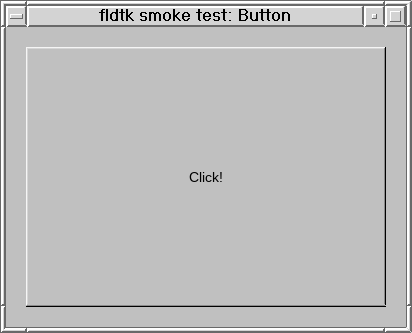
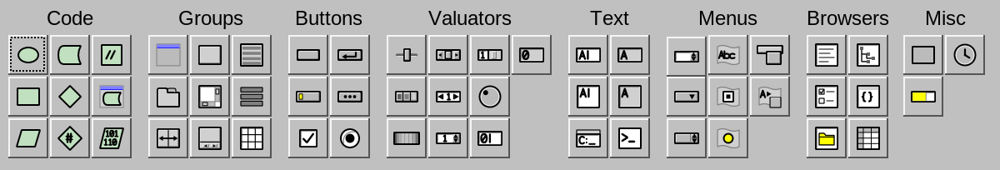

# fldtk

**fldtk** (Full-D-toolkit) is a complete port of [FLTK](https://www.fltk.org/), the
Fast Light Toolkit GUI system, to the D programming language. It is not a binding layer: the
toolkit is reimplemented as native D code, so the only things it links against are
the system's own libraries (Xlib, OpenGL, ...), not a compiled FLTK. It also
includes a port of Fluid, FLTK's UI designer, which exports D source files
instead of C++.

fldtk has the look and feel of FLTK, and its API follows FLTK's closely,
expressed in idiomatic D: callbacks are delegates, labels are `string`s, memory is
garbage-collected, and `Fl_Widget` is `fl.widget.Widget`.

## Example

``` D
import fl;
import std;

void main()
{
  auto win = new Window(100, 100, 400, 300, "fldtk smoke test: Button");
  auto btn = new Button(20, 20, 360, 260, "Click!"); // auto-parents into win (Group.current())
  win.end(); // not really needed here
  win.show();

  fl.run();
}
```

which produces a window with a clickable button.



## Status

The library and Fluid run stably on **Linux/X11**, **Linux/Wayland** and
**Windows**; Linux binaries pick Wayland or X11 at run time. macOS is out
of scope for now because I don't have the hardware to test it.

Highlights of v1.0.5:

- **Tutorials.** [`docs/TUTORIALS.md`](docs/TUTORIALS.md) starts a series of
  step-by-step tutorials for newcomers: a first Fluid program, a Fluid
  program as a dub project of its own, and buttons, shortcuts and groups
  (built on Windows). More are planned.
- **Simpler builds for your own programs.** A dub project selects fldtk's
  new `program` configuration and links the one `libfldtk.so` in the
  fldtk folder, so rebuilding fldtk updates every program; `fluid -c`
  writes that into its dub header. A `Makefile` at the repository root
  turns `example.fl` or `example.d` into a program with just
  `make example`.
- **PDF output.** `PdfFileSurface` writes widgets and windows to PDF, with
  vector lines, selectable text and images at their own resolution:
  through Cairo and Pango on Linux, through "Microsoft Print to PDF" on
  Windows.
- **The mouse wheel changes values.** Every value widget (sliders,
  rollers, dials, counters, spinners, adjusters, value inputs and
  outputs, the positioner) follows one rule: up or right increases, 10
  steps a notch, 1 with Shift, 100 with Ctrl. A vertical slider now has
  its maximum at the top.
- **Zoom on every platform.** Ctrl +/- steps through the zoom levels,
  Ctrl-Shift +/- by 1%, Ctrl-0 resets; the chosen zoom is remembered on
  Windows as well as Linux, and `FLDTK_SCALING_FACTOR` sets the starting
  zoom.
- **More complete.** PNG decodes every colour type including interlaced
  and colour-keyed images; SVG gradients follow the specification; GL
  windows can be captured and printed, and GL text works without
  textures and rotated; X11 works under window managers without EWMH;
  typed non-ASCII text works without an input method.

Earlier highlights (v1.0.3 and v1.0.4):

- **Wayland support is ahead of FLTK's.** fldtk's native Wayland driver
  needs no libdecor (and so no GTK): it draws its own title bar where the
  compositor leaves that to the program. Fractional desktop scales are
  drawn exactly, window icons, the desktop bell, clipboard change
  notification and OpenGL through EGL all work.
- **Multi-monitor setups with a different scale per monitor** (Wayland
  and Windows).
- **Multi-touch screens and pens.** Every finger can be followed on its
  own, pinch, turn, two-finger scroll and swipe gestures arrive as events
  on Windows, Wayland and X11; pens report pressure, tilt, twist, hover
  and the eraser on Windows and Wayland.
- **Modern looks.** Every icon and picture fldtk and Fluid draw themselves
  is SVG, so they look clean at any scale.

  

- **Fluid speaks D only**: a widget's code sections are the ones that
  mean something in D, `setup` and `finalize`.
- **Every FLTK demo, plus new ones.** All of FLTK's test and example
  programs run in fldtk (`source/test/`, `source/examples/`), except the
  one for the obsolete XForms compatibility layer, plus fldtk's own
  (`pen_test`, `touch_test`, `svg_animation`, `gl_text`, `value_wheel`,
  ...).

What is in the box:

- **Widgets:** buttons, valuators and sliders, menus, text input and editing,
  browsers, tables, trees, tabs, scroll, pack, flex and grid layouts, a help
  viewer, a terminal widget, file choosers, dialogs, and the rest of FLTK's
  widget set, with FLTK's box types and schemes (base, gtk+, gleam, plastic, oxy).
- **Fluid**, both the interactive designer and the headless
  `fluid -c file.fl` converter that writes D source.
- **Images**, decoded natively in D: PNG, JPEG, GIF (including animated), SVG,
  BMP, ICO, XPM, XBM and PNM.
- **OpenGL** windows (with FLTK widgets drawn over them) and the GLUT
  compatibility layer.
- **Platform services:** clipboard, drag and drop, multi-monitor and scaling
  support, input methods, pen and touch input, printing, and output to
  PDF, PostScript, SVG and images.
- **Cairo and Pango:** `CairoWindow` and the full Cairo and Pango APIs, built
  in on Linux and optional on Windows (see [`docs/BUILDING.md`](docs/BUILDING.md)).
  fldtk itself draws through Cairo, with text through Pango, on Wayland,
  and on X11 when asked to (`FLDTK_GRAPHICS=cairo`).

[`docs/PORTING.md`](docs/PORTING.md) tracks the port file by file: what is complete, what
is partial and why, what is deliberately left out, and what a platform such
as Wayland doesn't allow; nearly every module is complete. Suspected bugs
in FLTK itself, found while porting, are collected in
the `FLTK_ISSUES_n.md` files at the repository root; the highest `n` is
the latest batch.

## Direction

Release **v1.0.2** is the version that resembles FLTK as closely as
possible. If you know FLTK and want an easy move to D, use that release.

From here on, fldtk goes its own way. Later releases are for D programmers
who are new to GUI programming and want the ease of a graphical designer,
presented in the simplest, easiest-to-understand way, much like what Visual
Basic did for many people in its day. The rule is KISS: keep it simple.
Where FLTK's way and a simpler way differ, the simpler way wins, so expect
fldtk to move away from FLTK over time.

Simple also means portable: a program written with fldtk, or designed in
Fluid, builds and runs from the same source on Linux and Windows, without
platform-specific code in the program and without extra libraries to
install beyond what the system provides.

## Building

You need a D compiler (dmd, ldc or gdc) and `dub`. On Linux the development
packages for X11, Xft, Xinerama, fontconfig, Xcursor, Xfixes, Xext, Xi, OpenGL,
GLU and zlib must be installed, which is the case by default on most
Linux distributions. Then, from the repository root:

    dub build              # the library: ./libfldtk.so
    rdmd buildfluid.d      # the Fluid designer: ./fluid
    rdmd buildsamples.d    # the demo programs: ./build/*

New to fldtk? Start with the [tutorials](docs/TUTORIALS.md).
[`docs/BUILDING.md`](docs/BUILDING.md) has the details, including how to compile your own
programs against the library and the Windows instructions.
It should be mentioned that dmd and gdc have both been tested to work. ldc has not been tested.

## Documentation

- [`docs/BUILDING.md`](docs/BUILDING.md): building and using the library, Fluid and the samples
- [`docs/TUTORIALS.md`](docs/TUTORIALS.md): step-by-step tutorials, from a first Fluid program on
- [`docs/PORTING.md`](docs/PORTING.md): porting status, module by module
- [`docs/CONVENTIONS.md`](docs/CONVENTIONS.md): how FLTK maps onto D, and the design decisions behind it
- [`docs/FLUID_DIALECT.md`](docs/FLUID_DIALECT.md): the `.fl` dialect Fluid reads and writes for D
- [`docs/TRANSLITERATION_GUIDE.md`](docs/TRANSLITERATION_GUIDE.md): converting FLTK's C++ `.fl` files to D
- [`docs/BENCHMARKS.md`](docs/BENCHMARKS.md): performance comparisons with FLTK. This document is not very up to date

## Contributing

Bug reports and pull requests are welcome. Where fldtk behaves differently from
FLTK, it may or may not have been by design. Deliberate deviations from FLTK should
have been documented clearly in the source or in docs/PORTING.md.

## License

[Boost Software License 1.0](LICENSE_1_0.txt).
