<!-- Written by source/devtools/make_reference.d from source/devtools/technical_reference.md and the library's source: edit those, not this file. -->

# fldtk Technical Reference

[//]: # (This file is best viewed using a markdown reader https://md-reader.github.io/install)

This is the reference for programming with fldtk: what the toolkit
consists of, how a program is put together, every widget of Fluid's
widget bin with its member functions and the values its properties
take, and the rest of the library a program needs. The
[tutorials](TUTORIALS.md) teach fldtk step by step, the
[demo programs](../source/test/README.md) show it working, and
[BUILDING.md](BUILDING.md) explains building.

The member tables list the public functions each class declares
itself, with the first sentence of their documentation from the source.
A class also has the members of the classes above it; each section says
which those are.

Contents:

1. [Introduction](#1-introduction)
2. [Every widget](#2-every-widget)
3. [Groups](#3-groups)
4. [Buttons](#4-buttons)
5. [Valuators](#5-valuators)
6. [Text](#6-text)
7. [Menus](#7-menus)
8. [Browsers](#8-browsers)
9. [Misc](#9-misc)
10. [Beyond widgets](#10-beyond-widgets)

## 1. Introduction

fldtk (Full-D-toolkit) is a GUI toolkit written in D. A program built
with it runs from the same source on Linux (X11 and Wayland) and
Windows, and needs no libraries beyond what the system provides. It
comes in four parts.

| Part | What it is | Build and start it |
|---|---|---|
| The library | The widgets, drawing, images, dialogs and events: `import fl;` | `dub build` (makes `libfldtk.so`, `fldtk.lib` on Windows) |
| Fluid | The designer: draw a window with the mouse, set the widgets' properties, and Fluid writes the D code. F5 builds and runs the program. | `dub run fldtk:fluid`, or `dub build :fluid` in the fldtk folder |
| fldtk-options | The settings every fldtk program reads when it starts: scheme, zoom, tooltips, visible keyboard focus, dragging text, and on Linux Wayland or X11 and Xlib or Cairo drawing; for you or for every user of the computer. It also works from the command line (`fldtk-options -h`). | `dub build fldtk:options` |
| The demo | One window that starts the demo programs: one for nearly every widget and feature, with their source in `source/test/` and `source/examples/` | `dub run fldtk:demo` |

### A first program

```D
import fl;

void main()
{
    auto win = new Window(300, 180, "Hello");
    auto button = new Button(100, 70, 100, 40, "Click me");
    button.callback((w) { button.label("Thanks!"); });
    win.end();
    win.show();
    fl.run();
}
```

A dub project gets fldtk with `dub add fldtk`; `dub run` then builds
and starts the program.

### How a program fits together

**The widget tree.** Every widget sits in a group, and a window is a
group. A new widget goes into the *current group*: creating a window or
group makes it the current one, and its `end()` makes its parent the
current one again. So the widgets created between `new Window(...)` and
`win.end()` are the window's.

**Coordinates.** Positions and sizes are whole pixels: `x`, `y` for the
top left corner, then the width `w` and height `h`. A widget's position
is counted from the top left corner of its window, not of its group. A
window's own `x`, `y` are on the screen.

**The event loop.** `win.show()` puts the window on the screen and
`fl.run()` handles events (mouse, keyboard, timers, redrawing) until the
last window closes.

**Callbacks.** A widget calls its callback, a delegate taking the
widget, when the user does something with it: clicks a button, moves a
slider, presses Enter in an input field. When exactly is the widget's
`when()` setting (see [When the callback is called](#when-the-callback-is-called)).

**Labels and looks.** Most widgets show a label; `alignment()` places
it outside or inside the widget. Their looks are their box type
(`box()`), colours (`color()`, `selectionColor()`), and the label's font,
size and colour. The scheme (set in fldtk-options, or by the program)
gives all box types a common style.

**Drawing happens later.** Changing a property redraws the widget the
next time the program waits for events, not at once. A widget that
draws itself calls `redraw()` when what it shows changes.

**Resizing.** When a window is resized, its `resizable()` widget grows
and shrinks with it and the others keep their size; inside a group, the
same goes for the group's `resizable()`. Without a resizable widget, the
window can't be resized.

### Reading this reference

Sections 3 to 9 follow Fluid's widget bin, group by group, in the bin's
order. Each widget has its bin icon, a picture, what it is for, how to
make one in code, its member functions, and the constants its
properties take. Section 2 holds what every widget has in common, and
section 10 the parts of the library that aren't widgets.

## 2. Every widget

Every widget is a `Widget`: these members belong to all of them. A
property is a pair of functions with one name: `label()` gives the
label and `label("Name")` sets it.

| Member | What it does |
|---|---|
| `int send(Event event)` | Sends event to this widget; a wrapper for handle(), used by groups to deliver events to children. |
| `bool isLabelCopied()` |  |
| `void needsKeyboard(bool needs)`<br>`bool needsKeyboard()` |  |
| `inout(Widget) parent() inout` | The widget's parent -- normally a real FlGroup (matching FLTK's `Fl_Widget::parent()`, which returns `Fl_Group*`), but widened to plain `Widget` here so a non-FlGroup widget can still legitimately set itself as the parent of a composed-but-not-tree-managed child (e.g. `fl.value_input.ValueInput`'s embedded `Input`). |
| `ubyte type()`<br>`void type(ubyte t)` |  |
| `int x()` |  |
| `int y()` |  |
| `int w()` |  |
| `int h()` |  |
| `void resize(int x, int y, int w, int h)` |  |
| `void resizeBoundsOnly(int x, int y, int w, int h)` | Sets x()/y()/w()/h() directly, without going through any subclass's resize() override -- the D structural equivalent of a C++-only pattern FLTK leans on in a few places: calling `Fl_Widget::resize(...)` by explicit qualification to reach the base implementation from several levels down, skipping every override in between (e.g. `Fl_Pack::draw()` resizing the pack itself to fit its children, without re-running `Fl_Group::resize()`'s child-layout algorithm or a subclass's own `resize()` override's side effects). |
| `int damageResize(int x, int y, int w, int h)` | Internal use only. |
| `void position(int x, int y)` |  |
| `void size(int w, int h)` |  |
| `Align alignment()`<br>`void alignment(Align a)` |  |
| `Boxtype box()`<br>`void box(Boxtype b)` |  |
| `Color color()`<br>`void color(Color bg)`<br>`void color(Color bg, Color sel)` |  |
| `Color selectionColor()`<br>`void selectionColor(Color c)` |  |
| `string label()`<br>`void label(string text)`<br>`void label(Labeltype type, string text)`<br>`void label(MultiLabel m)`<br>`void label(FileIcon ic)` | Associates m with this widget's label: draws/measures via m's labela/labelb from now on. |
| `void copyLabel(const(char)[] newLabel)` | Unlike label(), stores an owned copy of the text. |
| `inout(MultiLabel) labelMulti() inout` |  |
| `inout(FileIcon) labelIcon() inout` |  |
| `Labeltype labeltype()`<br>`void labeltype(Labeltype t)` |  |
| `Color labelcolor()`<br>`void labelcolor(Color c)` |  |
| `Font labelfont()`<br>`void labelfont(Font f)` |  |
| `Fontsize labelsize()`<br>`void labelsize(Fontsize s)` |  |
| `inout(Image) image() inout`<br>`void image(Image img)` |  |
| `void bindImage(Image img)`<br>`void bindImage(bool bound)` | Binds img to the widget: the widget will release() it when no longer needed. |
| `bool imageBound()` |  |
| `inout(Image) deimage() inout`<br>`void deimage(Image img)` |  |
| `void bindDeimage(Image img)`<br>`void bindDeimage(bool bound)` |  |
| `bool deimageBound()` |  |
| `void labelImageSpacing(int gap)`<br>`int labelImageSpacing()` |  |
| `void horizontalLabelMargin(int px)`<br>`int horizontalLabelMargin()` |  |
| `void verticalLabelMargin(int px)`<br>`int verticalLabelMargin()` |  |
| `Object userData()`<br>`void userData(Object data)` | The object attached to this widget, or null. |
| `string tooltip()`<br>`void tooltip(string text)` |  |
| `void copyTooltip(const(char)[] text)` | Unlike tooltip(), stores an owned copy of the text. |
| `Callback callback()`<br>`void callback(Callback cb)` | Sets the callback invoked by doCallback(). |
| `When when()`<br>`void when(When i)` |  |
| `bool visible()` |  |
| `bool visibleR()` |  |
| `void show()` |  |
| `void hide()` |  |
| `void setVisible()` |  |
| `void clearVisible()` |  |
| `bool active()` |  |
| `bool activeR()` |  |
| `void activate()` |  |
| `void deactivate()` |  |
| `bool output()` |  |
| `void setOutput()` |  |
| `void clearOutput()` |  |
| `bool takesEvents()` |  |
| `bool changed()` |  |
| `void setChanged()` |  |
| `void clearChanged()` |  |
| `void clearActive()` |  |
| `void setActive()` |  |
| `bool takeFocus()` |  |
| `void setVisibleFocus()` |  |
| `void clearVisibleFocus()` |  |
| `void visibleFocus(bool v)`<br>`bool visibleFocus()` |  |
| `void defaultCallback(Widget widget)` | Puts a pointer to the widget on the queue returned by fl.fl.core.readqueue(). |
| `void doCallback(CallbackReason reason = CallbackReason.unknown)`<br>`void doCallback(Widget widget, CallbackReason reason = CallbackReason.unknown)` |  |
| `bool contains(const(Widget) w)` |  |
| `bool inside(const(Widget) w)` |  |
| `void redraw()` |  |
| `void redrawLabel()` | A widget with no solid background needs its *parent* to repaint the thin strip around it (the parent owns those pixels); a widget whose label sits *outside* its own bounds (`alignment()` set and not `alignInside`) damages just that computed bounding box instead of the whole window; otherwise (label drawn inside the widget) a plain whole-widget `damage(damageAll)` covers it. |
| `Damage damage()`<br>`void damage(Damage c)`<br>`void damage(Damage c, int x, int y, int w, int h)` | Sets the whole-widget damage bits. |
| `void clearDamage(Damage c = 0)` |  |
| `void measureLabel(out int w, out int h)` |  |
| `Window window()` | Returns the window widget containing this widget -- a sub-window if this widget is inside one, otherwise the top-level window. |
| `Window topWindow()` | Returns the top-level window containing this widget (never a sub-window, even if there is one). |
| `Window topWindowOffset(out int xoff, out int yoff)` | Finds this widget's x/y offset relative to its top-level window, walking up through any sub-windows along the way. |
| `FlGroup asGroup()`<br>`const(FlGroup) asGroup()` |  |
| `Window asWindow()`<br>`const(Window) asWindow()` |  |
| `GlWindow asGlWindow()`<br>`const(GlWindow) asGlWindow()` | Returns this object as a `GlWindow`, or `null` if it isn't one -- a cheaper test than `cast(GlWindow)`. |
| `bool useAccentsMenu()` |  |
| `void shortcutLabel(bool value)`<br>`bool shortcutLabel()` |  |
| `uint labelShortcut(string t)` | Internal use only. |
| `bool testShortcut(string t, bool requireAlt = false)`<br>`bool testShortcut()` | Internal use only. |

### Box types

`box()` sets how a widget's background is drawn. The `...Frame` types
draw only the border. The look of most types follows the scheme.

| Value | |
|---|---|
| `Boxtype.noBox` |  |
| `Boxtype.flatBox` |  |
| `Boxtype.upBox` |  |
| `Boxtype.downBox` |  |
| `Boxtype.upFrame` |  |
| `Boxtype.downFrame` |  |
| `Boxtype.thinUpBox` |  |
| `Boxtype.thinDownBox` |  |
| `Boxtype.thinUpFrame` |  |
| `Boxtype.thinDownFrame` |  |
| `Boxtype.engravedBox` |  |
| `Boxtype.embossedBox` |  |
| `Boxtype.engravedFrame` |  |
| `Boxtype.embossedFrame` |  |
| `Boxtype.borderBox` |  |
| `Boxtype.shadowBox` |  |
| `Boxtype.borderFrame` |  |
| `Boxtype.shadowFrame` |  |
| `Boxtype.roundedBox` |  |
| `Boxtype.rshadowBox` |  |
| `Boxtype.roundedFrame` |  |
| `Boxtype.rflatBox` |  |
| `Boxtype.roundUpBox` |  |
| `Boxtype.roundDownBox` |  |
| `Boxtype.diamondUpBox` |  |
| `Boxtype.diamondDownBox` |  |
| `Boxtype.ovalBox` |  |
| `Boxtype.oshadowBox` |  |
| `Boxtype.ovalFrame` |  |
| `Boxtype.oflatBox` |  |
| `Boxtype.plasticUpBox` |  |
| `Boxtype.plasticDownBox` |  |
| `Boxtype.plasticUpFrame` |  |
| `Boxtype.plasticDownFrame` |  |
| `Boxtype.plasticThinUpBox` |  |
| `Boxtype.plasticThinDownBox` |  |
| `Boxtype.plasticRoundUpBox` |  |
| `Boxtype.plasticRoundDownBox` |  |
| `Boxtype.gtkUpBox` |  |
| `Boxtype.gtkDownBox` |  |
| `Boxtype.gtkUpFrame` |  |
| `Boxtype.gtkDownFrame` |  |
| `Boxtype.gtkThinUpBox` |  |
| `Boxtype.gtkThinDownBox` |  |
| `Boxtype.gtkThinUpFrame` |  |
| `Boxtype.gtkThinDownFrame` |  |
| `Boxtype.gtkRoundUpBox` |  |
| `Boxtype.gtkRoundDownBox` |  |
| `Boxtype.gleamUpBox` |  |
| `Boxtype.gleamDownBox` |  |
| `Boxtype.gleamUpFrame` |  |
| `Boxtype.gleamDownFrame` |  |
| `Boxtype.gleamThinUpBox` |  |
| `Boxtype.gleamThinDownBox` |  |
| `Boxtype.gleamRoundUpBox` |  |
| `Boxtype.gleamRoundDownBox` |  |
| `Boxtype.oxyUpBox` |  |
| `Boxtype.oxyDownBox` |  |
| `Boxtype.oxyUpFrame` |  |
| `Boxtype.oxyDownFrame` |  |
| `Boxtype.oxyThinUpBox` |  |
| `Boxtype.oxyThinDownBox` |  |
| `Boxtype.oxyThinUpFrame` |  |
| `Boxtype.oxyThinDownFrame` |  |
| `Boxtype.oxyRoundUpBox` |  |
| `Boxtype.oxyRoundDownBox` |  |
| `Boxtype.oxyButtonUpBox` |  |
| `Boxtype.oxyButtonDownBox` |  |
| `Boxtype.freeBoxtype` |  |
| `Boxtype.maxBoxtype` |  |

### Label types

`labeltype()` sets how a label is drawn.

| Value | |
|---|---|
| `Labeltype.normalLabel` |  |
| `Labeltype.noLabel` |  |
| `Labeltype.shadowLabel` |  |
| `Labeltype.engravedLabel` |  |
| `Labeltype.embossedLabel` |  |
| `Labeltype.multiLabel` |  |
| `Labeltype.iconLabel` |  |
| `Labeltype.imageLabel` |  |
| `Labeltype.freeLabeltype` |  |

### Alignment

`alignment()` places the label, as a combination of these with `|`:
`alignTop | alignLeft` puts it above the widget, at its left. With
`alignInside` it goes inside the widget.

| Constant | Value | |
|---|---|---|
| `alignCenter` | `0x0000` |  |
| `alignTop` | `0x0001` |  |
| `alignBottom` | `0x0002` |  |
| `alignLeft` | `0x0004` |  |
| `alignRight` | `0x0008` |  |
| `alignInside` | `0x0010` |  |
| `alignTextOverImage` | `0x0020` |  |
| `alignImageOverText` | `0x0000` |  |
| `alignClip` | `0x0040` |  |
| `alignWrap` | `0x0080` |  |
| `alignImageNextToText` | `0x0100` |  |
| `alignTextNextToImage` | `0x0120` |  |
| `alignImageBackdrop` | `0x0200` |  |
| `alignTopLeft` | `alignTop \| alignLeft` |  |
| `alignTopRight` | `alignTop \| alignRight` |  |
| `alignBottomLeft` | `alignBottom \| alignLeft` |  |
| `alignBottomRight` | `alignBottom \| alignRight` |  |
| `alignLeftTop` | `0x0007` |  |
| `alignRightTop` | `0x000b` |  |
| `alignLeftBottom` | `0x000d` |  |
| `alignRightBottom` | `0x000e` |  |
| `alignNowrap` | `0x0000` | Same as alignCenter, kept for back compatibility. |
| `alignPositionMask` | `0x000f` | Tests for the top/bottom/left/right bits (including the "magic value" outside-position combinations above). |
| `alignImageMask` | `0x0320` | Tests for the image-alignment bits. |

### When the callback is called

`when()` sets when a widget calls its callback, as a combination of
these with `|`.

| Constant | Value | |
|---|---|---|
| `whenNever` | `0` |  |
| `whenChanged` | `1` |  |
| `whenNotChanged` | `2` |  |
| `whenRelease` | `4` |  |
| `whenReleaseAlways` | `6` |  |
| `whenEnterKey` | `8` |  |
| `whenEnterKeyAlways` | `10` |  |
| `whenEnterKeyChanged` | `11` |  |
| `whenClosed` | `16` |  |

### Fonts

`labelfont()` and `textfont()` take a font. `Font` values beyond these
are added with `fl.draw.setFont()`.

| Constant | Value | |
|---|---|---|
| `helvetica` | `0` |  |
| `helveticaBold` | `1` |  |
| `helveticaItalic` | `2` |  |
| `helveticaBoldItalic` | `3` |  |
| `courier` | `4` |  |
| `courierBold` | `5` |  |
| `courierItalic` | `6` |  |
| `courierBoldItalic` | `7` |  |
| `times` | `8` |  |
| `timesBold` | `9` |  |
| `timesItalic` | `10` |  |
| `timesBoldItalic` | `11` |  |
| `symbol` | `12` |  |
| `screen` | `13` |  |
| `screenBold` | `14` |  |
| `zapfDingbats` | `15` |  |
| `freeFont` | `16` |  |
| `bold` | `1` |  |
| `italic` | `2` |  |
| `boldItalic` | `3` |  |

### Colours

Properties such as `color()`, `labelcolor()` and `selectionColor()`
take a `Color`: one of these, an index into the colour map, or
`rgbColor(r, g, b)`.

| Constant | Value | |
|---|---|---|
| `foregroundColor` | `0` |  |
| `background2Color` | `7` |  |
| `inactiveColor` | `8` |  |
| `selectionColor` | `15` |  |
| `gray0` | `32` |  |
| `dark3` | `39` |  |
| `dark2` | `45` |  |
| `dark1` | `47` |  |
| `backgroundColor` | `49` |  |
| `light1` | `50` |  |
| `light2` | `52` |  |
| `light3` | `54` |  |
| `black` | `56` |  |
| `red` | `88` |  |
| `green` | `63` |  |
| `yellow` | `95` |  |
| `blue` | `216` |  |
| `magenta` | `248` |  |
| `cyan` | `223` |  |
| `darkRed` | `72` |  |
| `darkGreen` | `60` |  |
| `darkYellow` | `76` |  |
| `darkBlue` | `136` |  |
| `darkMagenta` | `152` |  |
| `darkCyan` | `140` |  |
| `white` | `255` |  |
| `freeColor` | `16` |  |
| `numFreeColor` | `16` |  |
| `grayRamp` | `32` |  |
| `numGray` | `24` |  |
| `gray` | `backgroundColor` |  |
| `colorCube` | `56` |  |
| `numRed` | `5` |  |
| `numGreen` | `8` |  |
| `numBlue` | `5` |  |

### Why a callback was called

`fl.core.callbackReason()` says, inside a callback, why it was called.

| Value | |
|---|---|
| `CallbackReason.unknown` |  |
| `CallbackReason.selected` |  |
| `CallbackReason.deselected` |  |
| `CallbackReason.reselected` |  |
| `CallbackReason.opened` |  |
| `CallbackReason.closed` |  |
| `CallbackReason.dragged` |  |
| `CallbackReason.cancelled` |  |
| `CallbackReason.changed` |  |
| `CallbackReason.gotFocus` |  |
| `CallbackReason.lostFocus` |  |
| `CallbackReason.released` |  |
| `CallbackReason.enterKey` |  |
| `CallbackReason.user` |  |

## 3. Groups

A group holds other widgets: it moves them, draws them, and hands them
events. Each group below is an `FlGroup`, with these members as well as
those of `Widget`.

| Member | What it does |
|---|---|
| `FlGroup current()`<br>`void current(FlGroup g)` | The group new widgets are auto-added to; see fl.widget's ctor. |
| `void begin()` | Makes this the current() group: subsequently constructed widgets are auto-added to it until end() is called. |
| `void end()` | Same as current(this.parent), so widget construction resumes adding to the enclosing group. |
| `int children()` |  |
| `inout(Widget) child(int n) inout` | Returns null if n is out of range. |
| `int find(const(Widget) o)` | Returns children() if o is null or not found. |
| `inout(Widget)[] array() inout` | Valid only until the next add()/insert()/remove() on this group. |
| `void insert(Widget o, int index)`<br>`void insert(Widget o, Widget before)` | The widget is removed from its current group (if any) and then inserted into this group at index (or appended, if index >= children()). |
| `void add(Widget o)` | The widget is removed from its current group (if any) and added to the end of this group. |
| `void remove(int index)`<br>`void remove(Widget o)` | Removes the widget at index from the group without deleting it. |
| `void clear()` | Removes all children from the group and destroys them (deltes all child widgets from memory, recursively). |
| `int deleteChild(int index)` | Removes the widget at index from the group and destroys it. |
| `Widget resizable()`<br>`void resizable(Widget o)` | The resizable widget defines both the resizing box and the resizing behavior of the group and its children; see resizable(Widget). |
| `void addResizable(Widget o)` | Adds o to the group and makes it the resizable widget. |
| `void initSizes()` | Discards the cached initial child sizes/positions used by resize(); they'll be recomputed from the current layout next time resize() or bounds() runs. |
| `void clipChildren(bool c)`<br>`bool clipChildren()` |  |
| `void drawChildren()` | Draws every child, useful when a FlGroup subclass wants to draw its own border/background then call this from its own draw(). |

###  Window

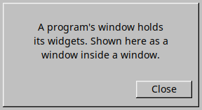

A window on the screen, holding the program's widgets. Fluid makes a
`DoubleWindow`, which draws into a hidden buffer first and so doesn't
flicker; it has the same members. A window created inside another
window's group is a window inside that window.

```D
new Window(int x, int y, int w, int h, string label = null)
new Window(int w, int h, string label = null)
```

| Member | What it does |
|---|---|
| `string defaultXclass()`<br>`void defaultXclass(string xc)` | Sets the default xclass for all windows subsequently created (and shown) that don't set their own. |
| `string xclass()`<br>`void xclass(string xc)` | This window's own X11 WM_CLASS, or `defaultXclass()` if this window never set one. |
| `void defaultIcons(RGBImage[] icons)` | Sets the process-wide default icon(s) for windows created (and shown) after this call -- doesn't affect already-created windows or ones that already set their own. |
| `void defaultIcon(RGBImage icon)` | Convenience one-icon form of `defaultIcons()`. |
| `void icons(RGBImage[] imgs)` | Sets this window's icon(s) -- shown by the window manager in the taskbar/titlebar/alt-tab switcher, etc. Ported from `Fl_Window::icons(const Fl_RGB_Image*[], int)`. |
| `void icon(RGBImage ic)` | Convenience one-icon form of `icons()`. |
| `void freeIcons()` | Clears this window's own icon(s), like `icons([])`: the window falls back to `defaultIconsForWM()` at once if it is shown. |
| `string iconlabel()`<br>`void iconlabel(string iname)` | The window's icon-title override, or empty if none was ever set (in which case the icon name shown to the window manager is derived from `label()` instead -- see `fl.platform_x11. |
| `bool shown()` | True once the platform layer has created (and not since destroyed) this window's real on-screen representation. |
| `void show(string[] args)` | Convenience overload matching FLTK's `Fl_Window::show(int argc, char **argv)` call shape -- a `main(string[] args)`'s `args` can be handed straight through. |
| `void makeCurrent()` | A no-op if the window hasn't been `show()`n yet (`xid_` still `0`). |
| `void sizeRange(int minWidth, int minHeight, int maxWidth = 0, int maxHeight = 0, int deltaX = 0, int deltaY = 0, bool aspectRatio = false)` | Sets the allowable range to which the user can resize this window. |
| `bool getSizeRange(int* minWidth = null, int* minHeight = null, int* maxWidth = null, int* maxHeight = null, int* deltaX = null, int* deltaY = null, bool* aspectRatio = null)` | Gets the allowable resize range set by sizeRange(). |
| `void defaultSizeRange()` | Calculates and records a default size range when sizeRange() was never called explicitly -- ported from `Fl_Window::default_size_range()` (`src/Fl_Window.cxx`). |
| `Window current()` | Set by `makeCurrent()` above for callers that draw outside the normal repaint cycle (e.g. `test/offscreen.cxx`), and by `fl.platform_x11.flushDamage()` (via `setCurrentForDraw()` below) right before each window's own `draw()` cycle -- matching FLTK's own two `current_ = this;` call sites in `Fl_Window::make_current()`/`Fl_Window::draw()`. |
| `bool isARescale()` | Reports whether the current resize is due to a DPI/scale change rather than an ordinary size change -- used by `FlGroup.resize()` to force a child resize even when the relative position didn't change (a rescale can change device-pixel geometry while every FLTK-unit coordinate involved stays numerically identical, e.g. a window sitting at `x() == 0` with an unchanged FLTK-unit width). |
| `void cursor(Cursor c)`<br>`void cursor(const(RGBImage) image, int hotx, int hoty)` | Changes this window's cursor shape. |
| `void shape(const(Image) img)`<br>`const(Image) shape()` | Assigns a non-rectangular shape to this window via the X SHAPE extension (`fl.platform_x11.applyWindowShapeMask()`). |
| `bool border()`<br>`void border(bool b)` | Whether the window manager draws a border/titlebar/decorations around this window. |
| `void clearBorder()` | ditto -- FLTK's fast inline spelling for `border(false)`. |
| `int decoratedW()` | The width/height of this window's outer, window-manager-decorated bounding box (title bar + borders included), as opposed to `w()`/ `h()` which only ever cover this window's own content area. |
| `int decoratedH()` |  |
| `bool modal()` | Whether this window is flagged modal. |
| `void setModal()` |  |
| `void setNonModal()` |  |
| `bool nonModal()` | Whether this window is flagged *either* modal or non-modal- transient -- ported from `Fl_Window::non_modal()` (`FL/Fl_Window.H`, `return flags() & (NON_MODAL\|MODAL);`), a real, if confusingly- named, combined check: "this window is a dialog-like window logically owned by another top-level window" (as opposed to a plain, default, untouched top-level window), true for either flag, not just `NON_MODAL`. |
| `void freePosition()` | Clears `Flag.forcePosition` -- the next `show()` (or, on this port's Linux path, the initial `createWindow()`) is free to let the window manager place the window rather than requesting an exact position. |
| `bool forcePosition()`<br>`void forcePosition(bool force)` | `Flag.forcePosition` is set by `resize()`'s own move-tracking and `fl.core. |
| `void hotspot(int X, int Y, bool offscreen = false)`<br>`void hotspot(Widget o, bool offscreen = false)` | Positions this window so that point `(X, Y)` *within* it lands under the current mouse position -- e.g. `hotspot(w()/2, h()/2)` centers the window on the mouse. |
| `int xRoot()` | The window's position on the screen, in root (screen) coordinates. |
| `int yRoot()` |  |
| `int isResizable()` | Non-zero (bit 1 for horizontal, bit 2 for vertical) if the window is resizable in that direction -- computes defaultSizeRange() first if sizeRange() was never called explicitly. |
| `bool fullscreenActive()` | True once fullscreen() has taken effect and fullscreenOff() hasn't undone it. |
| `bool maximizeActive()` | True once maximize() has taken effect and unMaximize() hasn't undone it. |
| `void fullscreen()` | Makes the window fill its screen with no window-manager decorations, via the EWMH `_NET_WM_STATE_FULLSCREEN` protocol on Linux (see `fl.platform_x11.fullscreenOn()` for the exact scope -- EWMH-supporting window managers only). |
| `void fullscreenOff(int X, int Y, int W, int H)`<br>`void fullscreenOff()` | Turns off any side effects of fullscreen() and moves/resizes the window to (X,Y,W,H). |
| `void fullscreenScreens(int top, int bottom, int left, int right)` | Sets which screens should be used when this window is in fullscreen mode: the window spans from the top edge of monitor `top` to the bottom edge of monitor `bottom`, the left edge of `left` to the right edge of `right` (so a single value repeated four times spans exactly that one monitor; different values let the window span multiple physical monitors). |
| `int screenNum()`<br>`void screenNum(int n)` | The index (0 .. |
| `void maximize()` | Maximizes a top-level window to its current screen, via the EWMH `_NET_WM_STATE_MAXIMIZED_VERT`/`_HORZ` protocol on Linux (see `fl.platform_x11.maximizeOn()` for the exact scope -- EWMH- supporting window managers only). |
| `void unMaximize()` | Returns a previously maximize()'d top-level window to its previous size. |
| `void showNextWindowIconic(bool v)`<br>`bool showNextWindowIconic()` | Whether the *next* top-level window shown will be created already iconified (born iconified, no visible-then-minimized flash) -- ported from `Fl_Window::show_next_window_iconic(char)`/`()`. |
| `void iconize()` | Iconifies (minimizes) this top-level window. |
| `void waitForExpose()` | Blocks until this window has received its first real repaint since being shown -- useful right after `show()` when the very next thing a program does (e.g. `takeFocus()`) needs the window to genuinely be on screen first, not just requested. |
| `bool menuWindow()` | Whether this window is a popup/tooltip-style menu window (an override-redirect, undecorated top-level created by `fl.menu_popup`/`fl.tooltip`, not an ordinary application window). |
| `void setMenuWindow()` | Marks this window as a menu window. |
| `void setTooltipWindow()` | Marks this window as a tooltip window, which also clears the menu-window state. |
| `bool tooltipWindow()` | Whether this window is a tooltip window. |
| `void setOverride()` | Removes the window border and makes the window override-redirect: the window manager neither decorates nor places it. |
| `bool isOverride()` | Whether `setOverride()` was called. |
| `void clearModalStates()` | Turns a modal or non-modal window back into a normal one. |
| `void defaultCursor(Cursor c)`<br>`void defaultCursor(Cursor c, Color fg, Color bg = white)` | Sets the cursor `cursor(Cursor.default_)` shows from now on, and shows it. |
| `OverlayWindow asOverlayWindow()` | Returns this object as an `OverlayWindow`, or `null`. |
| `DoubleWindow asDoubleWindow()` | Returns this object as a `DoubleWindow`, or `null`. |
| `size_t osId()` | The platform's identifier for this window: the X11 window id on Linux, the `HWND` on Windows, `0` if it isn't shown. |
| `void allowExpandOutsideParent()` | Lets a subwindow extend beyond its parent's area. |

###  Group

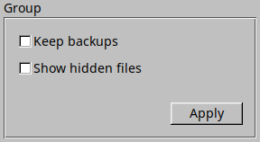

`FlGroup` itself: a container that keeps its children where they were
put. With a box type (such as `Boxtype.engravedFrame`) and a label it
frames related widgets.

```D
new FlGroup(int x, int y, int w, int h, string label = null)
```

###  Pack

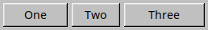

Lines its children up one after the other, in a row or a column,
spaced `spacing()` apart; each keeps its own width (in a row) or height
(in a column).

```D
new Pack(int x, int y, int w, int h, string label = null)
```

| Member | What it does |
|---|---|
| `int spacing()`<br>`void spacing(int i)` | Extra pixels of blank space added between children. |
| `ubyte horizontal()` | Non-zero if this Pack's alignment is horizontal (type() == packHorizontal). |

`type()` values:

| Constant | Value | |
|---|---|---|
| `packVertical` | `0` | type() for vertical stacking (the default): children are resized to this Pack's width and stacked top to bottom. |
| `packHorizontal` | `1` | type() for horizontal stacking: children are resized to this Pack's height and placed left to right. |

###  Tabs

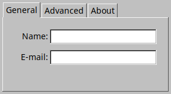

Shows one child at a time, with a tab for each child's label to pick
it. Each child is a group that fills the area below the tabs.

```D
new Tabs(int x, int y, int w, int h, string label = null)
```

| Member | What it does |
|---|---|
| `void tabAlign(Align a)`<br>`Align tabAlign()` |  |
| `Widget which(int eventX, int eventY)` |  |
| `int push(Widget o)`<br>`Widget push()` | Sets/gets the tab widget the user last pushed on (null once released or dragged off). |
| `Widget value()`<br>`int value(Widget newvalue)`<br>`int value(int ix)` | Returns the currently visible child, showing the first visible one found and hiding the rest -- or, if none are visible, forces the last child visible. |
| `void clientArea(out int rx, out int ry, out int rw, out int rh, int tabh = 0)` | Position/size available for children, in rx/ry/rw/rh. |
| `void handleOverflow(ubyte ov)` | Sets how an overflowing tab bar (more tabs than fit) is handled: overflowCompress (default), overflowClip, overflowPulldown, or overflowDrag. |

What happens when the tabs don't fit (`handleOverflow()`):

| Constant | Value | |
|---|---|---|
| `overflowCompress` | `0` | Values for handleOverflow()/overflow-mode tracking; mirrors Fl_Tabs.H's anonymous enum. |
| `overflowClip` | `1` |  |
| `overflowPulldown` | `2` |  |
| `overflowDrag` | `3` |  |

###  Scroll

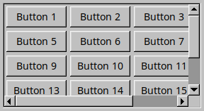

Shows part of an area larger than itself, with scrollbars to move
around in it. The children may lie anywhere; the scrollbars cover them
all.

```D
new Scroll(int x, int y, int w, int h, string label = null)
```

| Member | What it does |
|---|---|
| `int xposition()` | Current horizontal scrolling position. |
| `int yposition()` | Current vertical scrolling position. |
| `void scrollTo(int X, int Y)` | Moves the logical origin of the scrolling area to (X, Y) -- every non-scrollbar child is repositioned by the resulting delta. |
| `int scrollbarSize()`<br>`void scrollbarSize(int newSize)` | Gets the current size of the scrollbars' troughs, in pixels, or 0 if tracking the global fl.core.scrollbarSize(). |

`type()` values, which scrollbars show:

| Constant | Value | |
|---|---|---|
| `scrollHorizontal` | `1` | Values for type(); mirrors Fl_Scroll.H's anonymous enum. |
| `scrollVertical` | `2` |  |
| `scrollBoth` | `3` |  |
| `scrollAlwaysOn` | `4` |  |
| `scrollHorizontalAlways` | `5` |  |
| `scrollVerticalAlways` | `6` |  |
| `scrollBothAlways` | `7` |  |

###  Flex

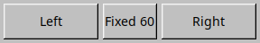

Lays its children out in a row or a column and shares the space between
them, `gap()` apart; `fixed()` gives a child a size of its own. Resizing
the Flex lays them out again.

```D
new Flex(int x, int y, int w, int h, string label = null)
new Flex(ubyte direction)
new Flex(int w, int h, ubyte direction)
new Flex(int x, int y, int w, int h, ubyte direction)
```

| Member | What it does |
|---|---|
| `void needLayout(bool set)`<br>`bool needLayout()` | Set or reset the request to recalculate layout before the next draw(). |
| `int margin()`<br>`bool margin(int* left, int* top, int* right, int* bottom)`<br>`void margin(int m, int g = -1)`<br>`void margin(int left, int top, int right, int bottom)` | Returns the left margin (the free space inside the box frame, around all children, on that side). |
| `int gap()`<br>`void gap(int g)` | Free space between children (same concept as fl.pack.Pack's spacing() -- spacing()/gap() are interchangeable names for it, kept both so Flex can be a drop-in Pack replacement). |
| `int spacing()`<br>`void spacing(int i)` |  |
| `bool horizontal()` | True if type() == flexHorizontal (a row); false for a column. |
| `void fixed(Widget child, int size)`<br>`bool fixed(const(Widget) child)` | Gives child a fixed width (flexHorizontal) or height (flexVertical) instead of sharing the remaining space evenly with the other non-fixed children. |
| `void layout()` | Recalculates every child's position/size along the row/column axis and redraws. |

Directions:

| Constant | Value | |
|---|---|---|
| `flexVertical` | `0` | type() for a single column (the default, for consistency with fl.pack.Pack). |
| `flexHorizontal` | `1` | type() for a single row. |
| `flexColumn` | `flexVertical` | Alias for flexVertical. |
| `flexRow` | `flexHorizontal` | Alias for flexHorizontal. |

###  Tile

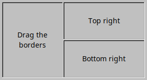

Children side by side and above each other, filling the Tile, with
borders the user drags to make one larger and its neighbours smaller.

```D
new Tile(int x, int y, int w, int h, string label = null)
```

| Member | What it does |
|---|---|
| `void moveIntersection(int oldx, int oldy, int newx, int newy)` | Drags the intersection at (oldx, oldy) to as close to (newx, newy) as constraints allow, redrawing every affected child. |
| `void dragIntersection(int oldx, int oldy, int newx, int newy)` | Like moveIntersection(), but doesn't call initSizes() -- intended for interactive mouse dragging (handle() calls this on FL_DRAG, moveIntersection() on FL_RELEASE) so the cached layout baseline only updates once the drag finishes. |
| `void sizeRange(int index, int minw, int minh, int maxw = int.max, int maxh = int.max)`<br>`void sizeRange(Widget w, int minw, int minh, int maxw = int.max, int maxh = int.max)` | Sets the allowed minimum (and, currently ignored, maximum) size for the child at index, enabling size_range mode if it isn't already on. |
| `void initSizeRange(int defaultMinW = -1, int defaultMinH = -1)` | Enables size_range mode with the given default minimum size for any child that doesn't get its own sizeRange() call. |

###  Wizard

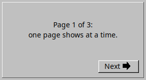

Shows one child at a time, without tabs: the program goes to the next
or previous one with `next()` and `prev()`, as in a dialog that asks
its questions in steps.

```D
new Wizard(int x, int y, int w, int h, string label = null)
```

| Member | What it does |
|---|---|
| `void next()` | Shows the next child. |
| `void prev()` | Shows the previous child. |
| `Widget value()`<br>`void value(Widget kid)`<br>`void value(int ix)` | Returns the currently visible child. |

###  Grid

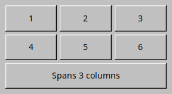

Lays its children out in rows and columns. `layout(rows, cols)` sets
the size of the grid, `widget(w, row, col)` puts a child in a cell (also
over several rows or columns), and the cells' sizes follow the Grid's.

```D
new Grid(int x, int y, int w, int h, string label = null)
```

| Member | What it does |
|---|---|
| `void layout(int rows, int cols, int margin = -1, int gap = -1)`<br>`void layout()` | Sets the basic layout parameters. |
| `short rows()` |  |
| `short cols()` |  |
| `void needLayout(bool set)`<br>`bool needLayout()` |  |
| `void clearLayout()` | Removes all cells and resets rows/cols to zero. |
| `void margin(int left, int top = -1, int right = -1, int bottom = -1)` |  |
| `int marginLeft()` |  |
| `int marginTop()` |  |
| `int marginRight()` |  |
| `int marginBottom()` |  |
| `void gap(int rowGap, int colGap = -1)` |  |
| `int gapRow()` |  |
| `int gapCol()` |  |
| `Cell cell(int row, int col)`<br>`Cell cell(Widget widget)` | The cell at (row, col), or null if out of bounds or unoccupied. |
| `Cell widget(Widget wi, int row, int col, GridAlign align_ = gridFill)`<br>`Cell widget(Widget wi, int row, int col, int rowspan, int colspan, GridAlign align_ = gridFill)` | Assigns wi to the cell at (row, col), spanning rowspan rows and colspan columns. |
| `void colWidth(int col, int value)`<br>`void colWidth(const(int)[] values)`<br>`int colWidth(int col)` |  |
| `void colWeight(int col, int value)`<br>`void colWeight(const(int)[] values)`<br>`int colWeight(int col)` |  |
| `void colGap(int col, int value)`<br>`void colGap(const(int)[] values)`<br>`int colGap(int col)` |  |
| `void rowHeight(int row, int value)`<br>`void rowHeight(const(int)[] values)`<br>`int rowHeight(int row)` |  |
| `void rowWeight(int row, int value)`<br>`void rowWeight(const(int)[] values)`<br>`int rowWeight(int row)` |  |
| `void rowGap(int row, int value)`<br>`void rowGap(const(int)[] values)`<br>`int rowGap(int row)` |  |
| `int computedColWidth(int col)` |  |
| `int computedRowHeight(int row)` |  |
| `void showGrid(bool set)`<br>`void showGrid(bool set, Color col)` |  |

How a child sits in its cell:

| Constant | Value | |
|---|---|---|
| `gridCenter` | `0x0000` |  |
| `gridTop` | `0x0001` |  |
| `gridBottom` | `0x0002` |  |
| `gridLeft` | `0x0004` |  |
| `gridRight` | `0x0008` |  |
| `gridHorizontal` | `0x0010` |  |
| `gridVertical` | `0x0020` |  |
| `gridFill` | `gridHorizontal \| gridVertical` |  |
| `gridProportional` | `0x0040` |  |
| `gridTopLeft` | `gridTop \| gridLeft` |  |
| `gridTopRight` | `gridTop \| gridRight` |  |
| `gridBottomLeft` | `gridBottom \| gridLeft` |  |
| `gridBottomRight` | `gridBottom \| gridRight` |  |

## 4. Buttons

Each button is a `Button`, with these members as well as those of
`Widget`. `value()` is 1 when the button is on.

| Member | What it does |
|---|---|
| `bool value(bool v)`<br>`bool value()` | Sets the current value (on/off) of the button. |
| `bool set()` | Same as value(true). |
| `bool clear()` | Same as value(false). |
| `void setonly()` | Turns this radio button on and turns off every other sibling widget with type() == radioButton. |
| `int shortcut()`<br>`void shortcut(int s)` |  |
| `Boxtype downBox()`<br>`void downBox(Boxtype b)` |  |
| `Color downColor()`<br>`void downColor(Color c)` |  |
| `void compact(bool v)`<br>`bool compact()` |  |

`type()` values: a normal button calls back when clicked, a toggle
button stays on or off, and of the radio buttons in one group only one
is on.

| Constant | Value | |
|---|---|---|
| `normalButton` | `0` | Values for type(); mirrors Fl_Button.H's #defines (FL_RADIO_BUTTON is FL_RESERVED_TYPE(100) + 2, kept as the same literal here). |
| `toggleButton` | `1` |  |
| `radioButton` | `102` |  |
| `hiddenButton` | `3` |  |

###  Button

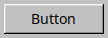

A push button.

```D
new Button(int x, int y, int w, int h, string label = null)
```

###  Return Button

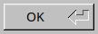

A button that the Enter key also presses, with a symbol saying so: the
default button of a dialog.

```D
new ReturnButton(int x, int y, int w, int h, string label = null)
```

###  Light Button

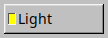

A button with a light that shows whether it is on. Clicking switches it.

```D
new LightButton(int x, int y, int w, int h, string label = null)
```

No members of its own.

###  Repeat Button

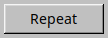

A button that calls back again and again while it is held down.

```D
new RepeatButton(int x, int y, int w, int h, string label = null)
```

No members of its own.

###  Check Button


A check box with a label: on or off.

```D
new CheckButton(int x, int y, int w, int h, string label = null)
```

###  Round Button


A round indicator with a label. As a radio button, it picks one option
of several.

```D
new RoundButton(int x, int y, int w, int h, string label = null)
```

## 5. Valuators

A valuator holds a number between a minimum and a maximum, in steps.
Each is a `Valuator`, with these members as well as those of `Widget`.
The mouse wheel changes any of them: 10 steps a notch, 1 with Shift,
100 with Ctrl.

| Member | What it does |
|---|---|
| `int wheelStepFactor()` | How many steps one notch of the mouse wheel moves a value: 10, or 1 with Shift held (fine control), or 100 with Ctrl held (coarse). |
| `void bounds(double a, double b)` | Sets the minimum (a) and maximum (b) values. |
| `double minimum()`<br>`void minimum(double a)` |  |
| `double maximum()`<br>`void maximum(double a)` |  |
| `void range(double a, double b)` | Same as bounds(a, b). |
| `void step(int a)`<br>`void step(double a, int b)`<br>`void step(double s)`<br>`double step()` | Sets the step value; see the getter's documentation for how this is stored internally as a ratio a_/b_ for precision. |
| `void precision(int digits)` | Sets the step value to 1.0 / 10^digits (clamped to 0..9). |
| `double value()`<br>`bool value(double v)` | Sets the current value, not clamped or rounded first (use clamp()/round() before calling this if needed). |
| `double round(double v)` | Rounds v to the nearest multiple of step(); a no-op if step() is zero. |
| `double clamp(double v)` | Clamps v to [minimum(), maximum()] (or the reverse range, if minimum() > maximum()). |
| `double increment(double v, int n)` | Adds n times the step value to v; if step() is zero, adds n/100 of the full range instead. |
| `string format()` | Formats value() using internal rules based on the current step: "%g" if step() is zero, otherwise "%.*f" with just enough decimal places to represent step() precisely (an integer step gives 0 decimal places, i.e. an integer display). |

Orientation, for the valuators that have one:

| Constant | Value | |
|---|---|---|
| `verticalType` | `0` | Shared type() values for valuators that work in both directions; FL_VERTICAL is 0 so it's also every valuator's default type(). |
| `horizontalType` | `1` |  |

###  Slider

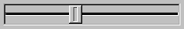

A knob the user slides along a track.

```D
new Slider(int x, int y, int w, int h, string label = null)
new Slider(ubyte t, int x, int y, int w, int h, string label)
```

| Member | What it does |
|---|---|
| `void sliderSize(double v)`<br>`float sliderSize()` | Fraction (0..1) of the widget's size taken up by the moving slider knob; 1 means the knob can't move. |
| `bool scrollvalue(int pos, int size, int first, int total)` | Sets up the slider to represent a scrollbar-style range: pos is the first visible line, size the number of visible lines, first the first line overall, and total the total number of lines. |
| `Boxtype slider()`<br>`void slider(Boxtype c)` | Gets the slider knob's own boxtype (noBox means "figure out a matching one from box()"). |
| `ScaleType scale()`<br>`void scale(ScaleType s)` |  |
| `TickPosition ticks()`<br>`void ticks(TickPosition t, ubyte numTicks = 11)` | ticksLeft/ticksRight can be OR'd together for vertical sliders, ticksBelow/ticksAbove for horizontal ones. |
| `ubyte numTicks()` |  |

`type()` values and tick marks:

| Constant | Value | |
|---|---|---|
| `vertSlider` | `0` | type() values; FL_VERTICAL/FL_VERT_SLIDER (0) is the default. |
| `horSlider` | `1` |  |
| `vertFillSlider` | `2` |  |
| `horFillSlider` | `3` |  |
| `vertNiceSlider` | `4` |  |
| `horNiceSlider` | `5` |  |
| `ticksNone` | `0x00` |  |
| `ticksBelow` | `0x01` |  |
| `ticksAbove` | `0x02` |  |
| `ticksLeft` | `0x01` |  |
| `ticksRight` | `0x02` |  |

###  Scroll Bar


A slider with arrows at its ends, whose knob shows how much of
something is in view. A `Slider`, with these members as well.

```D
new Scrollbar(int x, int y, int w, int h, string label = null)
```

| Member | What it does |
|---|---|
| `int value(int p)`<br>`int value(int pos, int windowSize, int firstLine, int totalLines)` | Sets the value (position) of the slider in the scrollbar. |
| `int linesize()`<br>`void linesize(int i)` | The step, in lines, that the arrow keys/end buttons move. |

###  Value Slider

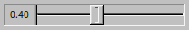

A slider that also shows its value as a number. A `Slider`, with these
members as well.

```D
new ValueSlider(int x, int y, int w, int h, string label = null)
```

| Member | What it does |
|---|---|
| `Font textfont()`<br>`void textfont(Font f)` |  |
| `Fontsize textsize()`<br>`void textsize(Fontsize s)` |  |
| `Color textcolor()`<br>`void textcolor(Color c)` |  |
| `void valueWidth(int s)`<br>`int valueWidth()` | Width of the value box in pixels (horizontal mode only); clamped to [10, w()-10]. |
| `void valueHeight(int s)`<br>`int valueHeight()` | Height of the value box in pixels (vertical mode only); clamped to [10, h()-10]. |

###  Value Output

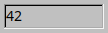

Shows a number, which the user can't change.

```D
new ValueOutput(int x, int y, int w, int h, string label = null)
```

| Member | What it does |
|---|---|
| `Font textfont()`<br>`void textfont(Font f)` |  |
| `Fontsize textsize()`<br>`void textsize(Fontsize s)` |  |
| `Color textcolor()`<br>`void textcolor(Color c)` |  |

###  Adjuster

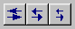

Three small buttons that change the value by dragging over them, each
by a different amount: fine, medium and coarse.

```D
new Adjuster(int x, int y, int w, int h, string label = null)
```

| Member | What it does |
|---|---|
| `void soft(bool s)`<br>`bool soft()` | If "soft" is turned on (the default), clicks and the mouse wheel can take the value outside the range: a change stops at the end of the range, and the next one from there goes past it. |

###  Counter

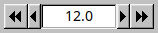

A number between arrow buttons that step it down and up; the outer
arrows take larger steps (`lstep()`).

```D
new Counter(int x, int y, int w, int h, string label = null)
```

| Member | What it does |
|---|---|
| `void lstep(double a)` | Sets the increment for the large (outer) step buttons. |
| `void step(double a, double b)`<br>`void step(int a, int b)` | Sets the increments for the normal (inner) and large (outer) step buttons. |
| `Font textfont()`<br>`void textfont(Font s)` |  |
| `Fontsize textsize()`<br>`void textsize(Fontsize s)` |  |
| `Color textcolor()`<br>`void textcolor(Color s)` |  |

`type()` values:

| Constant | Value | |
|---|---|---|
| `normalCounter` | `0` | type() for a counter with 4 arrow buttons (the default). |
| `simpleCounter` | `1` | type() for a counter with only the 2 inner arrow buttons. |

###  Dial

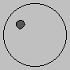

A round knob the user turns.

```D
new Dial(int x, int y, int w, int h, string label = null)
```

| Member | What it does |
|---|---|
| `short angle1()`<br>`void angle1(short a)` | Sets or gets the angles used for the minimum and maximum values. |
| `short angle2()`<br>`void angle2(short a)` |  |
| `void angles(short a, short b)` |  |

`type()` values:

| Constant | Value | |
|---|---|---|
| `normalDial` | `0` | type() for a dial variant with a dot (the default). |
| `lineDial` | `1` | type() for a dial variant with a line. |
| `fillDial` | `2` | type() for a dial variant with a filled arc. |

###  Roller

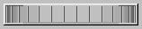

A wheel the user rolls with the mouse, for a value without fixed
ends in sight.

```D
new Roller(int x, int y, int w, int h, string label = null)
```

No members of its own.

###  Spinner

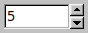

A number field with up and down arrows, for whole numbers or with
decimals.

```D
new Spinner(int x, int y, int w, int h, string label = null)
```

| Member | What it does |
|---|---|
| `string format()`<br>`void format(string f)` |  |
| `double maximum()`<br>`void maximum(double m)` |  |
| `double minimum()`<br>`void minimum(double m)` |  |
| `void range(double a, double b)` |  |
| `void step(double s)`<br>`double step()` |  |
| `void wrap(bool set)`<br>`bool wrap()` |  |
| `Color textcolor()`<br>`void textcolor(Color c)` |  |
| `Font textfont()`<br>`void textfont(Font f)` |  |
| `Fontsize textsize()`<br>`void textsize(Fontsize s)` |  |
| `double value()`<br>`void value(double v)` |  |
| `void maximumSize(int m)`<br>`int maximumSize()` |  |

###  Value Input

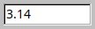

A number field the user types in, or drags over to change.

```D
new ValueInput(int x, int y, int w, int h, string label = null)
```

| Member | What it does |
|---|---|
| `void soft(bool s)`<br>`bool soft()` | If "soft" is turned on, the mouse wheel can take the value outside the range: a turn stops at the end of the range, and the next turn from there goes past it. |
| `Font textfont()`<br>`void textfont(Font f)` |  |
| `Fontsize textsize()`<br>`void textsize(Fontsize s)` |  |
| `Color textcolor()`<br>`void textcolor(Color c)` |  |
| `Color cursorColor()`<br>`void cursorColor(Color c)` |  |
| `int shortcut()`<br>`void shortcut(int s)` |  |

## 6. Text

The one-line text widgets (Input, Output, File Input) are each an
`Input_`, with these members as well as those of `Widget`.

| Member | What it does |
|---|---|
| `uint index(int i)` | Returns the Unicode codepoint at byte index i, or 0 past the end (see byteAt()'s doc comment). |
| `int insertPosition(int p, int m)`<br>`int insertPosition(int p)`<br>`int insertPosition()` |  |
| `int mark()`<br>`int mark(int m)` |  |
| `int copy(int clipboard)` |  |
| `int cut()`<br>`int cut(int n)`<br>`int cut(int a, int b)` |  |
| `int insert(string t)` |  |
| `int append(string t, bool keepSelection = false)` |  |
| `int replace(int b, int e, string text)` | Deletes value_[b..e) and inserts text there, clamped to UTF-8 character boundaries and maximum_size(). |
| `int undo()` |  |
| `bool canUndo()` |  |
| `int redo()` |  |
| `bool canRedo()` |  |
| `int copyCuts()` |  |
| `int staticValue(string str, int len)`<br>`int staticValue(string str)` |  |
| `int value(string str, int len)`<br>`int value(string str)`<br>`int value(int v)`<br>`int value(double v)`<br>`string value()` | D `string` is already immutable+GC-owned, so unlike FLTK there's no separate "copy into an owned buffer" step -- value() and staticValue() are the same operation here. |
| `int ivalue()` |  |
| `string placeholder()`<br>`void placeholder(string text)` | The text shown, in a lighter color, while the input is empty. |
| `double dvalue()` |  |
| `int size()` |  |
| `int maximumSize()`<br>`void maximumSize(int m)` |  |
| `int shortcut()`<br>`void shortcut(int s)` |  |
| `Font textfont()`<br>`void textfont(Font s)` |  |
| `Fontsize textsize()`<br>`void textsize(Fontsize s)` |  |
| `Color textcolor()`<br>`void textcolor(Color n)` |  |
| `Color cursorColor()`<br>`void cursorColor(Color n)` |  |
| `InputType inputType()`<br>`void inputType(InputType t)` | Returns 0, inputFloat, inputInt, inputMultiline, or inputSecret -- type() masked to just the input-kind bits (readonly()/wrap() are separate bits, tested independently). |
| `InputType readonly()`<br>`void readonly(bool b)` | Returns the raw masked bit (0 or inputReadonly), not a plain bool -- inputType(int)'s `t \| readonly()` composition above relies on that exact value, matching FLTK's `int` return. |
| `InputType wrap()`<br>`void wrap(bool b)` |  |
| `void tabNav(bool val)`<br>`bool tabNav()` |  |

###  Input

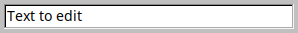

A one-line field for text the user types. `IntInput`, `FloatInput`,
`SecretInput` and `MultilineInput` are inputs for whole numbers,
numbers, passwords and several lines.

```D
new Input(int x, int y, int w, int h, string label = null)
```

No members of its own.

###  Output

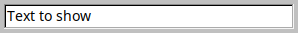

Shows one line of text, which the user can select and copy but not
change. `MultilineOutput` shows several lines.

```D
new Output(int x, int y, int w, int h, string label = null)
```

###  Text Edit

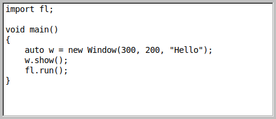

An editor for text of any length, with scrollbars, the keyboard and
mouse editing a programmer expects, and undo. The text is in a
`TextBuffer`, which several editors and displays can share. A
`TextDisplay` (next), with these members as well.

```D
new TextEditor(int x, int y, int w, int h, string label = null)
```

| Member | What it does |
|---|---|
| `void insertMode(bool b)`<br>`bool insertMode()` | If non-zero, new text is inserted before the current cursor position; otherwise new text replaces text at the current cursor position (overstrike mode). |
| `void tabNav(bool val)`<br>`bool tabNav()` | Enables (val=true) or disables (val=false, the default) Tab navigating focus to the next widget instead of inserting a tab character. |
| `void addKeyBinding(int key, int state, KeyFunc f, KeyBinding list)`<br>`void addKeyBinding(int key, int state, KeyFunc f)` | Adds a key/state binding with function f to list. |
| `void removeKeyBinding(int key, int state, KeyBinding list)`<br>`void removeKeyBinding(int key, int state)` | Removes the key/state binding from list, if present. |
| `void removeAllKeyBindings(KeyBinding list)`<br>`void removeAllKeyBindings()` | Removes every binding from list. |
| `void addDefaultKeyBindings(KeyBinding list)` | Adds every built-in default binding (arrow keys, Home/End, Backspace/Delete, Ctrl+Z/Ctrl+Shift+Z undo/redo, Ctrl+X/C/V/A cut/copy/paste/select-all, ...) to list. |
| `KeyFunc boundKeyFunction(int key, int state, KeyBinding list)`<br>`KeyFunc boundKeyFunction(int key, int state)` | Returns the function bound to key/state in list, or null. |
| `void defaultKeyFunction(KeyFunc f)` | Sets the fallback function used for keys with no explicit binding (the default, kfDefault(), inserts/overstrikes a printable character). |
| `int kfDefault(int c, TextEditor e)` | Inserts the text associated with key c. |
| `int kfIgnore(int, TextEditor)` | Ignores the key; useful for disabling a key that would otherwise be handled or entered as text (e.g. Tab, when tabNav() is on). |
| `int kfBackspace(int, TextEditor e)` | Deletes the selection, or the character to the left of the cursor if there is no selection. |
| `int kfEnter(int, TextEditor e)` | Inserts a newline at the current cursor position. |
| `int kfMove(int c, TextEditor e)` | Moves the text cursor in the direction indicated by key c (Home/End/Left/Right/Up/Down/Page_Up/Page_Down). |
| `int kfShiftMove(int c, TextEditor e)` | Extends the current selection in the direction of key c. |
| `int kfCtrlMove(int c, TextEditor e)` | Moves the cursor by word/document-edge/scroll-by-line/page-top- bottom in the direction indicated by control key c. |
| `int kfMetaMove(int c, TextEditor e)` | Moves the cursor to the beginning/end of the document, or the current line, in the direction indicated by meta key c. |
| `int kfMSMove(int c, TextEditor e)` | Extends the current selection in the direction indicated by meta key c. |
| `int kfCSMove(int c, TextEditor e)` | Extends the current selection in the direction indicated by control key c. |
| `int kfHome(int, TextEditor e)` | Moves the text cursor to the beginning of the current line. |
| `int kfEnd(int, TextEditor e)` | Moves the text cursor to the end of the current line. |
| `int kfLeft(int, TextEditor e)` | Moves the text cursor one character left. |
| `int kfUp(int, TextEditor e)` | Moves the text cursor one line up. |
| `int kfRight(int, TextEditor e)` | Moves the text cursor one character right. |
| `int kfDown(int, TextEditor e)` | Moves the text cursor one line down. |
| `int kfPageUp(int, TextEditor e)` | Moves the text cursor up one page. |
| `int kfPageDown(int, TextEditor e)` | Moves the text cursor down one page. |
| `int kfInsert(int, TextEditor e)` | Toggles insert/overstrike mode. |
| `int kfDelete(int, TextEditor e)` | Deletes the selection, or the character under the cursor if there is no selection. |
| `int kfCopy(int, TextEditor e)` | Copies the selection to the clipboard. |
| `int kfCut(int c, TextEditor e)` | Cuts the selection to the clipboard. |
| `int kfPaste(int, TextEditor e)` | Pastes the clipboard, replacing any current selection. |
| `int kfSelectAll(int, TextEditor e)` | Selects the entire buffer. |
| `int kfUndo(int, TextEditor e)` | Undoes the last edit. |
| `int kfRedo(int, TextEditor e)` | Redoes the last undone edit. |

The `TextBuffer` holding the text:

| Member | What it does |
|---|---|
| `int length()` | Number of bytes in the buffer. |
| `string text()`<br>`void text(const(char)[] t)` | Returns a copy of the entire buffer contents. |
| `string textRange(int start, int end)` | Returns a copy of the text between byte offsets start and end (end exclusive). |
| `uint charAt(int pos)` | The UCS-4 codepoint at pos (which must be on a UTF-8 character boundary), or 0 if pos is out of range. |
| `char byteAt(int pos)` | The raw byte at pos, ignoring UTF-8 encoding entirely, or 0 if pos is out of range. |
| `const(char)* address(int pos)`<br>`char* address(int pos)` | Converts a byte offset into a raw pointer into the gap-buffer storage. |
| `void insert(int pos, const(char)[] text, int insertedLength = -1)` | Inserts text at pos (which must be on a UTF-8 character boundary), clamping pos into range first. |
| `void append(const(char)[] text, int addedLength = -1)` | Appends text to the end of the buffer. |
| `void replace(int start, int end, const(char)[] text, int insertedLength = -1)` | Deletes the byte range [start, end), inserting text in its place. |
| `void remove(int start, int end)` | Deletes the byte range [start, end), swapping/clamping out-of- order or out-of-range arguments first. |
| `void copy(TextBuffer fromBuf, int fromStart, int fromEnd, int toPos)` | Copies text from another TextBuffer (which may be this one) into this buffer at toPos. |
| `int undo(int* cursorPos = null)` | Undoes the most recent change, returning the previous cursor position through cursorPos if non-null. |
| `bool canUndo()`<br>`void canUndo(bool flag)` | True if undo is enabled and there's a pending action to undo. |
| `int redo(int* cursorPos = null)` | Redoes the most recently undone action, returning the resulting cursor position through cursorPos if non-null. |
| `bool canRedo()` | True if undo is enabled and there's a pending action to redo. |
| `int tabDistance()`<br>`void tabDistance(int tabDist)` | The tab width, in characters (an average-character-width multiple is used to turn this into pixels; see the header's own comment on why "columns" can't be a fixed pixel width once fonts are proportional). |
| `void select(int start, int end)` | Selects [start, end) as the primary selection. |
| `bool selected()` | True if any text is primary-selected. |
| `void unselect()` | Clears the primary selection. |
| `bool selectionPosition(out int start, out int end)` | Gets the primary selection's range; returns false (with both out params set to 0) if nothing is selected. |
| `string selectionText()` | Returns the primary-selected text, or "" if nothing is selected. |
| `void removeSelection()` | Removes the primary-selected text from the buffer. |
| `void replaceSelection(const(char)[] text)` | Replaces the primary-selected text, then clears the selection (its range no longer refers to anything meaningful). |
| `void secondarySelect(int start, int end)` | Selects [start, end) as the secondary selection. |
| `bool secondarySelected()` | True if any text is secondary-selected. |
| `void secondaryUnselect()` | Clears the secondary selection. |
| `bool secondarySelectionPosition(out int start, out int end)` | Gets the secondary selection's range; see selectionPosition(). |
| `string secondarySelectionText()` | Returns the secondary-selected text, or "" if none. |
| `void removeSecondarySelection()` | Removes the secondary-selected text from the buffer. |
| `void replaceSecondarySelection(const(char)[] text)` | Replaces the secondary-selected text, then clears the selection. |
| `void highlight(int start, int end)`<br>`bool highlight()` | Highlights [start, end). |
| `void unhighlight()` | Clears the highlight. |
| `bool highlightPosition(out int start, out int end)` | Gets the highlight's range; see selectionPosition(). |
| `string highlightText()` | Returns the highlighted text, or "" if none. |
| `TextSelection* primarySelection()`<br>`const(TextSelection)* primarySelection()` | The primary selection, mutable. |
| `const(TextSelection)* secondarySelection()` | The secondary selection, read-only (FLTK exposes no mutable accessor for this one either). |
| `const(TextSelection)* highlightSelection()` | The highlight selection, read-only. |
| `void addModifyCallback(TextModifyCb cb)` | Registers cb to be called on every buffer modification, most- recently-added first (matching FLTK's ordering). |
| `void removeModifyCallback(TextModifyCb cb)` | Unregisters cb (the first match, by delegate equality -- context pointer and all, standing in for FLTK's `(fn, void*)` pair match). |
| `void callModifyCallbacks()` | Calls every registered modify callback with all-zero/null arguments (a generic "something changed, redisplay everything" notification). |
| `void addPredeleteCallback(TextPredeleteCb cb)` | Registers cb to be called just before text is deleted, most- recently-added first. |
| `void removePredeleteCallback(TextPredeleteCb cb)` | Unregisters cb; see removeModifyCallback()'s doc comment. |
| `void callPredeleteCallbacks()` | Calls every registered predelete callback with (0, 0). |
| `string lineText(int pos)` | Returns the entire line containing pos. |
| `int lineStart(int pos)` | Returns the byte offset of the start of the line containing pos. |
| `int lineEnd(int pos)` | Returns the byte offset just past the end of the line containing pos (the position of the newline, or length() if pos's line is the last, unterminated one). |
| `bool isWordSeparator(int pos)` | True if the character at pos is a word separator: any non- alphanumeric, non-'_' ASCII character, NO-BREAK SPACE (U+00A0), or an IDEOGRAPHIC punctuation mark (U+3000-U+301F). |
| `int wordStart(int pos)` | Returns the byte offset of the start of the word containing pos. |
| `int wordEnd(int pos)` | Returns the byte offset just past the end of the word containing pos. |
| `int countDisplayedCharacters(int lineStartPos, int targetPos)` | Counts displayed characters (tabs/control characters expanded -- but see the module comment: this port doesn't do that expansion, so this currently just counts codepoints) between lineStartPos and targetPos. |
| `int skipDisplayedCharacters(int lineStartPos, int nChars)` | Advances nChars displayed characters forward from lineStartPos, stopping early at a newline. |
| `int countLines(int startPos, int endPos)` | Counts the newlines between startPos and endPos (endPos itself not counted). |
| `int estimateLines(int startPos, int endPos, int lineLen)` | Estimates the number of newlines between startPos and endPos, additionally counting a soft break every lineLen characters within a line (to account for line wrapping). |
| `int skipLines(int startPos, int nLines)` | Returns the byte offset of the first character of the line nLines forward from startPos. |
| `int rewindLines(int startPos, int nLines)` | Returns the byte offset of the first character of the line nLines backward from startPos (not counting a newline exactly at startPos). |
| `bool findcharForward(int startPos, uint searchChar, out int foundPos)` | Searches forward from startPos for searchChar (a UCS-4 codepoint); returns true and sets foundPos if found, else returns false and sets foundPos to length(). |
| `bool findcharBackward(int startPos, uint searchChar, out int foundPos)` | Searches backward from just before startPos for searchChar; returns true and sets foundPos if found, else returns false and sets foundPos to 0. |
| `bool searchForward(int startPos, const(char)[] searchString, out int foundPos, bool matchCase = false)` | Searches forward from startPos for searchString; returns true and sets foundPos to the match start if found. |
| `bool searchBackward(int startPos, const(char)[] searchString, out int foundPos, bool matchCase = false)` | Searches backward, starting the match attempt *at* startPos (not before it); returns true and sets foundPos to the match start if found. |
| `int nextChar(int pos)` | Returns the byte offset of the character after pos, clipped to length() at the end of the buffer. |
| `int nextCharClipped(int pos)` | Same as nextChar() -- FLTK's next_char_clipped() is a plain alias for next_char() too (next_char() already clips to length()). |
| `int prevCharClipped(int pos)` | Returns the byte offset of the character before pos, clipped to 0 at the start of the buffer: the backward twin of nextChar() (`prevGrapheme()`). |
| `int prevChar(int pos)` | Returns the byte offset of the character before pos, or -1 if pos is already 0 (FLTK's "ran off the start" sentinel). |
| `int utf8Align(int pos)` | Aligns pos backward to the start of the UTF-8 sequence it falls within (a no-op if it's already on a boundary). |
| `int insertfile(string file, int pos, int buflen = 128 * 1024)` | Inserts the contents of file at pos. |
| `int appendfile(string file, int buflen = 128 * 1024)` | Appends the contents of file to the end of the buffer. |
| `int loadfile(string file, int buflen = 128 * 1024)` | Replaces the entire buffer with the contents of file. |
| `int outputfile(string file, int start, int end, int buflen = 128 * 1024)` | Writes the byte range [start, end) to file. |
| `int savefile(string file, int buflen = 128 * 1024)` | Writes the entire buffer to file. |

###  Text Display

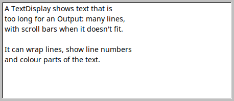

Shows text of any length from a `TextBuffer`, with scrollbars, line
wrapping, line numbers and coloured parts (a style buffer).

```D
new TextDisplay(int x, int y, int w, int h, string label = null)
```

| Member | What it does |
|---|---|
| `void buffer(TextBuffer buf)`<br>`TextBuffer buffer()` | Attaches buf as the buffer this widget displays, detaching the previous one (if any) first. |
| `TextBuffer styleBuffer()` | The attached style buffer, or null. |
| `void redisplayRange(int startpos, int endpos)` | Marks [startpos, endpos) as needing redraw. |
| `void scroll(int topLineNum, int horizOffset)` | Requests scrolling to topLineNum/horizOffset; actually applied by the next recalcDisplay() (deferred, same as FLTK). |
| `void insert(const(char)[] text)` | Inserts text at the current cursor position, then moves the cursor past it. |
| `void overstrike(const(char)[] text)` | Replaces text at the current cursor position (overwrite mode), padding with spaces if characters with visual width (e.g. tabs) were only partially consumed. |
| `void insertPosition(int newPos)`<br>`int insertPosition()` | Moves the insert cursor to newPos (clamped into the buffer). |
| `bool positionToXy(int pos, out int X, out int Y)` | Translates pos to a pixel position at the top-left of where its cursor would be drawn. |
| `bool inSelection(int X, int Y)` | True if pixel position (x,y) falls inside the primary selection. |
| `void showInsertPosition()` | Scrolls (deferred, via the next recalcDisplay()) to bring the insert cursor into view. |
| `bool moveRight()` | Moves the cursor right one character. |
| `bool moveLeft()` | Moves the cursor left one character. |
| `bool moveUp()` | Moves the cursor up one (possibly wrapped) line, preserving its preferred column. |
| `bool moveDown()` | Moves the cursor down one (possibly wrapped) line, preserving its preferred column. |
| `int countLines(int startPos, int endPos, bool startPosIsLineStart)` | Same as buffer().countLines(), but wrap-aware. |
| `int lineStart(int pos)` | Same as buffer().lineStart(pos), but wrap-aware: returns the character after the last wrap point rather than the last '\n'. |
| `int lineEnd(int startPos, bool startPosIsLineStart)` | Same as buffer().lineEnd(startPos), but wrap-aware. |
| `int skipLines(int startPos, int nLines, bool startPosIsLineStart)` | Same as buffer().skipLines(), but wrap-aware. |
| `int rewindLines(int startPos, int nLines)` | Same as buffer().rewindLines(), but wrap-aware. |
| `void nextWord()` | Moves the cursor right to the start of the next word. |
| `void previousWord()` | Moves the cursor left to the start of the current/previous word. |
| `void showCursor(bool b = true)` | Shows (b=true) or hides (b=false) the text cursor. |
| `void hideCursor()` | Hides the text cursor. |
| `bool cursorOn()` | Whether the cursor is currently shown (FLTK's `mCursorOn`). |
| `void cursorStyle(CursorStyle style)`<br>`CursorStyle cursorStyle()` | Sets the cursor style, switching it on. |
| `Color cursorColor()`<br>`void cursorColor(Color n)` |  |
| `int scrollbarWidth()`<br>`void scrollbarWidth(int width)` | Deprecated (matching FLTK's own `\deprecated` doc comment): use scrollbarSize() instead. |
| `int scrollbarSize()`<br>`void scrollbarSize(int newSize)` |  |
| `Align scrollbarAlign()`<br>`void scrollbarAlign(Align a)` |  |
| `int wordStart(int pos)` |  |
| `int wordEnd(int pos)` |  |
| `void highlightData(TextBuffer styleBuffer, const(StyleTableEntry)[] styleTable, char unfinishedStyle, UnfinishedStyleCb unfinishedHighlightCB)` | Attaches (or detaches, if styleBuffer is null) a parallel style buffer + style table for syntax highlighting. |
| `int positionStyle(int lineStartPos, int lineLen, int lineIndex)` | Resolves the drawing style (a style-table index plus selection/ highlight mask bits) for the character at byte offset lineStartPos+lineIndex within a line of length lineLen bytes. |
| `int shortcut()`<br>`void shortcut(int s)` | \todo (matching FLTK's own FIXME): shortcut()/shortcut(int) have no effect on the base TextDisplay -- FL_SHORTCUT reads it (see handle()), but nothing here ever sets it besides the user. |
| `Font textfont()`<br>`void textfont(Font s)` |  |
| `Fontsize textsize()`<br>`void textsize(Fontsize s)` |  |
| `Color textcolor()`<br>`void textcolor(Color n)` |  |
| `void grammarUnderlineColor(Color c)`<br>`Color grammarUnderlineColor()` |  |
| `void spellingUnderlineColor(Color c)`<br>`Color spellingUnderlineColor()` |  |
| `void secondarySelectionColor(Color c)`<br>`Color secondarySelectionColor()` |  |
| `int wrappedColumn(int row, int column)` | Column (row, column) -> absolute (non-wrapped) column, adjusting for continuous-wrap mode. |
| `int wrappedRow(int row)` | Wrapped display row -> count of real newlines from the top displayed line. |
| `void wrapMode(WrapMode wrap, int wrapMargin)` | Sets the wrap mode/margin. |
| `void recalcDisplay()` | Recalculates visible lines, scrollbar geometry/visibility, and text-area bounds. |
| `void displayNeedsRecalc()` | Schedules a recalcDisplay() on the next draw(), rather than recalculating immediately (which can be CPU-intensive if called repeatedly). |
| `double xToCol(double x)` | Converts an x pixel offset (from the left margin) to an approximate column number, based on an average character width in the main font -- a real measurement (`stringWidth("Mitg", 4, 'A') / 4.0`, cached in `columnScale_`), not `tmpFontWidth`'s fixed-6px placeholder (that one backs `xyToRowcol()` instead, FLTK's own `TMPFONTWIDTH` split exactly). |
| `double colToX(double col)` | Inverse of xToCol(). |
| `void linenumberWidth(int width)`<br>`int linenumberWidth()` | Sets the width (in pixels) of the line-number margin. |
| `void linenumberFont(Font val)`<br>`Font linenumberFont()` |  |
| `void linenumberSize(Fontsize val)`<br>`Fontsize linenumberSize()` |  |
| `void linenumberFgcolor(Color val)`<br>`Color linenumberFgcolor()` |  |
| `void linenumberBgcolor(Color val)`<br>`Color linenumberBgcolor()` |  |
| `void linenumberAlign(Align val)`<br>`Align linenumberAlign()` |  |
| `void linenumberFormat(string val)`<br>`string linenumberFormat()` | A printf-style format string (e.g. "%d", "%03d", "%x", "%o") used to render each line number -- fed to std.format.format() rather than a C printf() call, but the same basic numeric conversions are supported by both. |
| `void maintainAbsoluteTopLineNumber(bool state)` | Requests (state=true) or stops (state=false) maintaining the absolute (non-wrapped) top line number even when it isn't needed for line-number display. |
| `int getAbsoluteTopLineNumber()` | The absolute (non-wrapped) line number of the top displayed line, or 0 if it isn't being maintained. |
| `int scrollRow()` |  |
| `int scrollCol()` |  |

###  File Input

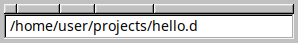

An input field for a file's path, with a row of buttons above the text
for each folder in it; clicking one cuts the path back to that folder.

```D
new FileInput(int x, int y, int w, int h, string label = null)
```

| Member | What it does |
|---|---|
| `Boxtype downBox()`<br>`void downBox(Boxtype b)` |  |

###  Terminal

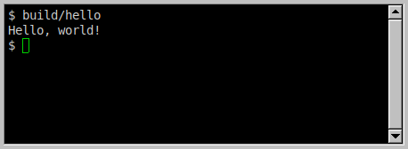

Shows text the way a terminal does: lines added at the bottom,
scrolling up, with colours and the usual terminal escape codes. For a
program's log or the output of a command.

```D
new Terminal(int x, int y, int w, int h, string label = null)
new Terminal(int x, int y, int w, int h, string label, int rows, int cols, int hist)
```

| Member | What it does |
|---|---|
| `int historyRows()`<br>`void historyRows(int hrows)` |  |
| `int historyUse()` |  |
| `int displayRows()`<br>`void displayRows(int drows)` |  |
| `int displayColumns()`<br>`void displayColumns(int dcols)` |  |
| `int marginLeft()`<br>`void marginLeft(int val)` |  |
| `int marginRight()`<br>`void marginRight(int val)` |  |
| `int marginTop()`<br>`void marginTop(int val)` |  |
| `int marginBottom()`<br>`void marginBottom(int val)` |  |
| `void textfont(Font val)`<br>`Font textfont()` |  |
| `void textsize(Fontsize val)`<br>`Fontsize textsize()` |  |
| `void textfgcolorXterm(ubyte val)` |  |
| `void textbgcolorXterm(ubyte val)` |  |
| `void textcolor(Color val)`<br>`Color textcolor()` |  |
| `void textfgcolor(Color val)`<br>`Color textfgcolor()` |  |
| `void textbgcolor(Color val)`<br>`Color textbgcolor()` |  |
| `void textfgcolorDefault(Color val)`<br>`Color textfgcolorDefault()` |  |
| `void textbgcolorDefault(Color val)`<br>`Color textbgcolorDefault()` |  |
| `void selectionfgcolor(Color val)`<br>`Color selectionfgcolor()` |  |
| `void selectionbgcolor(Color val)`<br>`Color selectionbgcolor()` |  |
| `void textattrib(Attrib val)`<br>`Attrib textattrib()` |  |
| `void clear(Color val)` |  |
| `void clearScreen(bool scrollToHist = true)` |  |
| `void clearScreenHome(bool scrollToHist = true)` |  |
| `void clearHistory()` |  |
| `void resetTerminal()` |  |
| `void cursorHome()` |  |
| `int selectionTextLen()` |  |
| `string selectionText()` |  |
| `void cursorfgcolor(Color val)`<br>`Color cursorfgcolor()` |  |
| `void cursorbgcolor(Color val)`<br>`Color cursorbgcolor()` |  |
| `int cursorRow()` |  |
| `int cursorCol()` |  |
| `void outputTranslate(OutFlags val)`<br>`OutFlags outputTranslate()` |  |
| `void displayModified()` |  |
| `void plotChar(const(char)[] text, int drow, int dcol)`<br>`void plotChar(char c, int drow, int dcol)` |  |
| `void printChar(const(char)[] text)`<br>`void printChar(char c)` |  |
| `void appendUtf8(const(char)[] buf)` |  |
| `void appendUtf8Clear()` | Clears the partial-UTF-8 cache -- call before/after a manual block-read loop, matching FLTK's `append(nullptr)` contract (a null D string can't be distinguished from an empty one the same way, so this is a separate, explicitly-named method). |
| `void appendAscii(const(char)[] s)` |  |
| `void append(const(char)[] s)` |  |
| `int handleUnknownChar()`<br>`int handleUnknownChar(int drow, int dcol)` |  |
| `string text(bool linesBelowCursor = false)` | Return a copy of all lines in the terminal (including scrollback history). |
| `RedrawStyle redrawStyle()`<br>`void redrawStyle(RedrawStyle val)` |  |
| `float redrawRate()`<br>`void redrawRate(float val)` |  |
| `bool showUnknown()`<br>`void showUnknown(bool val)` |  |
| `void errorChar(string val)`<br>`string errorChar()` |  |
| `bool ansi()`<br>`void ansi(bool val)` |  |
| `int historyLines()`<br>`void historyLines(int val)` |  |
| `int scrollbarActualSize()` |  |
| `int scrollbarSize()`<br>`void scrollbarSize(int val)` |  |
| `ScrollbarStyle hscrollbarStyle()`<br>`void hscrollbarStyle(ScrollbarStyle val)` |  |

## 7. Menus

A menu is a list of `MenuItem`s. Each widget below that shows one is a
`Menu_`, with these members as well as those of `Widget`; `add()` adds
items, with a `/` in the label for a submenu (`"&File/&Open..."`) and a
`&` before the letter that picks it from the keyboard.

| Member | What it does |
|---|---|
| `const(MenuItem)* menu()`<br>`void menu(MenuItem[] items)` | Returns a pointer to the first item of the menu array, or null if empty -- same shape as FLTK's `menu()` (a raw pointer), since MenuItem's own `next()`/`size()`/etc. all operate on pointers, not slices. |
| `void copy(MenuItem[] items)` | The `void* user_data` parameter FLTK also takes has no equivalent here (`MenuItem` has no user_data slot at all, see CONVENTIONS.md's callback-porting convention), so it's dropped rather than ported as a dead parameter. |
| `int size()` | This returns the number of MenuItems that make up the menu, correctly counting submenus, including the trailing sentinel. |
| `void clear()` | Same as menu(null): clears the menu array entirely. |
| `int clearSubmenu(int index)` | Clears the submenu at `index` (which must be a submenu title) of all its items, so it can be repopulated (e.g. a "Recent Files" list). |
| `int insert(int index, string label, int shortcut, Callback cb, MenuFlags flags = 0)` | Inserts a new item at `index` (-1 appends). |
| `int add(string label, int shortcut, Callback cb, MenuFlags flags = 0)` | Same as insert(-1, label, shortcut, cb, flags): appends. |
| `void replace(int i, string label)` | Changes item i's label. |
| `void remove(int i)` | Deletes item i (and, if it's a submenu title, its whole body) from the menu. |
| `int findIndex(const(MenuItem)* item)`<br>`int findIndex(Callback cb)`<br>`int findIndex(string pathname)` | Converts an item pointer into its index in menu(), or -1 if it isn't in this menu (including items inside a detached FL_SUBMENU_POINTER submenu, matching FLTK). |
| `const(MenuItem)* findItem(Callback cb)`<br>`const(MenuItem)* findItem(string pathname)` |  |
| `string itemPathname(const(MenuItem)* finditem = null)` | Returns `null` if `finditem` isn't found anywhere in this menu (FLTK's `-1` case) -- same D-`string`-return substitution CONVENTIONS.md documents for `Widget.label()`/`tooltip()` elsewhere in this port: no caller-supplied buffer/length, so there's no `-2` "buffer too small" case to report either. |
| `const(MenuItem)* mvalue()` |  |
| `const(MenuItem)* prevMvalue()` |  |
| `int value()`<br>`int value(const(MenuItem)* m)`<br>`int value(int i)` | Index into menu() of the last item picked, or -1 (see mvalue()'s own doc comment for when: never picked yet, or the picked item lives in a detached FL_SUBMENU_POINTER submenu). |
| `string text()`<br>`string text(int i)` | The label of the last item picked, or null. |
| `Font textfont()`<br>`void textfont(Font f)` |  |
| `Fontsize textsize()`<br>`void textsize(Fontsize s)` |  |
| `Color textcolor()`<br>`void textcolor(Color c)` |  |
| `Boxtype downBox()`<br>`void downBox(Boxtype b)` |  |
| `Boxtype menuBox()`<br>`void menuBox(Boxtype b)` | Box type for the menu popup windows; noBox means "use box() instead" (see fl.menu_bar/fl.menu_button/fl.choice, not yet ported, for where this gets consumed). |
| `Color downColor()`<br>`void downColor(Color c)` |  |
| `MenuStyle style()` | Builds the MenuStyle fl.menu_popup's popup engine needs from this widget's own style fields -- see fl.menu_item's doc comment on why MenuStyle exists instead of passing `this` directly. |
| `void shortcut(int i, int s)` |  |
| `void mode(int i, MenuFlags f)`<br>`int mode(int i)` |  |
| `void image(int i, Image img)` | Sets item i's plain `image()` field. |
| `void multiLabel(int i, MultiLabel ml)` | Sets item i's label to a side-by-side icon+text `MultiLabel` -- D counterpart of FLTK's `fill_in_New_Menu()`/ `make_iconlabel()` (`fluid/nodes/factory.cxx`), which builds an `Fl_Multi_Label` (an image part plus a text part) and assigns it via `Fl_Multi_Label::label(mi)` rather than `mi->image(ic)` -- deliberately, since `Fl_Multi_Label::draw()`/`measure()` (`fl.multi_label`) always lay their two parts out left-to-right, unlike a plain `image()` field's stacked default (see `image()` just above). |
| `void setonly(MenuItem* item)` | Searches this menu (only the embedded-submenu part of it, not any FL_SUBMENU_POINTER-detached array -- see the module doc comment) for the (sub)menu containing `item`, then turns it on, turning off adjacent radio items in the same group. |
| `const(MenuItem)* picked(const(MenuItem)* v)` | Call this when the user picks item v: applies radio/toggle on/off bookkeeping, updates value()/mvalue(), and fires either the item's own callback (if it has one) or this widget's callback, depending on when(). |
| `const(MenuItem)* testShortcut()` | Returns the menu item matching the current event's shortcut (must be called in response to FL_KEYBOARD/FL_SHORTCUT), running it through picked() first (so the match's callback -- or this widget's own -- already fired by the time this returns). |
| `void global()` | Makes the shortcuts for this menu work no matter what window has focus, by installing a global `fl.core.addHandler()` fallback. |

###  Input Choice

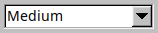

An input field with a menu of suggestions: the user picks one or types
something else.

```D
new InputChoice(int x, int y, int w, int h, string label = null)
```

| Member | What it does |
|---|---|
| `void add(string s)` | Adds a single item to the menu (see the module doc comment on why this doesn't split `s` on '\|' the way FLTK's single-string add() does). |
| `Boxtype downBox()`<br>`void downBox(Boxtype b)` |  |
| `const(MenuItem)* menu()`<br>`void menu(MenuItem[] items)` |  |
| `Color textcolor()`<br>`void textcolor(Color c)` |  |
| `Font textfont()`<br>`void textfont(Font f)` |  |
| `Fontsize textsize()`<br>`void textsize(Fontsize s)` |  |
| `string value()`<br>`void value(string val)`<br>`void value(int val)` | Chooses item #val in the menu, and sets the input field to that value (clearing any previous text). |
| `int updateMenubutton()` | If the input field's current text matches one of the menu items, makes that item the menu's current selection too. |
| `MenuButton menubutton()` |  |
| `Input input()` |  |

###     Menu items

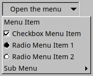

The entries of a Menu Bar, Menu Button or Choice: a plain item, a check
box item, a radio item (one of several), and a submenu holding more
items. In code, flags passed to `add()` make an item one or the other.

| Member | What it does |
|---|---|
| `inout(MenuItem)* next(int n = 1) inout` | Advances by n items, skipping submenu contents and invisible items. |
| `inout(MenuItem)* first() inout` |  |
| `int size()` | Size of this (sub)menu array in elements, including the trailing sentinel. |
| `string label()`<br>`void label(string a)`<br>`void label(Labeltype t, string a)` |  |
| `void multiLabel(MultiLabel ml)` | D counterpart of Fl_Menu_Item::multi_label(): sets label()/ labeltype() to a fl.multi_label.MultiLabel, same substitution fl.widget's Widget.label(MultiLabel) makes for a class reference where FLTK smuggles a pointer through `text`. |
| `Image image()`<br>`void image(Image img)` | Gets/sets the image drawn alongside this item's label. |
| `Labeltype labeltype()`<br>`void labeltype(Labeltype a)` |  |
| `Color labelcolor()`<br>`void labelcolor(Color a)` |  |
| `Font labelfont()`<br>`void labelfont(Font a)` |  |
| `Fontsize labelsize()`<br>`void labelsize(Fontsize a)` |  |
| `Callback callback()`<br>`void callback(Callback c)` |  |
| `void doCallback(Widget o, CallbackReason reason = CallbackReason.unknown)` | Calls the item's callback with the given widget (the menu/ button that owns this item, matching FLTK's `do_callback(Fl_Widget*, ...)`). |
| `int shortcut()`<br>`void shortcut(int s)` |  |
| `int submenu()` |  |
| `int checkbox()` |  |
| `int radio()` |  |
| `int value()`<br>`void value(int v)` |  |
| `void set()` |  |
| `void clear()` |  |
| `void setonly(const(MenuItem)* first = null)` | Turns this radio item on, turning off adjacent radio items in the same group (stopping at a divider, a non-radio item, the sentinel, or -- going upward -- at `first`). |
| `int visible()` |  |
| `void show()` |  |
| `void hide()` |  |
| `int active()` |  |
| `void activate()` |  |
| `void deactivate()` |  |
| `int activevisible()` |  |
| `int selectable()` |  |
| `void headline(bool yes)`<br>`int headline()` |  |
| `const(MenuItem)* testShortcut()` | Recursively searches this (sub)menu array -- and, depth-first, any nested submenus -- for an item whose shortcut() matches the current FL_SHORTCUT event, top-level matches winning over matches found deeper in a submenu. |
| `const(MenuItem)* findShortcut(int* ip = null, bool requireAlt = false)` | Searches this (sub)menu array (not nested submenus) for an item whose shortcut_ value matches the current event, or whose label has a matching '&x' shortcut. |
| `int measure(out int h, const MenuStyle style = MenuStyle.defaults())` | Measures the label's width (including the checkbox/radio mark's width, if any), returning the label height via `h`. |

Flags:

| Constant | Value | |
|---|---|---|
| `menuInactive` | `1` | deactivate item (gray out) |
| `menuToggle` | `2` | item shows a checkbox |
| `menuValue` | `4` | checkbox/radio on/off state |
| `menuRadio` | `8` | item is a radio button |
| `menuInvisible` | `0x10` | hidden (shortcut still works) |
| `menuSubmenuPointer` | `0x20` | submenuItems_ points at a detached array |
| `menuSubmenu` | `0x40` | item is a submenu title, embedded inline |
| `menuDivider` | `0x80` | divider line below this item |
| `menuHorizontal` | `0x100` | reserved, unused (matches FLTK) |
| `menuChatty` | `0x200` | item also gets gotFocus/lostFocus callbacks |
| `menuHeadline` | `0x400` | non-selectable section heading |

###  Menu Bar

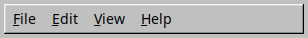

The row of menus along the top of a window.

```D
new MenuBar(int x, int y, int w, int h, string label = null)
```

| Member | What it does |
|---|---|
| `void update()` | Called after the menu items change; a menu bar that mirrors them elsewhere (FLTK's macOS system menu bar) refreshes itself here. |
| `void playMenu(const(MenuItem)* item)` | Opens the dropdown of the top-level `item`, as if it had been clicked. |

###  Menu Button

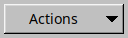

A button that opens a menu.

```D
new MenuButton(int x, int y, int w, int h, string label = null)
```

| Member | What it does |
|---|---|
| `const(MenuItem)* popup()` | Acts exactly as though the user clicked the button or typed its shortcut key: shows the menu, waits for a pick, and if one is made, sets value() and fires the callback (or sets changed()). |

###  Choice

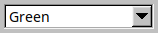

Shows the item that is picked, and opens the menu to pick another.

```D
new Choice(int x, int y, int w, int h, string label = null)
```

No members of its own.

## 8. Browsers

###  Browser

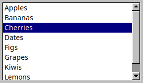

A list of lines, with a scrollbar. `type()` sets whether, and how many
of, its lines can be selected: `HoldBrowser` keeps one line selected,
`MultiBrowser` several. A line's text can start with format codes for
its font and colour. A `Browser_`, with these members as well.

```D
new Browser(int x, int y, int w, int h, string label = null)
```

| Member | What it does |
|---|---|
| `void insert(int line, string newtext, Object d = null)` | Inserts a new line with text newtext above line, with optional user data d. |
| `void move(int to, int from)` | Removes line from, reinserts it at to (computed *after* removal). |
| `void swap(BLine a, BLine b)`<br>`void swap(int a, int b)` | Swaps the two lines a and b (1-based). |
| `void add(string newtext, Object d = null)` | Adds a new line to the end, with optional user data d. |
| `int size()` | Number of lines; 0 if empty. |
| `int topline()`<br>`void topline(int line)` |  |
| `void lineposition(int line, LinePosition pos)` | Scrolls so line appears at the given position. |
| `void bottomline(int line)` |  |
| `void middleline(int line)` |  |
| `int select(int line, int val = 1)` |  |
| `int selected(int line)` |  |
| `void show(int line)` | Makes line visible/selectable by the user (opposite of hide(int)). |
| `void hide(int line)` | Hides line, preventing user selection (still selectable from code). |
| `void display(int line, int val = 1)` |  |
| `int visible(int line)` |  |
| `int value()`<br>`void value(int line)` |  |
| `const(char)[] text(int line)`<br>`void text(int line, string newtext)` | Changes line's text. |
| `Object data(int line)`<br>`void data(int line, Object d)` |  |
| `const(int)[] columnWidths()`<br>`void columnWidths(const(int)[] arr)` |  |
| `char columnChar()`<br>`void columnChar(char c)` |  |
| `char formatChar()`<br>`void formatChar(char c)` |  |
| `int displayed(int line)` |  |
| `void makeVisible(int line)` |  |
| `void icon(int line, Image ic)`<br>`Image icon(int line)` |  |
| `void removeIcon(int line)` |  |
| `void replace(int a, string b)` |  |
| `bool load(string filename)` | Clears the browser and loads filename, one browser line per source line. |

The members of `Browser_`, the base of Browser, Check Browser and File
Browser:

| Member | What it does |
|---|---|
| `int vposition()`<br>`void vposition(int pos)` | Vertical scroll position, in pixels scrolled off the top. |
| `int hposition()`<br>`void hposition(int pos)` | Horizontal scroll position, in pixels scrolled off the left. |
| `void display(Object item)` | Scrolls the list so item is shown. |
| `ubyte hasScrollbar()`<br>`void hasScrollbar(ubyte mode)` | Scrollbar mode: see browserHorizontal/browserVertical/ browserBoth/browserAlwaysOn and combinations. |
| `Font textfont()`<br>`void textfont(Font f)` |  |
| `Fontsize textsize()`<br>`void textsize(Fontsize s)` |  |
| `Color textcolor()`<br>`void textcolor(Color c)` |  |
| `int scrollbarSize()`<br>`void scrollbarSize(int newSize)` | Size (in pixels) of the scrollbars' troughs, or 0 to track the global fl.core.scrollbarSize(). |
| `void scrollbarRight()` | Moves the vertical scrollbar to the righthand side. |
| `void scrollbarLeft()` | Moves the vertical scrollbar to the lefthand side. |
| `void linespacing(int pixels)`<br>`int linespacing()` | Additional pixels of spacing between browser lines. |
| `int select(Object item, int val = 1, int docallbacks = 0)` | Sets the selection state of item; returns true if it changed. |
| `int deselect(int docallbacks = 0)` | Deselects all items; returns true if the state changed. |
| `int selectOnly(Object item, int docallbacks = 0)` | Selects only item, deselecting everything else. |
| `void sort(int flags = 0)` | Sort the items based on flags (sortAscending/sortDescending, optionally \|sortCaseInsensitive). |

`type()` values, sort orders and scrollbars:

| Constant | Value | |
|---|---|---|
| `normalBrowser` | `0` | type() values for Fl_Browser and its subclasses (FL_NORMAL_BROWSER et al, FL/Fl_Browser_.H). |
| `selectBrowser` | `1` |  |
| `holdBrowser` | `2` |  |
| `multiBrowser` | `3` |  |
| `sortAscending` | `0` | sort() flags (FL_SORT_ASCENDING et al). |
| `sortDescending` | `1` |  |
| `sortCaseInsensitive` | `0x2` |  |
| `browserHorizontal` | `1` | has_scrollbar() mode bits -- open bitmask set (combines via `\|`), matching Align/Damage/etc.'s alias-plus-manifest-constants treatment elsewhere in this port (see fl.scroll's identical treatment of its own anonymous scrollbar-mode enum for precedent). |
| `browserVertical` | `2` |  |
| `browserBoth` | `3` |  |
| `browserAlwaysOn` | `4` |  |
| `browserHorizontalAlways` | `5` |  |
| `browserVerticalAlways` | `6` |  |
| `browserBothAlways` | `7` |  |

###  Tree

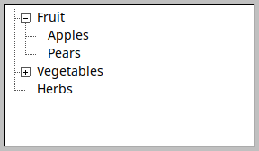

Items in a hierarchy, with branches the user opens and closes. Items
are added by path (`add("Fruit/Apples")`); each is a `TreeItem`.

```D
new Tree(int X, int Y, int W, int H, string L = null)
```

| Member | What it does |
|---|---|
| `void autoResizeChildren(bool mode)`<br>`bool autoResizeChildren()` | Enable/disable automatically resizing children when the Tree container itself is resized (default: false). |
| `void rootLabel(string newLabel)` | Set the label for the root item. |
| `TreeItem root()`<br>`void root(TreeItem newitem)` | Returns the root item, or null. |
| `TreePrefs prefs()`<br>`const(TreePrefs) prefs()` | Return the tree's preferences (fonts, colors, margins, icons, selection/connector style). |
| `TreeItem add(string path, TreeItem item = null)`<br>`TreeItem add(TreeItem parentItem, string name)`<br>`TreeItem add(TreeItem parentItem, string name, TreeItem item)` | Add a new item given a menu-style path (e.g. "Flintstones/Fred"), creating any missing parent nodes automatically. |
| `TreeItem insertAbove(TreeItem above, string name)` | Insert a new item named name above item above. |
| `TreeItem insert(TreeItem item, string name, int pos)` | Insert a new item named name into item's children at pos. |
| `void load(prefsmod.Preferences prefs)` | Loads (visualizes) a `fl.preferences.Preferences` database as a tree: each group becomes a subtree (recursively), each key/value entry becomes a leaf item labeled "key = value" (truncated past 40 characters), and any `/` in a key or value is replaced with `\` first, since `/` is this tree's own path separator. |
| `int remove(TreeItem item)` | Remove item (and its children) from the tree. |
| `void clearChildren(TreeItem item)` | Clear all children of item (item itself is kept). |
| `TreeItem findItem(string path)` | Find the item at a menu-style path (e.g. "Parent/Child/item"), or null if not found. |
| `string itemPathname(TreeItem item)` | Return item's full pathname (e.g. "Parent/Child/Item"), '/' and '\' within a label escaped with a backslash. |
| `TreeItem findClicked(bool yonly = false)` | Find the item the last event was over (walks the whole tree). |
| `TreeItem first()` | Returns the first item in the tree (always root()), or null. |
| `TreeItem firstVisibleItem()` | Returns the first open()/visible() item, or null. |
| `TreeItem next(TreeItem item)` | Return the next item after item, or null. |
| `TreeItem prev(TreeItem item)` | Return the previous item before item, or null. |
| `TreeItem last()` | Returns the last item in the tree, or null. |
| `TreeItem lastVisibleItem()` | Returns the last open()/visible() item, or null. |
| `TreeItem nextVisibleItem(TreeItem item, int dir)` | Returns the next open()/visible() item above (dir==up) or below (dir==down) item, or null. |
| `TreeItem firstSelectedItem()` | Returns the first selected item, or null. |
| `TreeItem lastSelectedItem()` | Returns the last selected item, or null. |
| `TreeItem nextItem(TreeItem item, int dir = down, bool visible = false)` | Returns the next item after item in direction dir (up/down), open/closed items included unless visible is true. |
| `TreeItem nextSelectedItem(TreeItem item, int dir = down)` | Returns the next selected item above/below item, per dir. |
| `TreeItem[] selectedItems()` | Returns every currently-selected item, top to bottom. |
| `int open(TreeItem item, bool docallback = true)`<br>`int open(string path, bool docallback = true)` | Open item. |
| `void openToggle(TreeItem item, bool docallback = true)` | Toggle item's open/closed state. |
| `int close(TreeItem item, bool docallback = true)`<br>`int close(string path, bool docallback = true)` | Close item. |
| `bool isOpen(const(TreeItem) item)`<br>`int isOpen(string path)` | See if item is open. |
| `bool isClose(const(TreeItem) item)`<br>`int isClose(string path)` | See if item is closed. |
| `int select(TreeItem item, bool docallback = true)`<br>`int select(string path, bool docallback = true)` | Select item. |
| `void selectToggle(TreeItem item, bool docallback = true)` | Toggle item's selection state. |
| `int deselect(TreeItem item, bool docallback = true)`<br>`int deselect(string path, bool docallback = true)` | Deselect item. |
| `int deselectAll(TreeItem item = null, bool docallback = true)` | Deselect item and all its children (first() if item is null). |
| `int selectOnly(TreeItem selitem, bool docallback = true)` | Select only selitem, deselecting everything else (first() if null). |
| `int selectAll(TreeItem item = null, bool docallback = true)` | Select item and all its children (first() if null). |
| `int extendSelectionDir(TreeItem from, TreeItem to, int dir, int val, bool visible)` | Extend the selection between from and to (inclusive), moving in direction dir. |
| `int extendSelection(TreeItem from, TreeItem to, int val = 1, bool visible = false)` | Extend the selection between from and to (inclusive), direction need not be known in advance (searches the tree). |
| `void setItemFocus(TreeItem item)` | Set the item with keyboard focus (null: none). |
| `TreeItem getItemFocus()` | Get the item that currently has keyboard focus, or null. |
| `bool isSelected(const(TreeItem) item)`<br>`int isSelected(string path)` | See if item is selected. |
| `Font itemLabelfont()`<br>`void itemLabelfont(Font val)` |  |
| `Fontsize itemLabelsize()`<br>`void itemLabelsize(Fontsize val)` |  |
| `Color itemLabelfgcolor()`<br>`void itemLabelfgcolor(Color val)` |  |
| `Color itemLabelbgcolor()`<br>`void itemLabelbgcolor(Color val)` |  |
| `Color connectorcolor()`<br>`void connectorcolor(Color val)` |  |
| `int marginleft()`<br>`void marginleft(int val)` |  |
| `int margintop()`<br>`void margintop(int val)` |  |
| `int marginbottom()`<br>`void marginbottom(int val)` |  |
| `int linespacing()`<br>`void linespacing(int val)` |  |
| `int openchildMarginbottom()`<br>`void openchildMarginbottom(int val)` |  |
| `int usericonmarginleft()`<br>`void usericonmarginleft(int val)` |  |
| `int labelmarginleft()`<br>`void labelmarginleft(int val)` |  |
| `int widgetmarginleft()`<br>`void widgetmarginleft(int val)` |  |
| `int connectorwidth()`<br>`void connectorwidth(int val)` |  |
| `Image usericon()`<br>`void usericon(Image val)` |  |
| `Image openicon()`<br>`void openicon(Image val)` |  |
| `Image closeicon()`<br>`void closeicon(Image val)` |  |
| `bool showcollapse()`<br>`void showcollapse(bool val)` |  |
| `bool showroot()`<br>`void showroot(bool val)` |  |
| `TreeConnector connectorstyle()`<br>`void connectorstyle(TreeConnector val)` |  |
| `TreeSort sortorder()`<br>`void sortorder(TreeSort val)` |  |
| `Boxtype selectbox()`<br>`void selectbox(Boxtype val)` |  |
| `TreeSelect selectmode()`<br>`void selectmode(TreeSelect val)` |  |
| `TreeItemReselectMode itemReselectMode()`<br>`void itemReselectMode(TreeItemReselectMode mode)` |  |
| `TreeItemDrawMode itemDrawMode()`<br>`void itemDrawMode(TreeItemDrawMode mode)` |  |
| `void calcDimensions()` | Recalculate the widget's outer/inner dimensions and scrollbar visibility -- a low-overhead update, not a full tree re-walk. |
| `void calcTree()` | Recalculate the tree's overall pixel size (walking the whole tree) and scrollbar visibility. |
| `void showSelf()` | Print the tree as 'ascii art' to stdout, for debugging. |
| `bool displayed(TreeItem item)` | See if item is currently displayed within the widget's visible area (doesn't consider open()/close()/hide()/show()). |
| `void showItem(TreeItem item, int yoff)`<br>`void showItem(TreeItem item)` | Scroll so item is yoff pixels from the top. |
| `void showItemTop(TreeItem item)` | Scroll so item is at the top of the display. |
| `void showItemMiddle(TreeItem item)` | Scroll so item is in the middle of the display. |
| `void showItemBottom(TreeItem item)` | Scroll so item is at the bottom of the display. |
| `void display(TreeItem item)` | Display item, scrolling as necessary. |
| `int vposition()`<br>`void vposition(int pos)` | Vertical scroll position, in pixels scrolled off the top. |
| `int hposition()`<br>`void hposition(int pos)` | Horizontal scroll position, in pixels scrolled off the left. |
| `bool isScrollbar(Widget w)` | See if w is one of this tree's own scrollbars -- skip these when walking array(). |
| `int scrollbarSize()`<br>`void scrollbarSize(int size)` | Get the scrollbar trough size (0: uses fl.core.scrollbarSize()). |
| `bool isVscrollVisible()` | See if the vertical scrollbar is currently visible. |
| `bool isHscrollVisible()` | See if the horizontal scrollbar is currently visible. |
| `void callbackItem(TreeItem item)`<br>`TreeItem callbackItem()` | Sets the item that caused the callback -- normally managed by Tree itself; only subclasses needing to override this should call it. |
| `void callbackReason(CallbackReason reason)`<br>`CallbackReason callbackReason()` | Sets the reason for this callback. |
| `void recalcTree()` | Schedule the tree to recalculate its overall size on the next calcTree() (draw() or an explicit calcTree() call). |

The members of a `TreeItem`:

| Member | What it does |
|---|---|
| `int x()` | The item's x position relative to the window. |
| `int y()` | The item's y position relative to the window. |
| `int w()` | The entire item's width to the right edge of Tree's inner width within scrollbars. |
| `int h()` | The item's height. |
| `int labelX()` | The item's label x position relative to the window. |
| `int labelY()` | The item's label y position relative to the window. |
| `int labelW()` | The item's maximum label width to the right edge of Tree's inner width within scrollbars. |
| `int labelH()` | The item's label height. |
| `void showSelf(string indent = "")` | Print the tree as 'ascii art' to stdout -- mainly for debugging. |
| `void label(string val)`<br>`string label()` | Set the label. |
| `void userData(Object data)`<br>`Object userData()` | Set a user-data value for the item -- see this module's own top comment on why this is Object, not void*. |
| `void labelfont(Font val)`<br>`Font labelfont()` | Set item's label font face. |
| `void labelsize(Fontsize val)`<br>`Fontsize labelsize()` | Set item's label font size. |
| `void labelfgcolor(Color val)`<br>`Color labelfgcolor()` | Set item's label foreground text color. |
| `void labelcolor(Color val)`<br>`Color labelcolor()` | Set item's label text color. |
| `void labelbgcolor(Color val)`<br>`Color labelbgcolor()` | Set item's label background color. |
| `void widget(Widget val)`<br>`Widget widget()` | Assign an FLTK widget to this item. |
| `int children()` | Return the number of children this item has. |
| `TreeItem child(int index)` | Return the child item for the given index. |
| `bool hasChildren()` | See if this item has children. |
| `int findChild(string name)`<br>`int findChild(TreeItem item)` | Return the index of the immediate child with label name, or -1. |
| `TreeItem findChildItem(string name)`<br>`TreeItem findChildItem(const(string)[] arr)` | Return the immediate child with label name, or null. |
| `TreeItem findItem(const(string)[] names)` | Find item by descending path names (includes self). |
| `TreeItem add(TreePrefs prefs, string newLabel)`<br>`TreeItem add(TreePrefs prefs, string newLabel, TreeItem item)`<br>`TreeItem add(TreePrefs prefs, const(string)[] arr)`<br>`TreeItem add(TreePrefs prefs, const(string)[] arr, TreeItem newitem)` | Add a new child with label new_label, using prefs.sortorder() to place it. |
| `TreeItem insert(TreePrefs prefs, string newLabel, int pos = 0)` | Insert a new item named new_label into this item's children at position pos (prepended if pos < 0, appended if pos > children()). |
| `TreeItem insertAbove(TreePrefs prefs, string newLabel)` | Insert a new item named new_label above this item, or null if this item has no parent. |
| `TreeItem deparent(int pos)` | Deparent child at index pos: creates an "orphaned" item (still allocated, no parent or siblings), typically reparented elsewhere immediately after. |
| `int reparent(TreeItem newchild, int pos)` | Reparent newchild as our own child at position pos (typically a recently-deparent()ed item). |
| `int move(int to, int from)`<br>`int move(TreeItem item, int op = 0, int pos = 0)` | Move a child within this item's children, from index from to index to. |
| `int moveAbove(TreeItem item)` | Move this item above item. |
| `int moveBelow(TreeItem item)` | Move this item below item. |
| `int moveInto(TreeItem item, int pos = 0)` | Parent this item as a child of item. |
| `TreePrefs prefs()` | Return the parent tree's prefs. |
| `TreeItem parent()`<br>`void parent(TreeItem val)` | Return the parent for this item, or null if we're the root. |
| `Tree tree()` | Return the tree this item belongs to. |
| `TreeItem replace(TreeItem newitem)` | Replace this item with newitem. |
| `TreeItem replaceChild(TreeItem olditem, TreeItem newitem)` | Replace existing child olditem with newitem. |
| `int removeChild(TreeItem item)`<br>`int removeChild(string name)` | Remove item from this item's children. |
| `void clearChildren()` | Clear all the children for this item. |
| `void swapChildren(int ax, int bx)`<br>`int swapChildren(TreeItem a, TreeItem b)` | Swap two of our children, given index values. |
| `void open()` | Open this item and all its children (shows their widget()s). |
| `void close()` | Close this item and all its children (hides their widget()s). |
| `bool isOpen()` | See if the item is 'open'. |
| `bool isClose()` | See if the item is 'closed'. |
| `void openToggle()` | Toggle the item's open/closed state. |
| `void select(bool val = true)` | Change the item's selection state. |
| `void selectToggle()` | Toggle the item's selection state. |
| `int selectAll()` | Select item and all its children. |
| `void deselect()` | Deselect the item. |
| `int deselectAll()` | Deselect item and all its children. |
| `bool isSelected()` | See if the item is selected. |
| `void activate(bool val = true)` | Change the item's activation state. |
| `void deactivate()` | Deactivate the item. |
| `bool isActivated()` | See if the item is activated. |
| `bool isActive()` | See if the item is activated. |
| `bool visible()` | See if the item is visible. |
| `bool isVisible()` | See if the item is visible. |
| `bool visibleR()` | See if item and all its parents are open() and visible(). |
| `bool isVisibleR()` | See if item and all its parents are open() and visible(). |
| `void usericon(Image val)`<br>`Image usericon()` | Set the item's user icon. |
| `void userdeicon(Image val)`<br>`Image userdeicon()` | Set the icon to draw when the item is deactivated. |
| `TreeItem findClicked(TreePrefs prefs, bool yonly = false)` | Find the item the last event was over. |
| `bool eventOnCollapseIcon(TreePrefs prefs)` | Was the event on this item's collapse icon? |
| `bool eventOnUserIcon(TreePrefs prefs)` | Was the event on this item's user icon, if any? |
| `bool eventOnItem(TreePrefs prefs)` | Was the event anywhere on the item? |
| `bool eventOnLabel(TreePrefs prefs)` | Was the event on this item's label? |
| `bool isRoot()` | Is this item the root of the tree? |
| `int depth()` | Returns how many levels deep this item is (root == 0). |
| `TreeItem next()` | Return the next item in the tree (forward walk). |
| `TreeItem prev()` | Return the previous item in the tree (backward walk). |
| `TreeItem nextSibling()` | Return this item's next sibling, or null. |
| `TreeItem prevSibling()` | Return this item's previous sibling, or null. |
| `void updatePrevNext(int index)` | Update our prevSibling/nextSibling to point to neighbors, given index as our current position in the parent's children. |
| `TreeItem nextVisible(TreePrefs prefs)` | Return the next open()/visible() item, skipping closed children. |
| `TreeItem nextDisplayed(TreePrefs prefs)` | Same as nextVisible(). |
| `TreeItem prevVisible(TreePrefs prefs)` | Return the previous open()/visible() item, skipping closed children. |
| `TreeItem prevDisplayed(TreePrefs prefs)` | Same as prevVisible(). |

How the tree sorts and selects:

| Value | |
|---|---|
| `TreeSort.sortNone` |  |
| `TreeSort.sortAscending` |  |
| `TreeSort.sortDescending` |  |

| Value | |
|---|---|
| `TreeSelect.selectNone` |  |
| `TreeSelect.selectSingle` |  |
| `TreeSelect.selectMulti` |  |
| `TreeSelect.selectSingleDraggable` |  |

###  Check Browser

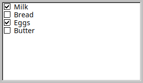

A list of lines, each with a check box.

```D
new CheckBrowser(int x, int y, int w, int h, string label = null)
```

| Member | What it does |
|---|---|
| `void itemSwap(int ia, int ib)` | Swaps the two 1-based line numbers. |
| `int add(string s)`<br>`int add(string s, bool checked)` | Adds an unchecked line, returning the new nitems(). |
| `int remove(int item)` | Removes the given 1-based line, returning the new nitems(). |
| `int nitems()` | Number of lines in the browser. |
| `int nchecked()` | Number of currently checked lines. |
| `int checked(int item)`<br>`void checked(int item, bool b)` |  |
| `void setChecked(int item)` | Equivalent to checked(item, true). |
| `void checkAll()` |  |
| `void checkNone()` |  |
| `int value()` | The 1-based line number of the currently selected item, or 0. |
| `const(char)[] text(int item)` |  |

###  HTML View

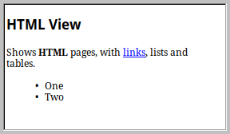

Shows HTML pages: headings, paragraphs, lists, tables, links, images
and fonts. `HtmlDialog` is a window with an HTML View and Back, Forward,
text size and find.

```D
new HtmlView(int x, int y, int w, int h, string label = null)
```

| Member | What it does |
|---|---|
| `Scrollbar scrollbar()` |  |
| `Scrollbar hscrollbar()` |  |
| `void value(string val)`<br>`string value()` | Sets the current help text buffer and reformats. |
| `int load(string f)` | Non-`file:` schemes (ftp/http/https/ipp/mailto/news) dispatch through `fl.filename.openUri()` (see this module's top comment): on success this returns 0 and leaves the view's content unchanged (an external handler took over); on failure, a real in-view HTML error page is built and displayed, matching FLTK exactly. |
| `int find(string s, int p = 0)` | Finds `s` in the document's text, starting at byte offset `p` (0 if out of range), selects the match (from the start of its word, see `hvDraw()`), scrolls the block containing it into view and returns the match's byte offset, or -1. |
| `void link(HtmlLinkFunc fn)` |  |
| `string filename()` |  |
| `string directory()` |  |
| `string title()` |  |
| `int size()` |  |
| `void textcolor(Color c)`<br>`Color textcolor()` |  |
| `void textfont(Font f)`<br>`Font textfont()` |  |
| `void textsize(Fontsize s)`<br>`Fontsize textsize()` |  |
| `void topline(string anchor)`<br>`void topline(int top)`<br>`int topline()` |  |
| `void leftline(int left)`<br>`int leftline()` |  |
| `void clearSelection()` |  |
| `void selectAll()` |  |
| `bool textSelected()` |  |
| `int copy(int clipboard = 1)` |  |
| `int scrollbarSize()`<br>`void scrollbarSize(int newSize)` |  |

###  Markdown View

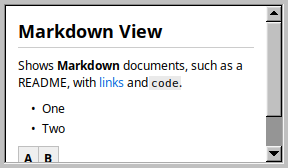

Shows Markdown documents, such as a README, formatted: headings,
emphasis, lists, block quotes, code, tables, links and images. Links to
other `.md` files open them. `MarkdownDialog` is a window with a
Markdown View and Back, Forward, text size and find; Fluid's Help menu
shows fldtk's README in one.

```D
new MarkdownView(int x, int y, int w, int h, string label = null)
```

| Member | What it does |
|---|---|
| `Scrollbar scrollbar()` | The vertical and horizontal scrollbars. |
| `Scrollbar hscrollbar()` |  |
| `void value(string md)`<br>`string value()` | Shows the Markdown text `md`. |
| `int load(string f)` | Loads and shows the Markdown file `f`, scrolled to the heading `#anchor` at the end of `f` if there is one (`README.md#status`). |
| `string filename()` | The file on show, as an absolute path, or null. |
| `string directory()` | The folder relative links and images are found from, or null for the current directory. |
| `string title()` | The document's title: the text of its first heading, or else its file name. |
| `void link(MarkdownLinkFunc fn)` | Sets a function that sees each link the user clicks first (see `MarkdownLinkFunc`). |
| `Fontsize textsize()`<br>`void textsize(Fontsize s)` | The size of body text; headings and code are sized from it. |
| `Font textfont()`<br>`void textfont(Font f)` | The font of body text, with its bold and italic forms used for emphasis. |
| `Color textcolor()`<br>`void textcolor(Color c)` | The colour of body text. |
| `int scrollbarSize()`<br>`void scrollbarSize(int s)` | The scrollbars' width, or 0 for `fl.core.scrollbarSize()`. |
| `void topline(string anchor)`<br>`void topline(int top)`<br>`int topline()` | Scrolls to the heading whose anchor is `anchor` (`fl.markdown. |
| `void leftline(int left)`<br>`int leftline()` | Scrolls sideways so that column `left` is at the left of the view. |
| `int size()` | The laid-out document's height in pixels. |
| `bool textSelected()` | Whether text is selected. |
| `void clearSelection()` | Unselects the text. |
| `void selectAll()` | Selects all text. |
| `string selection()` | The selected text, as `copy()` gives it. |
| `int copy(int clipboard = 1)` | Puts the selected text on the clipboard (`clipboard` 1) or the selection buffer (0). |
| `int find(string s, int p = 0)` | Finds `s` in the document's text, ignoring the case of ASCII letters, starting at text position `p`. |

###  File Browser

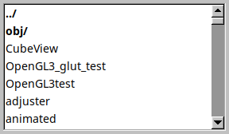

A list of the files in a folder, with icons. `loadDirectory()` fills
it.

```D
new FileBrowser(int x, int y, int w, int h, string label = null)
```

| Member | What it does |
|---|---|
| `ubyte iconsize()`<br>`void iconsize(ubyte s)` | Icon size, in pixels (default 20). |
| `void filter(string pattern)`<br>`string filter()` | Filename filter pattern, matched via fl.filename.filenameMatch(). |
| `int filetype()`<br>`void filetype(int t)` | fileBrowserFiles (show files and directories) or fileBrowserDirectories (directories only). |
| `void errmsg(string emsg)`<br>`string errmsg()` |  |
| `bool loadDirectory(string directory, FileSortFunc sortFn = null)` | Clears the browser and loads directory's entries (directories first, in bold with a trailing '/', then files matching filter()). |

| Constant | Value | |
|---|---|---|
| `fileBrowserFiles` | `0` | filetype() values (FLTK's anonymous enum FILES/DIRECTORIES). |
| `fileBrowserDirectories` | `1` |  |

###  Table

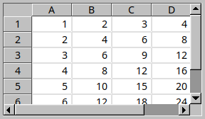

Rows and columns of cells, with row and column headers, which the user
can resize. A Table draws no cells itself: a program makes a subclass
and overrides `drawCell()`, which is called for each cell and header in
view. `TableRow` adds selecting rows.

```D
new Table(int X, int Y, int W, int H, string L = null)
```

| Member | What it does |
|---|---|
| `void tableBox(Boxtype val)`<br>`Boxtype tableBox()` | The box type drawn around the data table (default: noBox). |
| `void rows(int val)`<br>`int rows()` | Sets the number of rows in the table, and the table is redrawn. |
| `void cols(int val)`<br>`int cols()` | Sets the number of columns in the table, and the table is redrawn. |
| `void visibleCells(out int r1, out int r2, out int c1, out int c2)` | Returns the range of row/column numbers for all visible and partially visible cells. |
| `bool isInteractiveResize()` | True if someone is interactively resizing a row or column. |
| `bool rowResize()`<br>`void rowResize(bool flag)` | Allows/disallows row resizing by the user (via the row headers -- rowHeader() must also be enabled). |
| `bool colResize()`<br>`void colResize(bool flag)` | Allows/disallows column resizing by the user (via the column headers -- colHeader() must also be enabled). |
| `int colResizeMin()`<br>`void colResizeMin(int val)` |  |
| `int rowResizeMin()`<br>`void rowResizeMin(int val)` |  |
| `bool rowHeader()`<br>`void rowHeader(bool flag)` | Enables/disables showing the row headers; redraws if changed. |
| `bool colHeader()`<br>`void colHeader(bool flag)` | Enables/disables showing the column headers; redraws if changed. |
| `void colHeaderHeight(int height)`<br>`int colHeaderHeight()` | Sets the height in pixels for column headers and redraws. |
| `void rowHeaderWidth(int width)`<br>`int rowHeaderWidth()` | Sets the row header width in pixels and redraws. |
| `void rowHeaderColor(Color val)`<br>`Color rowHeaderColor()` | Sets the row header color and redraws. |
| `void colHeaderColor(Color val)`<br>`Color colHeaderColor()` | Sets the column header color and redraws. |
| `void rowHeight(int row, int height)`<br>`int rowHeight(int row)` | Sets the height of the specified row in pixels, and the table is redrawn. |
| `void colWidth(int col, int width)`<br>`int colWidth(int col)` | Sets the width of the specified column in pixels, and the table is redrawn. |
| `void rowHeightAll(int height)` | Sets the height of all rows to the same value, in pixels. |
| `void colWidthAll(int width)` | Sets the width of all columns to the same value, in pixels. |
| `void rowPosition(int row)`<br>`int rowPosition()` | Sets which row should be at the top of the table (scrolling as necessary; clamped if the table can't scroll that far). |
| `void colPosition(int col)`<br>`int colPosition()` | Sets which column should be at the left of the table. |
| `void topRow(int row)`<br>`int topRow()` | Deprecated alias for rowPosition(int). |
| `bool isSelected(int r, int c)` | See if the cell at row r, column c is within the current selection rectangle. |
| `void getSelection(out int rowTop, out int colLeft, out int rowBot, out int colRight)` | Gets the region of cells selected (highlighted). |
| `void setSelection(int rowTop, int colLeft, int rowBot, int colRight)` | Sets the region of cells to be selected (highlighted). |
| `int moveCursor(int R, int C, bool shiftselect)`<br>`int moveCursor(int R, int C)` | Moves the selection cursor a relative number of rows/columns. |
| `Widget child(int n)` | Returns the nth child widget. |
| `int callbackRow()` | The row the event occurred on. |
| `int callbackCol()` | The column the event occurred on. |
| `TableContext callbackContext()` | The current table context. |
| `void doCallback(TableContext context, int row, int col)` | Calls the widget callback, saving context/row/col for callback_context()/callback_row()/callback_col() to read. |
| `int scrollbarSize()`<br>`void scrollbarSize(int newSize)` |  |
| `void tabCellNav(bool val)`<br>`bool tabCellNav()` | If true, Tab navigates table cells instead of FLTK widget focus (default: false). |

What `drawCell()` is asked to draw:

| Constant | Value | |
|---|---|---|
| `contextNone` | `0` | no known context |
| `contextStartpage` | `0x01` | before the table is redrawn |
| `contextEndpage` | `0x02` | after the table is redrawn |
| `contextRowHeader` | `0x04` | drawing or event occurred in the row header |
| `contextColHeader` | `0x08` | drawing or event occurred in the col header |
| `contextCell` | `0x10` | drawing or event occurred in a cell |
| `contextTable` | `0x20` | drawing or event occurred in a dead zone of table |
| `contextRcResize` | `0x40` | column or row is being resized |

## 9. Misc

###  Box

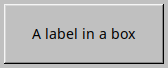

A box and a label, and nothing else: for text, a picture, or a frame
around other widgets.

```D
new Box(int x, int y, int w, int h, string label = null)
new Box(Boxtype b, int x, int y, int w, int h, string label)
```

###  Clock

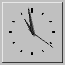

A clock that shows the time and keeps going. `FlClock` is a
`ClockOutput`, which shows a time it is given, with these members.

```D
new FlClock(int x, int y, int w, int h, string label = null)
new FlClock(ubyte t, int x, int y, int w, int h, string label)
```

| Member | What it does |
|---|---|
| `void value(int H, int m, int s)`<br>`void value(ulong v)`<br>`ulong value()` | Sets the displayed time in hours, minutes, and seconds. |
| `int hour()` | Returns the displayed hour (0 to 23). |
| `int minute()` | Returns the displayed minute (0 to 59). |
| `int second()` | Returns the displayed second (0 to 60, 60 = leap second). |
| `bool shadow()`<br>`void shadow(bool mode)` | Whether the hands are drawn with a drop shadow (default true). |

`type()` values:

| Constant | Value | |
|---|---|---|
| `squareClock` | `0` | type() of the square (default) clock variant. |
| `roundClock` | `1` | type() of the round clock variant. |
| `analogClock` | `squareClock` | An analog clock is square. |
| `digitalClock` | `squareClock` | Not yet implemented, FLTK or here. |

###  Progress

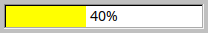

A bar that fills as work gets done, between `minimum()` and
`maximum()`.

```D
new Progress(int x, int y, int w, int h, string label = null)
```

| Member | What it does |
|---|---|
| `void maximum(float v)`<br>`float maximum()` |  |
| `void minimum(float v)`<br>`float minimum()` |  |
| `void value(float v)`<br>`float value()` |  |

## 10. Beyond widgets

### The program: `fl.core`

The event loop, timers, threads, the clipboard, drag and drop, the
screens, the scheme, and the state of the event being handled.

| Function | What it does |
|---|---|
| `Event event()` | The last event that was processed. |
| `int eventX()`<br>`void eventX(int v)` | Mouse position of the event, relative to the window it was passed to. |
| `int eventY()`<br>`void eventY(int v)` |  |
| `int eventXRoot()` | Mouse position of the event, in screen coordinates. |
| `int eventYRoot()` |  |
| `int eventDx()` | Horizontal/vertical mouse wheel scroll delta for an FL_MOUSEWHEEL event. |
| `int eventDy()` |  |
| `float eventDxF()` | Horizontal mouse wheel/touchpad scroll delta of an FL_MOUSEWHEEL event in fractional lines; right is positive. |
| `float eventDyF()` | Vertical counterpart of eventDxF(); down is positive. |
| `int eventClicks()`<br>`void eventClicks(int i)` | Number of consecutive clicks; N-1 for N clicks. |
| `float eventZoom()` | During `Event.zoomGesture` (fingers pinched or spread on a touchpad or a touchscreen): how much larger to make the view since the previous zoom event -- 1.05 is 5% larger, 0.95 5% smaller. |
| `float eventRotation()` | During `Event.rotateGesture`: how many degrees the fingers turned since the previous rotate event, clockwise positive. |
| `int eventFingers()` | During a gesture event: the number of fingers making it. |
| `GesturePhase eventGesturePhase()` | During a gesture event: whether it begins, updates, ends or cancels the gesture. |
| `bool eventIsClick()`<br>`void eventIsClick(bool v)` | Whether the mouse hasn't moved far/long enough since the last FL_PUSH/FL_KEYBOARD to be considered a "drag" rather than a "click". |
| `int eventButton()` | Which mouse button caused the current event; garbage unless the last event was FL_PUSH or FL_RELEASE. |
| `EventState eventState()`<br>`EventState eventState(EventState mask)` | Keyboard/mouse-button state bitfield of the last event. |
| `Keysym eventKey()`<br>`bool eventKey(Keysym k)` | Which key caused the current FL_KEYBOARD/FL_SHORTCUT event, or 0. |
| `void eventKeysym(Keysym k)` | Overrides the key reported for the current event -- matches FLTK's `Fl::e_keysym` being a genuinely mutable public global (`FL/core/events.H`), not just a read accessor: an `addHandler()`/ `addSystemHandler()` callback can rewrite it before the event reaches widgets (e.g. remapping a keypad key to a digit). |
| `Keysym eventOriginalKey()` | eventKey() before NumLock keypad-to-arrow-key translation. |
| `bool getKey(Keysym k)` | Whether key `k` is currently held down right now, via a fresh query -- the direct equivalent of FLTK's `Fl::get_key(int)`. |
| `int getMouse(out int x, out int y)` | Computes the current mouse position in screen coordinates via a fresh server round trip -- the direct equivalent of FLTK's `Fl::get_mouse(int&, int&)`. |
| `RGBImage captureWindow(CoreWindow win, int x, int y, int w, int h)` | Captures the content of a rectangular zone of a mapped window as an `RGBImage`. |
| `void setSpot(Font font, Fontsize size, int X, int Y, int W, int H, CoreWindow win = null)` | Reports the text cursor's screen position to the input method, so a CJK (or other composing) input method can position its own floating preedit window at the cursor instead of some fixed default location -- "over the spot" IME positioning. |
| `void resetSpot()` | Clears the cached "over the spot" position, so the next `setSpot()` call is guaranteed to push a real update rather than being skipped as a no-op change. |
| `void enableIm()` | A rarely-used escape hatch most apps never call (IME composition works transparently without it). |
| `void disableIm()` | ditto (the disabling half). |
| `string eventText()`<br>`void eventText(string s)` | Text associated with the current event (FL_KEYBOARD, FL_PASTE, ...). |
| `size_t eventLength()` |  |
| `Object eventClipboard()` | Associated data for an `Event.paste` whose `eventClipboardType()` is `clipboardImage` -- cast to `RGBImage` to use (matches FLTK's own `void*`-cast-to-`Fl_RGB_Image*` convention exactly). |
| `string eventClipboardType()` | `clipboardPlainText` or `clipboardImage` -- which kind of data the current `Event.paste` carries. |
| `bool compose(out int del)` | Any text-editing widget calls this for each FL_KEYBOARD event: if it returns true, eventText()/eventLength() hold bytes that should be inserted (`del` says how many bytes to the left of the cursor to delete first, to replace a previous provisional composition); if false, the keystroke should be treated as a function/control key instead. |
| `void composeReset()` | Call after moving the cursor so the next compose() call doesn't set a stale `del`. |
| `void copy(string text, int clipboard)` | Stores `text` into the PRIMARY (`clipboard` 0) or CLIPBOARD (`clipboard` 1) selection slot and claims real X11 selection ownership for it (`XSetSelectionOwner()`, via fl.platform_x11.setSelectionOwner()) so other X applications -- not just other widgets in this process -- can request it too. |
| `void selectionToClipboard(bool on)`<br>`bool selectionToClipboard()` | Whether `copy()` to the selection buffer (`clipboard` 0) also copies to the clipboard, making X11 selection behave more like other platforms. |
| `Widget selectionOwner()`<br>`void selectionOwner(Widget owner)` | The widget that last set the selection with `selection()`. |
| `void selection(Widget owner, string text)` | Makes `owner` the selection owner and copies `text` to the selection buffer. |
| `void copyImage(const(ubyte)[] rgbData, int w, int h, int clipboard)` | The write-side counterpart to `paste(..., clipboardImage)`. |
| `void paste(Widget receiver, int clipboard, string type = clipboardPlainText)` | If this process already owns the requested selection, delivers it to `receiver` synchronously -- matching FLTK's own fast path (`Fl_X11_Screen_Driver::paste()`'s `if (Fl::e_clipboard_type == ...)` in-process shortcut). |
| `bool clipboardContains(string type)` | Returns whether the CLIPBOARD selection currently holds data of the given `type` (`clipboardPlainText` or `clipboardImage`) -- both can be true at once (an owner can offer text and image forms of the same data), so this genuinely answers "does it contain this type", not "is this the only type". |
| `void addClipboardNotify(ClipboardNotifyHandler h)` | `h` is called with `source` (0 = selection buffer, 1 = clipboard) whenever *another* application changes the selection or clipboard -- not for this process's own copy()/paste() calls. |
| `void removeClipboardNotify(ClipboardNotifyHandler h)` |  |
| `bool eventShift()` |  |
| `bool eventCtrl()` |  |
| `bool eventCommand()` |  |
| `bool eventAlt()` |  |
| `EventState eventButtons()` |  |
| `bool eventButton1()` |  |
| `bool eventButton2()` |  |
| `bool eventButton3()` |  |
| `bool eventButton4()` |  |
| `bool eventButton5()` |  |
| `bool eventInside(int x, int y, int w, int h)`<br>`bool eventInside(const(Widget) o)` | True if event_x()/event_y() falls inside the (x,y,w,h) rectangle. |
| `bool testShortcut(uint shortcut)` | Tests the current event (which must be FL_KEYBOARD or FL_SHORTCUT) against a shortcut value as described by Fl_Button::shortcut(): a keysym OR'd with required shift-state flags. |
| `string fl_shortcut_label(uint shortcut)`<br>`string fl_shortcut_label(uint shortcut, out string keyPart)` | Returns a human-readable string for a shortcut value, e.g. "Ctrl+Alt+F1". |
| `int scrollbarSize()`<br>`void scrollbarSize(int w)` | The default width (in pixels) of scrollbar troughs for any widget that doesn't override it with its own explicit instance-level scrollbar size (`fl.scroll.Scroll.scrollbarSize(int)`, `fl.text_display`'s `scrollbarSize(int)`, ...). |
| `int menuLinespacing()`<br>`void menuLinespacing(int h)` | Extra vertical padding (in pixels) added to every menu item's measured height when laying out a popup/menu-bar's rows. |
| `Widget grab()`<br>`void grab(Widget win)` | "Grab is done while menu systems are up" (FLTK's own comment) -- while a grab is active, focus()/belowmouse() below become no-ops (matching FLTK's `if (grab()) return;` guards). |
| `Widget modal()` | The current topmost modal window, or null. |
| `CoreWindow firstWindow()`<br>`void firstWindow(CoreWindow window)` | The first (most-recently-shown, or most-recently-made-`first`) top- level window in the list of shown() windows, or null if none are shown. |
| `CoreWindow nextWindow(CoreWindow window)` | The next top-level window after `window` in the list of shown() windows, or null if `window` is the last one (or isn't shown at all). |
| `void hideAllWindows()` | Hides every currently-shown top-level window. |
| `void redraw()` | Redraws every currently-shown top-level window -- ported from `Fl::redraw()` (`Fl.cxx`) verbatim, walking the same `firstWindow()`/ `nextWindow()` list `hideAllWindows()`/`reloadScheme()` already do. |
| `void addHandler(EventHandler ha)`<br>`void addHandler(EventHandler ha, EventHandler before)` | Installs a function to parse otherwise-unrecognized events. |
| `EventHandler lastHandler()` | Returns the most recently installed handler (via either `addHandler()` overload -- FLTK's own doc comment only mentions the 1-arg form, but its implementation (`return handlers ? |
| `void removeHandler(EventHandler ha)` | Removes a previously installed handler (found by delegate equality, same convention as `fl.core.removeTimeout()`). |
| `void addSystemHandler(SystemHandler ha)` | Installs a function to intercept **raw** system events, before FLTK's own translation into its `Event`/`handle()` model even runs. |
| `void removeSystemHandler(SystemHandler ha)` | Removes a previously installed system handler (found by delegate equality). |
| `EventDispatch eventDispatch()`<br>`void eventDispatch(EventDispatch d)` | The current custom event dispatch function, or `null` if none is installed. |
| `int dispatch(Event e, Widget window)` | The public event-dispatch entry point -- ported from `Fl::handle()` (`FL/core/events.H`/`src/Fl.cxx`), which FLTK splits from the real logic (`Fl::handle_()`, this module's own `handle()` below, matching FLTK's `handle_()` one-for-one) purely so a custom `eventDispatch()` hook can wrap it: `if (e_dispatch) return e_dispatch(e, window); else return handle_(e, window);`. |
| `Widget focus()`<br>`void focus(Widget o)` | Sets the widget receiving keyboard events. |
| `Widget belowmouse()`<br>`void belowmouse(Widget o)` | The widget under the mouse cursor. |
| `Widget pushed()`<br>`void pushed(Widget o)` | The widget receiving FL_DRAG/FL_RELEASE events (and further FL_PUSH). |
| `CallbackReason callbackReason()` |  |
| `string optionKey(Option opt)` | The preferences key `option()` reads `opt` from, in the "options" group of the `fldtk`/`options` preferences (see `readOptions_()`). |
| `bool optionDefault(Option opt)` | The value `opt` has when neither the system nor the user preferences set it. |
| `bool option(Option opt)`<br>`void option(Option opt, bool val)` | Returns a global FLTK-wide setting. |
| `int arg(string[] cmdArgs, int i)` | Parses a single switch from `cmdArgs`, starting at word `i`. |
| `int args(string[] cmdArgs, int i, ArgsHandler cb = null)`<br>`void args(string[] cmdArgs)` | Parses command-line switches, using `cb` (if given) to recognize any application-specific ones first. |
| `void setAbort(AbortHandler h)` | `null` restores the default (see `fatal()`'s own doc comment). |
| `AbortHandler abortHandler()` | `null` means "the default handler is installed." |
| `void fatal(string msg)` | Declares the library's state unusable and must not return normally -- ported from `Fl::fatal(const char*, ...)` (`Fl_System_Driver:: fatal()`, `src/Fl_System_Driver.cxx`). |
| `double versionNumber()` | Named `versionNumber` since `version` is a D keyword (see TRANSLITERATION_GUIDE.md's keyword table). |
| `int apiVersion()` |  |
| `int abiVersion()` |  |
| `bool abiCheck(int val = FL_ABI_VERSION)` | Whether `val` equals the library's ABI version. |
| `void display(string name)` | Sets the X display to connect to (`":0"`, `"host:0.1"`, ...) by setting `DISPLAY`, which child processes inherit as well. |
| `bool programShouldQuit()`<br>`void programShouldQuit(bool shouldQuit)` | Whether a request to terminate the program was received and accepted. |
| `int system(string command)` | Runs `command` through the shell and returns its exit status. |
| `void openCallback(void delegate(string filename) cb)` | A documented no-op here: FLTK's own base `Fl_System_Driver::open_callback()` is already an empty no-op on Linux too (only the macOS system driver overrides it), so this port's Linux-only target already matches FLTK's real behavior by doing nothing. |
| `string[] argsToUtf8(string[] args)` | A no-op passthrough here, faithfully: FLTK's own base `Fl_System_Driver::args_to_utf8()` is already a no-op, and neither the X11 nor generic Unix driver overrides it (only Windows does) -- so on this port's only real target, the real FLTK behavior already *is* "do nothing, return `args` unchanged." Returns `args` as given rather than mutating in place, since D `string[]` isn't reassignable through a `char**&` the way FLTK's is. |
| `void setColor(Color i, ubyte red, ubyte green, ubyte blue)`<br>`void setColor(Color i, ubyte red, ubyte green, ubyte blue, ubyte alpha)`<br>`void setColor(Color i, uint packedRgba)` | Sets an entry in the color table -- ported from `Fl::set_color(Fl_Color, uchar, uchar, uchar)`. |
| `uint getColor(Color i)`<br>`void getColor(Color i, out ubyte r, out ubyte g, out ubyte b)`<br>`void getColor(Color i, out ubyte r, out ubyte g, out ubyte b, out ubyte a)` | Returns the packed 0xRRGGBBAA value for color `i` -- ported from `Fl::get_color(Fl_Color)`. |
| `string getFontName(Font fnum)`<br>`string getFontName(Font fnum, out int attributes)` | Returns a human-readable "pretty" name for `fnum` (e.g. "sans bold"), and, via `attributes`, which of `Font.bold`/`Font.italic` the name encodes. |
| `void releaseColor(Color i, int overlay = 0)` | `Fl::free_color()` (`fl_color.cxx`) -- named `releaseColor()`, not `freeColor()`, to avoid colliding with the pre-existing `fl.enumerations.freeColor` constant (`FL_FREE_COLOR = 16`, the starting index of the application-assignable "free" color range -- an unrelated meaning of "free") once both are re-exported through the flattened `fl` package namespace. |
| `void foreground(ubyte r, ubyte g, ubyte b)` | Sets `foregroundColor`'s table entry -- ported from `Fl::foreground(uchar, uchar, uchar)` verbatim (it's just a `set_color()` call FLTK too). |
| `void background2(ubyte r, ubyte g, ubyte b)` | Sets `background2Color`'s table entry -- ported from `Fl::background2(uchar, uchar, uchar)` verbatim. |
| `void background(ubyte r, ubyte g, ubyte b)` | Recomputes the 24-entry gray ramp (`grayRamp` .. |
| `version (linux) bool flParseColor(string spec, out ubyte r, out ubyte g, out ubyte b)` | Parses a color description string into r/g/b -- ported from `fl_parse_color()`/`Fl_Screen_Driver::parse_color()` (base hex-triplet path, `#RGB`/`#RRGGBB`/`#RRRGGGBBB`/`#RRRRGGGGBBBB`, `#` optional) + `Fl_X11_Screen_Driver::parse_color()` (the X11 override: "none"/ "#transparent" always fail, and any non-hex spec falls through to a real `XParseColor()` query against the X server's own color database -- the same database `-fg red` and similar FLTK demos rely on). |
| `version (linux) void getSystemColors()` | For each of bg2/fg/bg: an explicit `-bg`/`-fg`/`-bg2` switch (`argBg_`/`argFg_`/ `argBg2_`, captured by `arg()` above) wins if present; otherwise `XGetDefault()` is consulted (`"Text"` as the resource class for bg2, matching FLTK's own hardcoded choice there, `key1` -- `firstWindow()->xclass()` or `"fldtk"` -- for fg/bg, same as `getSystemScheme()` just below uses for its own `XGetDefault()` call); a hardcoded fallback applies if neither resolved anything. |
| `void keyboardScreenScaling(bool value)` | `scaleHandler()` checks this on every `Event.shortcut`, so toggling it takes effect immediately regardless of when `scaleHandler()` itself was installed -- matches FLTK's own defensive double-check (`open_display()` also gates *installing* the handler on this flag's value at startup, but `scale_handler()`'s own `if (!keyboard_screen_scaling) return 0;` is what actually matters for toggling after the fact, so that's the only check this port bothers with -- installing an inert handler costs nothing). |
| `bool visibleFocus()`<br>`void visibleFocus(bool v)` |  |
| `bool dndTextOps()`<br>`void dndTextOps(bool v)` |  |
| `int boxShadowWidth()`<br>`void boxShadowWidth(int w)` | Width (in pixels) of the drop-shadow drawn by shadowBox/shadowFrame (fl.draw.drawBoxAt()). |
| `int boxBorderRadiusMax()`<br>`void boxBorderRadiusMax(int r)` | Maximum corner radius (in pixels) of the "rounded" (CSS-style) boxtype family (roundedBox/rshadowBox/roundedFrame/rflatBox, fl.draw.drawBoxAt()) -- a box's own radius is normally about 2/5 of its smaller dimension, clamped to this. |
| `void setLabeltype(Labeltype t, LabelDrawFunc f, LabelMeasureFunc m)` | Sets the functions that draw and measure label type t. |
| `fldraw.BoxDrawFunc getBoxtype(Boxtype t)` | The drawing function currently registered for boxtype t (`null` for an unused `freeBoxtype + n` slot). |
| `void setBoxtype(Boxtype t, fldraw.BoxDrawFunc f, ubyte dx, ubyte dy, ubyte dw, ubyte dh, fldraw.BoxDrawFocusFunc ff = null)`<br>`void setBoxtype(Boxtype to, Boxtype from)` | Sets the function that draws boxtype t, and its frame insets: dx, dy are the top-left frame widths, dw, dh the left-plus-right and top-plus-bottom widths. |
| `bool scheme(string s)`<br>`string scheme()` | Sets the current widget scheme; `null`/empty re-reads `getSystemScheme()` (the `FLDTK_SCHEME` environment variable). |
| `bool isScheme(string name)` | Returns whether the current scheme is name -- a fast, case-SENSITIVE string compare against the already-normalized (lowercase) `scheme_`, matching FLTK's own documented performance rationale ("you must provide a lowercase string"). |
| `void reloadScheme()` | The "none"/default branch puts the built-in drawing functions and insets back on those same 10 boxtypes, as FLTK's `else` branch does (`set_boxtype(FL_UP_BOX, fl_up_box, D1,D1,D2,D2)`); like FLTK's, it leaves each row's flags as they were. |
| `Image schemeBg()` | The current scheme's tiled window-background image (only "plastic" has one; `null` for every other scheme). |
| `Widget readqueue()` |  |
| `int handle(Event e, Widget window)` | Top-level event dispatcher -- ported from Fl::handle()/Fl::handle_() (Fl.cxx), collapsed into a single function here since FLTK's split only exists to support a user-installable Fl::event_dispatch() hook (an exception-wrapping mechanism), which isn't ported -- nothing calls add_handler()-style customization yet. |
| `void run()` | Runs the event loop until every open window has been closed. |
| `void deleteWidget(Widget wi)` | Schedules `wi` for deletion at the next safe point (the start of the next `wait()`/`check()` call) instead of destroying it immediately -- safe to call from inside `wi`'s own callback, unlike `destroy(wi)` directly, which would leave the currently-executing callback running on a destroyed object. |
| `void wait()`<br>`double wait(double timeToWait)` | Runs a single iteration of the event loop -- the finer-grained entry point below run()'s own `while (not-done) wait();` loop, direct equivalent of FLTK's `Fl::wait()`. |
| `bool check()` | Non-blocking variant of wait() -- the direct equivalent of FLTK's `Fl::check()`. |
| `void flush()` | Real gap found porting `source/test/checkers.d`: its `computer_move()` sets a wait cursor, calls `Fl::flush()` so that cursor is actually visible, *then* runs a synchronous AI search that can take a noticeable moment -- without a real flush here the cursor wouldn't appear until the search finishes and control returns to the event loop, defeating the point. |
| `void addTimeout(double time, TimeoutHandler cb)` | Schedules cb to run once, `time` seconds from now. |
| `void repeatTimeout(double time, TimeoutHandler cb)` | Meant to be called from *within* a timeout callback, to reschedule itself `time` seconds after the *previous* timeout's original due time (not from "now"), correcting for however late that timeout actually fired so a repeating timer doesn't drift. |
| `bool hasTimeout(TimeoutHandler cb)` |  |
| `void removeTimeout(TimeoutHandler cb)` | Removes every pending timeout matching cb (matching FLTK: "this method removes all matching timeouts, not just the first one"). |
| `int removeNextTimeout(TimeoutHandler cb)` | Removes the pending timeout matching `cb` that is due soonest, and returns how many matched before the removal: `0` if none did, `1` if the last one was removed, more if others are still pending. |
| `TimeoutData[] timeoutList()` | Every pending timeout, soonest first. |
| `bool ready()` | Whether an event or a due timer is waiting, without blocking or handling anything. |
| `void processTimeouts()` | Fires every timer whose due time has passed, soonest first, repeating until none are left expired -- a callback may itself schedule a new timer via addTimeout()/repeatTimeout(), which are marked `skip` so they can't be immediately re-fired within this same call (matching FLTK's own `skip` flag, added for FLTK issue #450: without it, a timer that reschedules itself with time <= 0 could loop forever inside a single call). |
| `Duration timeToWait(Duration ttw)` | How long fl.platform_x11's event loop should block waiting for the next X event before it needs to wake up and re-check timers, capped at `ttw`. |
| `void addFd(int fd, FdWhen when, FdHandler cb)`<br>`void addFd(int fd, FdHandler cb)` | Re-registering the same `fd` for overlapping `when` bits replaces the callback for those specific bits (via `removeFd()` below, matching FLTK's own `remove_fd(n,events)` call at the top of its `add_fd()`) rather than adding a second, competing entry. |
| `void removeFd(int fd, FdWhen when)`<br>`void removeFd(int fd)` |  |
| `void addIdle(IdleHandler cb)` | Adds `cb` to the set of idle callbacks -- ported from `Fl::add_idle(Fl_Idle_Handler, void*)`. |
| `bool hasIdle(IdleHandler cb)` |  |
| `void removeIdle(IdleHandler cb)` |  |
| `bool idle()` | Whether at least one idle callback is registered. |
| `void addCheck(CheckHandler cb)` | Registers `cb` to run just before the event loop flushes the display and blocks waiting for the next event -- ported from `Fl::add_check(Fl_Timeout_Handler, void*)`. |
| `bool hasCheck(CheckHandler cb)` |  |
| `void removeCheck(CheckHandler cb)` |  |
| `Timestamp now(double offset = 0)` | `offset` is an optional signed number of seconds added to the returned stamp. |
| `double secondsSince(Timestamp then)` |  |
| `double secondsBetween(Timestamp back, Timestamp furtherBack)` |  |
| `long ticksSince(Timestamp then)` |  |
| `long ticksBetween(Timestamp back, Timestamp furtherBack)` |  |
| `int lock()` | Acquires the recursive, process-wide FLTK UI lock, initializing the threading subsystem the first time it's called -- matching FLTK's own lazy `Fl::lock()`-triggered setup. |
| `void unlock()` | Releases the lock acquired by `lock()`. |
| `void awake()`<br>`int awake(AwakeHandler handler)` | Wakes the main thread's `run()`/`wait()` from a worker thread even if no real event is pending -- ported from `Fl::awake()`. |
| `int awakeOnce(AwakeHandler handler)` | Same as `awake(AwakeHandler)`, but first removes any previously scheduled entry `==` to `handler` (D delegate equality: same context pointer and function pointer) -- ported from `Fl::awake_once()`. |
| `void beep(Beep type = Beep.default_)` | Emits a system beep. |
| `bool visual(Mode flags)` | Selects a visual capable of `flags` (`modeRgb`/`modeRgb8`/ `modeIndex`/`modeDouble`, `fl.enumerations.Mode`) -- ported from `Fl::visual(int)` (`src/Fl_visual.cxx`), forwarding to `fl.platform_x11.setVisual()` (the real search/selection logic; see that function's own doc comment, including the deliberate limits of what it actually changes). |
| `int dnd(bool localOnly = false)` | Starts a drag-and-drop operation carrying whatever `copy()` most recently placed in the PRIMARY selection -- ported from `Fl::dnd()` (`Fl.cxx`, itself just `return screen_driver()->dnd();`), forwarding to `fl.platform_x11.dnd()` (the real XDND drag loop -- both the same-process and cross-application/XDND-protocol cases; see that function's own doc comment). |
| `int screenCount()` | Always at least 1; `1` on non-Linux platforms, since no other platform driver exists yet. |
| `void useHighResGL(bool val)`<br>`bool useHighResGL()` | Sets whether GL windows are drawn at high resolution on a Retina display. |
| `void drawGlTextWithTextures(bool val)`<br>`bool drawGlTextWithTextures()` | Sets whether `fl.gl.gl_draw()` draws text with textures. |
| `float screenScale(int n)`<br>`void screenScale(int n, float factor)` | Returns `screenScale_[n]`, or `1.0` if scaling isn't supported (`screenScalingSupported()`, always true on Linux/Windows) or `n` is out of range (`[0, screenCount())`), matching FLTK's own out-of-range/unsupported-platform fallback exactly. |
| `int screenScalingSupported()` | `2` on Linux and Windows now, matching FLTK's own X11/Windows drivers (`Fl_X11_Screen_Driver::rescalable()`/ `Fl_WinAPI_Screen_Driver::rescalable()`, both `PER_SCREEN_APP_ SCALING`) now that `screenScale_` is a genuine per-screen array (see its own doc comment). |
| `float currentScale()` | Reads the live drawing scale `currentScale(float)` below last set -- see `currentScale_`'s own doc comment for the FLTK mechanism this mirrors. |
| `float normalizedScreenScale(int n)`<br>`void normalizedScreenScale(int n, float factor)` | `1.0` if scaling isn't supported or `n` is out of range. |
| `void screenDpi(out float h, out float v, int n = 0)` | Horizontal/vertical dots-per-inch of monitor `n` (default `0`, matching FLTK's own default argument). |
| `void screenXYWH(out int x, out int y, out int w, out int h, int n)`<br>`void screenXYWH(out int x, out int y, out int w, out int h, int mx, int my)`<br>`void screenXYWH(out int x, out int y, out int w, out int h, int mx, int my, int mw, int mh)`<br>`void screenXYWH(out int x, out int y, out int w, out int h)` | A no-op (leaves `x`/`y`/`w`/`h` at their `.init` values, all `0`) on non-Linux platforms. |
| `void screenWorkArea(out int x, out int y, out int w, out int h, int n)`<br>`void screenWorkArea(out int x, out int y, out int w, out int h, int mx, int my)`<br>`void screenWorkArea(out int x, out int y, out int w, out int h)` | Bounding box of monitor `n`'s (or, no-arg/`(mx,my)` overloads, the mouse-containing/point-containing monitor's) *work area*. |
| `int x()` | Top-left position and size, in pixels, of the primary screen's work area (screen index 0). |
| `int y()` |  |
| `int w()` |  |
| `int h()` |  |
| `int screenNum(int x, int y)`<br>`int screenNum(int x, int y, int w, int h)` |  |
| `void clearWidgetPointer(Widget w)` | Simplified stand-in for Fl::clear_widget_pointer(); see module note above. |
| `int boxDx(Boxtype t)` |  |
| `int boxDy(Boxtype t)` |  |
| `int boxDw(Boxtype t)` |  |
| `int boxDh(Boxtype t)` |  |
| `bool boxBg(Boxtype t)` | True if boxtype t paints a solid background; false if it's an outline-only "frame" boxtype. |

### Messages and questions: `fl.ask`

Small dialogs that show a message or ask a question and wait for the
answer.

| Function | What it does |
|---|---|
| `void fl_beep(Beep type = Beep.default_)` | Emits a system beep. |
| `void messageIconLabel(string str)` | Overrides the icon label the *next* `message()`/`alert()`/ `fl_ask()`-family dialog shows, instead of that dialog type's own default glyph -- reverts automatically after that one dialog. |
| `Box messageIcon()` | Returns the default icon container used in the common dialogs (`message()`/`alert()`/`choice()`/`input()`/ `password()`), so its box type/font/size/color can be changed for every dialog shown from now on. |
| `void messageHotspot(int enable)`<br>`int messageHotspot()` | Sets whether the message box used by the common dialogs follows the mouse pointer (the default). |
| `void messagePosition(int x, int y, int center = 0)`<br>`void messagePosition(Widget widget)` | Sets the preferred position for the *next* common dialog shown, overriding the hotspot setting -- reset to "not set" as soon as that dialog is shown. |
| `void messageTitle(string title)` | Sets the title of the *next* common dialog shown; reverts to `messageTitleDefault()` (or no title) afterward. |
| `void messageTitleDefault(string title)` | Sets the permanent default title used by every common dialog that doesn't have a one-shot `fl_message_title()` pending. |
| `void message(string text)` | Shows an information message dialog box and waits for the user to dismiss it. |
| `void alert(string text)` | Shows an alert message dialog box and waits for the user to dismiss it. |
| `string fl_input(string text, string deflt = null, int maxchar = 0)` | Shows an input dialog with a text field preloaded with `deflt`, and waits for the user to confirm or cancel it. |
| `string password(string text, string deflt = null, int maxchar = 0)` | Same as `fl_input()`, except the entered text is masked (each character shown as a bullet glyph, via `inputSecret` -- see `fl.input_`'s `expand()`) rather than displayed in the clear. |
| `int choice(string text, string b0, string b1, string b2)` | Shows a dialog with up to 3 customizable choice buttons, laid out right-to-left (`b0` rightmost, `b1` the middle/default Return button, `b2` leftmost), and waits for the user to pick one. |
| `int choiceN(string text, string b0, string b1, string b2)` | Same as `choice()`, except Escape and the window close button return distinct negative values instead of both collapsing into the same `0` a real `b0` pick would also return. |

### Choosing files

`FileChooser` is fldtk's file dialog. `NativeFileChooser` is a simpler
way to show it: set what to choose, call `show()`, read `filename()`.

| Member | What it does |
|---|---|
| `void callback(FileChooserCallback cb)` |  |
| `void color(Color c)`<br>`Color color()` |  |
| `int count()` | Number of selected files -- ported from `count()`. |
| `string directory()`<br>`void directory(string d)` | Sets the current directory. |
| `void filter(string p)`<br>`string filter()` |  |
| `int filterValue()`<br>`void filterValue(int f)` |  |
| `ubyte iconsize()`<br>`void iconsize(ubyte s)` |  |
| `string label()`<br>`void label(string l)` |  |
| `void okLabel(string l)`<br>`string okLabel()` |  |
| `void preview(bool e)`<br>`bool preview()` | Enable/disable the preview tile. |
| `void rescan()` | Reloads the current directory into the file list. |
| `void rescanKeepFilename()` | Rescans without clearing the filename field, then re-selects it if still present in the (possibly-changed) listing. |
| `void show()` |  |
| `void hide()` |  |
| `bool shown()` |  |
| `void textcolor(Color c)`<br>`Color textcolor()` |  |
| `void textfont(Font f)`<br>`Font textfont()` |  |
| `void textsize(Fontsize s)`<br>`Fontsize textsize()` |  |
| `void type(int t)`<br>`int type()` |  |
| `bool visible()` |  |
| `void position(int x, int y)` |  |
| `int x()` |  |
| `int y()` |  |
| `int w()` |  |
| `int h()` |  |
| `void size(int w, int h)` |  |
| `void resize(int x, int y, int w, int h)` |  |
| `string value(int f = 1)`<br>`void value(string filename)` | Gets the current value of the selected file(s). |
| `Widget addExtra(Widget gr)` |  |

| Member | What it does |
|---|---|
| `void type(int t)`<br>`int type()` |  |
| `void options(int o)`<br>`int options()` |  |
| `int count()` |  |
| `string filename()`<br>`string filename(int i)` |  |
| `void directory(string val)`<br>`string directory()` |  |
| `void title(string t)`<br>`string title()` |  |
| `string filter()`<br>`void filter(string f)` |  |
| `int filters()` |  |
| `void filterValue(int i)`<br>`int filterValue()` |  |
| `void presetFile(string f)`<br>`string presetFile()` |  |
| `string errmsg()` | **Faithful, not a gap**: `errmsg_` is never assigned anywhere in this file, so this always returns `"No error"` -- matching FLTK's own `Fl_Native_File_Chooser_ FLTK_Driver` exactly, where the equivalent private `errmsg(const char*)` setter exists but is likewise never called anywhere in `Fl_Native_File_Chooser_FLTK.cxx` either. |
| `int show()` | Posts the chooser's dialog, blocking until completed or cancelled. |

### Files and links: `fl.filename`

| Function | What it does |
|---|---|
| `string filenameName(string path)` | Returns the name part of filename -- everything after the last separator, or the whole string if there's none. |
| `string filenamePath(string path)` | Returns the path part of filename -- everything up to and including the last '/', or "" if there's none. |
| `string filenameExt(string path)` | Returns the extension of filename, including the leading '.', or "" if there's none. |
| `string filenameSetExt(string path, string ext)` | Returns a copy of path with its extension replaced by ext (which should include the leading '.'; "" removes the extension entirely). |
| `string filenameExpand(string from)` | Expands a filename containing shell variables and a leading tilde: `"~"`/`"~/rest"` (current user's `$HOME`), `"~user/rest"` (that user's home directory, POSIX only -- see the module note), and `"$VARNAME"` (an environment variable; does NOT handle `${VARNAME}`). |
| `string filenameAbsolute(string from, string base = null)` | Makes from absolute, resolving `.`/`..` segments against base (which defaults to the current working directory). |
| `string filenameRelative(string dest, string base = null)` | Makes dest relative to base (which defaults to the current working directory), similar to C++17 `std::filesystem::path::lexically_relative`. |
| `bool filenameMatch(string s, string pattern)` | Checks whether s matches the glob-like pattern p: `?` any single char, `*` any run of chars, `[set]`/`[^set]`/`[!set]` a character class (ranges via `a-z`), `{X\|Y\|Z}` alternation, `\x` to quote a special character. |
| `bool filenameIsdir(string path)` | Returns whether path exists and is a directory. |
| `bool openUri(string uri, out string msg)` | Opens uri via the system's `xdg-open` launcher (see the module comment for why this is a deliberately minimal subset of FLTK's own multi-program fallback chain). |

### Drawing: `fl.draw`

For a widget that draws itself: a subclass overrides `draw()` and uses
these. Positions are in the window's coordinates.

| Function | What it does |
|---|---|
| `void deleteOffscreen(Offscreen ctx)` |  |
| `void beginOffscreen(Offscreen ctx)` |  |
| `void endOffscreen()` |  |
| `Offscreen createOffscreen(int w, int h)` | Free it with `deleteOffscreen()`. |
| `void copyOffscreen(int x, int y, int w, int h, Offscreen pixmap, int srcx, int srcy)` | A buffer made at another scale than the current one is copied at its own pixel size: call `rescaleOffscreen()` first when the scale may have changed. |
| `void rescaleOffscreen(Offscreen ctx)` | `ctx` is updated. |
| `void pushClip(int x, int y, int w, int h)` | Pushes a new clip rectangle, intersected with whatever clip (if any) is already in effect -- ported from Fl_Graphics_Driver:: push_clip(). |
| `void pushNoClip()` | Pushes an unbounded ("no clipping in effect") entry onto the clip stack, regardless of what clip (if any) was already active -- ported from `Fl_Graphics_Driver::push_no_clip()`. |
| `void popClip()` | Pops the most recent pushClip(), restoring whatever clip (if any) was in effect before it. |
| `bool notClipped(int x, int y, int w, int h)` | Reports whether any part of (x,y,w,h) could be visible under the current clip -- true if there's no active clip, or if (x,y,w,h) overlaps it at all (even partially); false only if they're completely disjoint. |
| `void colorToRgb8(Color c, out ubyte r, out ubyte g, out ubyte b)` | Decodes c into its RGB components. |
| `Color rgbColor(ubyte r, ubyte g, ubyte b)` | Packs r, g, b into a "free" (packed-RGB) Color -- ported from the inline `rgbColor(uchar,uchar,uchar)` in Enumerations.H (kept here rather than fl.enumerations for the same import-cycle reason darker()/lighter() are: it's a direct building block of colorAverage() below, which needs to live in fl.draw). |
| `void fl_color(Color c)`<br>`Color fl_color()` | Sets the color used by subsequent drawing calls. |
| `c_ulong xpixel(ubyte r, ubyte g, ubyte b)`<br>`c_ulong xpixel(Color c)` | The X pixel value packing r/g/b for the *active* visual's real channel layout -- ported from `fl_xpixel(uchar,uchar,uchar)`'s TrueColor branch (`Fl_Xlib_Graphics_Driver_color.cxx`): `(((r&mask)<<shift) + ...) >> extrashift` using the mask/shift state `figureOutVisual()` derived from `fl_visual`'s real `red_mask`/`green_mask`/`blue_mask`. |
| `void fl_arc(int x, int y, int w, int h, double a1, double a2)`<br>`void fl_arc(double x, double y, double r, double start, double end)` | Draws the outline of an elliptical arc inscribed in (x,y,w,h), from angle a1 to a2. |
| `void fl_pie(int x, int y, int w, int h, double a1, double a2)` | Draws a filled pie slice/ellipse inscribed in (x,y,w,h), from angle a1 to a2. |
| `void drawCircle(int x, int y, int d, Color c)` | Draws a filled circle bounded by (x,y,d,d) in color c. |
| `void pushMatrix()` | Pushes a copy of the current transform matrix, so a later fl_pop_matrix() can restore it. |
| `void popMatrix()` | Pops the transform matrix stack, restoring the previous transform. |
| `void loadIdentity()` | Sets the transform matrix to identity, discarding any accumulated translate/scale/rotate (but not the push/pop stack itself). |
| `void loadMatrix(double a, double b, double c, double d, double x, double y)` | Sets the transform matrix directly (replacing it, not concatenating -- unlike multMatrix()/fl_translate()/fl_scale()/fl_rotate()). |
| `void multMatrix(double a, double b, double c, double d, double x, double y)` | Concatenates an arbitrary transform onto the current one: `X' = aX + cY + x`, `Y' = bX + dY + y`. |
| `void fl_translate(double x, double y)` | Concatenates a translation by (x, y) onto the current transform. |
| `void fl_scale(double x, double y)`<br>`void fl_scale(double f)` | Concatenates a scale by (x, y) onto the current transform. |
| `void fl_rotate(double d)` | Concatenates a rotation by d degrees (counterclockwise) onto the current transform. |
| `void beginPolygon()` | Starts a closed, filled path (vertices added via vertex(), ended by fl_end_polygon()). |
| `void beginLoop()` | Starts a closed, unfilled path (vertices added via vertex(), ended by fl_end_loop()). |
| `void beginPoints()` | Starts an unconnected list of points (vertices added via vertex(), ended by fl_end_points()). |
| `void beginLine()` | Starts an open polyline (vertices added via vertex(), ended by fl_end_line()). |
| `void beginComplexPolygon()` | Starts a filled path that may be concave, have holes, or consist of several disconnected loops (vertices added via vertex(), loops separated by fl_gap(), ended by endComplexPolygon()). |
| `void fl_gap()` | Separates loops of a fl_begin_complex_polygon() path -- ported from Fl_Xlib_Graphics_Driver::gap() (src/drivers/Xlib/ Fl_Xlib_Graphics_Driver_vertex.cxx): drops trailing points equal to the current sub-loop's own start point, then either re-appends that start point to close the sub-loop and advances gapIndex_ to begin the next one (if at least 3 points remain), or discards the degenerate sub-loop entirely by truncating back to gapIndex_. |
| `void vertex(double x, double y)` | Adds (x, y), transformed by the current matrix, as the next point in the path started by fl_begin_polygon()/fl_begin_loop(). |
| `double transformX(double x, double y)` | Transforms (x, y) through the current matrix, x-component only. |
| `double transformY(double x, double y)` | ditto, y-component. |
| `double transformDx(double x, double y)` | Transforms a distance (x, y) through the current matrix's rotation/ scale only (translation dropped) -- x-component. |
| `double transformDy(double x, double y)` | ditto, y-component. |
| `void transformedVertex(double xf, double yf)` | Adds (xf, yf) -- already in transformed (device) coordinates, unlike fl_vertex() -- as the next point in the current path. |
| `void circle(double x, double y, double r)` | Adds a circle of radius r centered at (x, y) to the current path. |
| `void curve(double X0, double Y0, double X1, double Y1, double X2, double Y2, double X3, double Y3)` | Adds a cubic Bezier curve from (X0,Y0) to (X3,Y3) (control points X1,Y1/X2,Y2) to the current path, without beginning or ending it -- meant to be called inside a beginPolygon()/beginLoop()/ fl_begin_line()/fl_begin_points() block. |
| `void endPolygon()` | Ends the path started by beginPolygon(), drawing it filled. |
| `void endLoop()` | Ends the path started by beginLoop(), drawing it as an outline. |
| `void endPoints()` | Ends the path started by beginPoints(), drawing disconnected pixels. |
| `void endLine()` | Ends the path started by beginLine(), drawing an open polyline (a single point when the path has one). |
| `void endComplexPolygon()` | Ends the path started by beginComplexPolygon(), drawing it filled. |
| `Color colorAverage(Color c1, Color c2, float weight)` | Returns the weighted average of c1 and c2: `color1 * weight + color2 * (1 - weight)` per channel (weight 1.0 = all c1, 0.0 = all c2). |
| `Color inactive(Color c)` | Returns the inactive (dimmed/grayed-out) variant of c, used to draw disabled widgets. |
| `double luminance(Color c)` | Physical (linear-light) luminance Y of c, range 0.0 (black) to 1.0 (white). |
| `double lightness(Color c)` | Perceived lightness L* of c, per the CIELAB (L*a*b*) color model -- almost linear with respect to human visual perception, unlike raw luminance. |
| `void contrastMode(ContrastMode mode)`<br>`ContrastMode contrastMode()` | Sets the contrast algorithm `contrast()` uses. |
| `void contrastLevel(int level)`<br>`int contrastLevel()` | Sets the contrast sensitivity (0-100, clamped) of the *current* mode's algorithm -- each mode stores its own level independently, so `contrastMode()` must be set first if targeting a mode other than the current one. |
| `void contrastFunction(ContrastFunction f)` | Registers the function `contrast()` calls while in `ContrastMode.contrastCustom` -- has no effect in any other mode. |
| `Color contrast(Color fg, Color bg, int context = 0, int size = 0)` | Returns fg if it already contrasts enough against bg to stay legible, otherwise plain black or white (whichever contrasts more with bg). |
| `Color contrastLegacy(Color fg, Color bg, int context = 0, int size = 0)` | ditto, the older FLTK-1.3.x-compatible algorithm (integer luminance difference against two fixed thresholds, scaled by the legacy mode's own stored `fl_contrast_level()`). |
| `void drawCheck(Rect bb, Color col)` | Draws a checkmark filling bb, in color col (fl_color() is preserved across the call, matching FLTK). |
| `void drawRadio(int x, int y, int d, Color color)` | Draws a filled circle (radio button dot) of diameter d at (x,y). |
| `void drawArrow(Rect bb, ArrowType t, Orientation o, Color color)` | Draws an "arrow-like" GUI element (t: arrowSingle/arrowDouble/ arrowChoice) pointing o, filling bb, in color color. |
| `void fl_line(int x, int y, int x1, int y1)`<br>`void fl_line(int x, int y, int x1, int y1, int x2, int y2)` | Draws a line from (x,y) to (x1,y1). |
| `void loop(int x0, int y0, int x1, int y1, int x2, int y2)`<br>`void loop(int x0, int y0, int x1, int y1, int x2, int y2, int x3, int y3)` | Draws a closed, unfilled 3-point loop: (x0,y0)-(x1,y1)-(x2,y2)- (x0,y0). |
| `void fl_yxline(int x, int y, int y1)`<br>`void fl_yxline(int x, int y, int y1, int x2)`<br>`void fl_yxline(int x, int y, int y1, int x2, int y3)` | Draws a vertical line from (x,y) to (x,y1). |
| `void fl_xyline(int x, int y, int x1)`<br>`void fl_xyline(int x, int y, int x1, int y2)`<br>`void fl_xyline(int x, int y, int x1, int y2, int x3)` | Draws a horizontal line from (x,y) to (x1,y). |
| `void fl_polygon(int x, int y, int x1, int y1, int x2, int y2)`<br>`void fl_polygon(int x, int y, int x1, int y1, int x2, int y2, int x3, int y3)` | Fills a 3-sided polygon in the current fl_color(). |
| `void fl_rectf(int x, int y, int w, int h, Color c)`<br>`void fl_rectf(int x, int y, int w, int h)` | Sets the color to c, then fills a solid rectangle -- the common "draw a rect in this color" idiom FLTK's own inline wrapper exists for. |
| `void point(int x, int y)` | Draws a single pixel at (x,y) in the current fl_color(). |
| `Color darker(Color c)` | A slightly darker variant of c (67% toward black); see the module note above on why this lives here rather than fl.enumerations. |
| `Color lighter(Color c)` | A slightly lighter variant of c (67% toward white); see the module note above on why this lives here rather than fl.enumerations. |
| `string getFont(Font fnum)` | Gets the raw internal name string for `fnum` -- ported from `Fl::get_font()`/`Fl_Graphics_Driver::font_name(Fl_Font)`. |
| `void setFont(Font fnum, string name)`<br>`void setFont(Font fnum, Font from)` | Registers `name` as font `fnum`'s internal name, overriding whatever `getFont()` would otherwise resolve it to (built-in or not) -- ported from `Fl::set_font(Fl_Font, const char*)`. |
| `Font setFonts(string pattern = "*")` | Adds every font Fontconfig knows about to the custom-font range (`freeFont` and up), returning the new, larger `freeFont`- equivalent boundary (one past the last font index now valid). |
| `int getFontSizes(Font fnum, out int[] sizes)` | Returns every pixel size Fontconfig lists as fixed for `fnum`'s family, via `sizes` -- `[0]` alone means "scalable" (works at any size), matching FLTK's own convention for outline/TrueType fonts (which is what `sizes == [0]` will be for the overwhelming majority of fonts on a modern system). |
| `void fl_font(Font face, Fontsize size)`<br>`Font fl_font()` | Returns the font face last set via `fl_font()` -- ported from FLTK's own `Fl_Font fl_font()` getter (`FL/fl_draw.H`), not previously ported. |
| `void fl_draw(const(char)[] str, int x, int y)`<br>`void fl_draw(int angle, const(char)[] str, int nChars, int x, int y)`<br>`void fl_draw(int angle, const(char)[] str, int x, int y)`<br>`void fl_draw(string str, int x, int y, int w, int h, Align alignment)`<br>`void fl_draw(string str, int x, int y, int w, int h, Align alignment, Image img, int spacing = 0, bool drawSymbols = true)`<br>`void fl_draw(string str, int x, int y, int w, int h, Align alignment, DrawTextCb callthis, Image img, int spacing = 0, bool drawSymbols = true)`<br>`void fl_draw(const(char)[] str, int nChars, int x, int y)` | Draws all of str at (x,y), baseline-positioned -- the plain, no-alignment/no-wrap form. |
| `int height(Font face, Fontsize size)`<br>`int height()` | Height (in pixels) of a line of text in (face, size) -- opens/ caches that font without disturbing the current fl_font(). |
| `int descent()` | Descent (in pixels, below the baseline) of the current fl_font(). |
| `double width(const(char)[] str, int nChars)`<br>`double width(const(char)[] str)` | Width (in pixels) of nChars characters of str in the current fl_font(). |
| `void textExtents(const(char)[] str, int nChars, out int dx, out int dy, out int w, out int h)`<br>`void textExtents(const(char)[] str, out int dx, out int dy, out int w, out int h)` | Returns the exact bounding box (dx, dy, w, h) of nChars characters of str, relative to the pen position, in the current fl_font() -- the *tight* glyph bounding box, unlike fl_measure()'s typographical advance-based extents (which include a font's designed inter-line leading/whitespace). |
| `void rtlDraw(const(char)[] str, int n, int x, int y)` | Draws n bytes of str right-to-left, ending at (x, y) -- i.e. the string's right edge sits at x, matching FLTK's own doc comment ("Draw a UTF-8 string ... |
| `Fontsize fl_size()` | ditto, the current font size. |
| `void fl_measure(const(char)[] str, int w, out int h, bool drawSymbols = true)` | Measures the size str would need to draw at, in the current fl_font(). |
| `bool clipBox(int x, int y, int w, int h, out int X, out int Y, out int W, out int H)` | Intersects (x,y,w,h) with the current clip (if any) and reports whether the result differs from the input (i.e. whether anything was actually clipped away). |
| `void fl_rect(int x, int y, int w, int h)`<br>`void fl_rect(int x, int y, int w, int h, Color c)` | Draws an unfilled border *inside* (x,y,w,h), in the current fl_color(). |
| `void fl_scroll(int X, int Y, int W, int H, int dx, int dy, void delegate(int, int, int, int) drawArea)` | Scrolls the contents of (X,Y,W,H) by (dx,dy) pixels (via XCopyArea() on the current drawable) and calls drawArea() for each newly-exposed strip -- backs fl.scroll's incremental scroll-and-patch redraw. |
| `void lineStyle(int style, int width = 0, const(ubyte)[] dashes = null)` | Sets the line style (dash pattern), pen width, cap, and join used by subsequent line/rect-outline drawing calls. |
| `int antialias()`<br>`void antialias(int state)` | Sets/gets the "antialias" hint (`Fl_Graphics_Driver::antialias(int)`/ `antialias()`, `FL/fl_draw.H`'s inline `fl_antialias()`). |
| `void focusRect(int x, int y, int w, int h)` | Draws a dotted-line rectangle outline inside (x,y,w,h) in the current fl_color() -- the keyboard-focus indicator every interactive widget's drawFocus() draws. |
| `void shadowLabelDraw(const(char)[] str, int n, int x, int y)` | Draw callback for Labeltype.shadowLabel: the text plus a dark3 drop shadow offset (2,2). |
| `void engravedLabelDraw(const(char)[] str, int n, int x, int y)` | Draw callback for Labeltype.engravedLabel: a light3/dark3 bevel that reads as pressed into the surface. |
| `void embossedLabelDraw(const(char)[] str, int n, int x, int y)` | Draw callback for Labeltype.embossedLabel: the mirror image of engravedLabelDraw() -- reads as raised off the surface. |
| `void drawBoxFocus(Boxtype bt, int x, int y, int w, int h, Color fg, Color bg)` | Draws a widget's keyboard-focus indicator inside (x,y,w,h). |
| `void frame2(string s, int x, int y, int w, int h)` | Draws a beveled frame by walking groups of 4 grayscale line segments (bottom, right, top, left), closing inward by one pixel each group -- ported verbatim from fl_frame2() (fl_boxtype.cxx). |
| `void fl_frame(string s, int x, int y, int w, int h)` | Same as frame2() but walks the 4-character groups in top, left, bottom, right order instead of bottom, right, top, left -- ported verbatim from fl_frame() (fl_boxtype.cxx; FLTK's own doc comment: "The only difference between this function and fl_frame2() is the order of the line segments"). |
| `void rectbound(int x, int y, int w, int h, Color c)` | Draws a filled rectangle in color c with a black outline. |
| `void roundedRect(int x, int y, int w, int h, int r)` | Draws the outline of a rectangle inscribed in (x,y,w,h) with corner radius r, in the current fl_color(). |
| `void roundedRectf(int x, int y, int w, int h, int r)` | Draws a filled rectangle inscribed in (x,y,w,h) with corner radius r, in the current fl_color(). |
| `void plasticColorAverage(int av)` | Sets the "plastic" scheme's color-average value in percent (clamped to [10, 100], default 75). |
| `void drawBoxAt(Boxtype t, int x, int y, int w, int h, Color c)` | Draws a box of type t at (x, y, w, h) in color c, by calling the drawing function registered for t (`fl.core.setBoxtype()`). |
| `void drawImage(const(ubyte)* buf, int x, int y, int w, int h, int d = 3, int l = 0)`<br>`void drawImage(DrawImageCb cb, int x, int y, int w, int h, int d = 3)` | Draws an 8-bit-per-channel image directly to the current drawable. |
| `void drawImageFixed(const(ubyte)* buf, int drawW, int drawH, int drawL, int d, int x, int y)` | Draws an image buffer that has *already* been resampled to its correct on-screen pixel size -- the full-color counterpart of `drawBitmapFixed()`, same split of responsibility: only the *position* (`x,y`) is converted from FLTK units to device pixels here (via `scaledFloor()`, same as every other primitive); `drawW`/`drawH`/`drawL` describe `buf`'s own real pixel dimensions and are used exactly as given, with no further resampling. |
| `void drawImageMono(const(ubyte)* buf, int x, int y, int w, int h, int d = 1, int l = 0)`<br>`void drawImageMono(DrawImageCb cb, int x, int y, int w, int h, int d = 1)` | Draws a gray-scale (1 channel) image -- ported from `drawImageMono()`. |
| `ulong createBitmask(int dataW, int dataH, const(ubyte)* bits)` | Creates a cached 1-bit X Pixmap ("bitmask") from bits (dataW() rows of `(dataW()+7)/8` bytes each) -- the server-side resource `Fl_Bitmap`'s stipple-fill draw() uses. |
| `void freeBitmask(ulong id)` | Frees a bitmask created by createBitmask(). |
| `void drawBitmapFixed(ulong id, int dataW, int dataH, const(ubyte)* bits, int X, int Y, int W, int H, int cx, int cy)` | Draws a 1-bit bitmap via the classic X11 stipple-fill technique (the current color shows through wherever a bit is set) -- ported from `Fl_Xlib_Graphics_Driver::draw_fixed(Fl_Bitmap*,...)`. |
| `ubyte[] readImage(int x, int y, int w, int h, int alpha = 0)` | Reads an RGB(A) image from the currently active drawable (whatever `setDrawable()` last pointed `drawable_` at -- a real window or a `DoubleWindow`'s off-screen buffer, matching FLTK's own "reads from the current window or off-screen buffer" semantics without needing to distinguish the two, since this port's `drawable_` already *is* whichever one is currently active). |
| `void overlayClear()` | Erases a selection rectangle previously drawn by `overlayRect()` without drawing a new one. |
| `void overlayRect(int x, int y, int w, int h)` | Draws a transient dotted selection rectangle directly into the currently active drawable, saving whatever was under its 4 edge strips first so a later `overlayClear()` can restore them without a full redraw. |
| `ubyte[] resampleImage(const(ubyte)* buf, int w, int h, int d, int l, int sw, int sh)` | Resamples a `w` x `h` image buffer (`d` bytes per pixel, `l` bytes per row, the `fl_draw_image()` conventions: a negative `d` flips it horizontally, a negative `l` vertically, 0 means `w * \|d\|`) to `sw` x `sh` pixels, with the algorithm `Image.scalingAlgorithm()` names: bilinear by default, through `RGBImage.copy()`, as FLTK's `Fl_Scalable_Graphics_Driver::draw_image_rescale()` does, or nearest neighbor (`resampleImageNearest()`). |
| `ubyte[] resampleImageNearest(const(ubyte)* buf, int w, int h, int d, int l, int sw, int sh)` | Nearest-neighbor resampling of an `fl_draw_image()`-style buffer (see `resampleImage()` for the conventions); the result is in normal order, `\|d\|` bytes per pixel. |
| `void blendOverRgb(const(ubyte)* buf, int w, int h, int d, int l, ubyte[] dst)` | Blends `w`*`h` pixels of `d`-byte-stride gray+alpha (`d==2`) or RGBA (`d==4`) source data source-over `dst` (a tightly-packed `w*h*3` RGB buffer, mutated in place) -- the pure math half of `alphaBlendImage()` above, split out so it gets real headless `unittest` coverage despite needing a live X display to actually source/sink real pixels. |
| `bool parseColor(string spec, out ubyte r, out ubyte g, out ubyte b)` | Parses a color spec into RGB components -- `#RRGGBB`-style hex (any of the 1/2/3/4-digit-per-channel forms, see parseHexColor()) handled directly, anything else looked up against the X server's own color-name database via a real `XParseColor()` call (needs a live display; returns `false` without one, matching "no image was found" rather than crashing). |
| `void setClipMask(ulong maskId, int originX, int originY)` | Sets a 1-bit clip mask (as created by createBitmask()) around subsequent drawing, positioned so the mask's own (0,0) lands at (originX,originY) -- backs `Fl_Pixmap`'s transparency (binary, not alpha-blended: a classic XPM color is either fully opaque or the one transparent color, so a clip mask is exactly as capable as FLTK's own mechanism here, no compositing needed -- see `fl.pixmap`'s row). |
| `void clearClipMask()` | Restores the GC to this module's own real clip-stack state (see restoreClip()'s own doc comment) -- pairs with setClipMask() above. |
| `float overrideScale()` | Switches drawing to unscaled device pixels until `restoreScale()`, so code can draw at exact pixel positions on a scaled display. |
| `void restoreScale(float s)` | Restores the scale `overrideScale()` returned. |
| `bool canDoAlphaBlending()` | Whether RGBA images are drawn with real alpha blending rather than FLTK's screen-door fallback. |
| `bool measurePixmap(const(string)[] data, out int w, out int h)` | Reads the size of XPM image data from its header row. |
| `bool drawPixmap(const(string)[] data, int x, int y, Color bg = gray)` | Draws XPM image data with its top-left corner at `(x, y)`; transparent pixels let the background show through. |

### Images

`SharedImage.get(file)` loads a picture of any kind fldtk reads (PNG,
JPEG, GIF, BMP, SVG, XPM, ICO, PNM, XBM), once per file; `image()` puts
it on a widget. Each kind of picture is a subclass of `Image`.

| Member | What it does |
|---|---|
| `SharedImage asSharedImage()` | Returns this object as a `SharedImage`, or `null` if it isn't one. |
| `void rgbScaling(RGBScaling m)`<br>`RGBScaling rgbScaling()` | Sets the algorithm used to shrink/grow RGB image data -- process-wide, matching FLTK's own `static` storage. |
| `void scalingAlgorithm(RGBScaling m)`<br>`RGBScaling scalingAlgorithm()` | Sets the algorithm `RGBImage.draw()` uses for its own *automatic* resample to the live `fl.core.currentScale()`-driven target size -- a separate, independently-defaulted setting from `rgbScaling()` above. |
| `int w()` | The current image drawing width/height, in FLTK units. |
| `int h()` |  |
| `int dataW()` | The width/height of the raw image data -- fixed at construction, unlike w()/h() which scale() can change. |
| `int dataH()` |  |
| `int d()` | Image depth: 0 for bitmaps, 1 for pixmaps, 1-4 for color images. |
| `int ld()` | Line data size in bytes (row stride) -- 0 means dataW()*d(). |
| `int fail()` | Non-zero if there is no usable image: a failed load, data too short for the image's size (`errMemoryAccess`), or a default-constructed placeholder. |
| `void release()` | Releases any cached server-side resource now (see the module's own top comment for why this doesn't also destroy the D object the way FLTK's `delete this` does). |
| `void uncache()` | If the image has been cached for display, releases that cache -- lets the underlying data be changed and redrawn without recreating the image object. |
| `Image copy(int W, int H)`<br>`Image copy()` | Creates a resized copy of the image (W == dataW() == the new w()/dataW(), same for H). |
| `void colorAverage(Color c, float i)` | Averages the image's colors with c (i = 1.0 means no blend, 0.0 means a constant-color image). |
| `void inactive()` | Calls colorAverage(gray, 0.33) to produce a grayed-out "disabled" look. |
| `void desaturate()` | Converts the image to grayscale (preserving any alpha channel). |
| `void scale(int width, int height, bool proportional = true, bool canExpand = false)` | Sets the drawing size of the image (what w()/h() return) without changing dataW()/dataH(). |

| Member | What it does |
|---|---|
| `string name()` | The filename (or pool name, for get(RGBImage)) this shared image was loaded/created from. |
| `int compare(const SharedImage a, const SharedImage b)` | Orders two shared images by name, then data width, then data height: negative, zero or positive, like `std.algorithm.cmp`. |
| `int refcount()` | How many callers currently hold a reference (via get()/find()/ retain()) -- the image is actually destroyed once this reaches 0. |
| `bool original()` | True for an image loaded directly from a file/RGBImage, false for a resized copy of one (see get()'s own doc comment on the "original, plus one resized copy per requested size" caching model). |
| `void reload()` | Reloads the shared image from disk, re-sniffing its format -- called automatically by the loading constructor; only useful to call directly if the file on disk changed since it was loaded. |
| `SharedImage retain()` | Bumps the reference count and returns this -- see the module's own top comment for why this has its own name rather than reusing `copy()` the way FLTK's non-`const` overload does. |
| `inout(Image) image() inout` | The wrapped image -- inspect or `.copy()` it if needed, but never mutate it directly (matches FLTK's own documented caution: modifying it in place would corrupt every other caller sharing this same cached image). |
| `SharedImage find(string name, int W = 0, int H = 0)` | Finds a shared image by name and size. |
| `SharedImage get(string name, int W = 0, int H = 0)` | Finds or loads a shared image by filename, optionally resized to W x H. |
| `SharedImage getFromRgb(RGBImage rgb, bool ownIt = true)` | Wraps an already-in-memory RGBImage as a shared image under a synthetic unique name (a random UUID, matching FLTK's own `Fl_Preferences::newUUID()` -- `std.uuid.randomUUID()` here, no need to route through `fl.preferences` for this). |
| `const(SharedImage)[] images()` | The full pool of currently-cached shared images (every size of every name, not just originals). |
| `int numImages()` | ditto, just the count. |
| `void addHandler(SharedHandler f)` | Registers a format-detection handler for files this port's own built-in XBM/XPM/PNM sniffing doesn't recognize -- tried, in registration order, whenever reload() falls through to the handler chain. |
| `void removeHandler(SharedHandler f)` | Unregisters a handler added with addHandler(). |

### Settings: `Preferences`

Stores a program's settings between runs, for the user or for every
user of the computer.

| Member | What it does |
|---|---|
| `PreferencesNode id()` | An opaque-ish handle that can later be reused with `new Preferences(id)`/`Preferences.remove(id)`, as long as the database stays open (see this module's top comment: unlike FLTK, this is the real `PreferencesNode`, not a `void*`). |
| `bool remove(PreferencesNode id_)` | Removes the group referred to by `id_` from its database. |
| `string name()` | This entry's own name (the last path segment). |
| `string path()` | The full path to this entry from the database root. |
| `int groups()` |  |
| `string group(int numGroup)` |  |
| `bool groupExists(string key)` |  |
| `bool deleteGroup(string group)` |  |
| `bool deleteAllGroups()` |  |
| `int entries()` |  |
| `string entry(int index)` |  |
| `bool entryExists(string key)` |  |
| `bool deleteEntry(string key)` |  |
| `bool deleteAllEntries()` |  |
| `bool clear()` |  |
| `bool get(string key, out int value, int defaultValue)`<br>`bool get(string key, out float value, float defaultValue)`<br>`bool get(string key, out double value, double defaultValue)`<br>`bool get(string key, out string value, string defaultValue, int maxSize)`<br>`bool get(string key, out string value, string defaultValue)`<br>`bool get(string key, ubyte[] data, const(ubyte)[] defaultValue, out int size)`<br>`bool get(string key, out ubyte[] data, const(ubyte)[] defaultValue)` | `maxSize`-truncated read into a fixed buffer, matching FLTK's `get(key, char*, default, maxSize)` overload. |
| `bool set(string key, int value)`<br>`bool set(string key, float value)`<br>`bool set(string key, float value, int precision)`<br>`bool set(string key, double value)`<br>`bool set(string key, double value, int precision)`<br>`bool set(string key, string value)`<br>`bool set(string key, const(ubyte)[] data)` |  |
| `int size(string key)` | The length, in bytes, of the raw stored value for `key` (before any hex/escape decoding) -- 0 if the entry doesn't exist. |
| `Root filename(out string path)` | Returns the actual file path (and `Root`) this database is backed by -- ported from the non-static `Fl_Preferences:: filename(char*, size_t)` member overload, distinct from the static `Fl_Preferences::filename()`/this module's own `preferencesFilename()` free function (which only *predicts* a path without opening anything, e.g. before this `Preferences` is even constructed). |
| `bool getUserdataPath(out string path)` | Fills `path` with a directory suitable for extra application data, creating it if necessary. |
| `int flush()` | Writes the database to disk if it (or anything below it) has unsaved changes. |
| `int dirty()` | 1 if `flush()`/the destructor would write to disk, 0 if unchanged, -1 on an internal error. |

### Printing and image output

`Printer` prints; `ImageSurface` draws into an image, for saving with
`writePng()`.

| Member | What it does |
|---|---|
| `int beginJob(int pageCount, out string errMessage)` | Convenience overload for callers that don't need the resulting page range back -- FLTK's own `begin_job(int, int*, int*, char**)` accepts `NULL` for `frompage`/`topage`, which D's `out` parameters can't express directly (there's no "don't care, skip writing to it" pointer state); this is the equivalent "I don't care" spelling. |

| Member | What it does |
|---|---|
| `fldraw.Offscreen offscreen()` | The underlying offscreen buffer this surface draws into (a `Pixmap` on Linux, an `HBITMAP` on Windows). |
| `RGBImage image()` | Reads the offscreen buffer back via `fl.draw.readPixelsFromDrawable()` -- the same `XGetImage()`- based primitive `fl_read_image()` uses on Linux; on Windows, the `BitBlt()`+`GetDIBits()` pair that function's own doc comment describes. |
| `void rescale()` | Adapts this surface to the *current* GUI scale factor -- ported from `Fl_Image_Surface::rescale()`, backed by `fl.core. |
| `void mask(const(RGBImage) maskImage)` | Defines a mask applied to drawings made after this call -- ported from `Fl_Image_Surface::mask(const Fl_RGB_Image*)`. |
| `int w()` |  |
| `int h()` |  |

### OpenGL

`GlWindow` is a window that draws with OpenGL: a subclass overrides
`draw()`.

| Member | What it does |
|---|---|
| `bool canDo(int m, const(int)* a = null)`<br>`bool canDo()` | Returns non-zero if the hardware supports the given (or, with no arguments, this window's current) OpenGL mode. |
| `Mode mode()`<br>`void mode(int m)` | The current OpenGL capability flags (`fl.enumerations.Mode`). |
| `bool valid()`<br>`void valid(bool v)` | Is turned off when a new context is created for this window or the window resizes, and turned back on after draw() runs. |
| `bool contextValid()`<br>`void contextValid(bool v)` | Set only when the OpenGL context is (re)created. |
| `void invalidate()` |  |
| `void drawOverlay()` | Override this to draw into the overlay -- called after the main scene is drawn/swapped, straight on top of it, whenever the overlay needs a fresh paint (see `fl.platform_x11. |
| `bool canDoOverlay()` | Returns true if there's hardware overlay-plane support. |
| `void redrawOverlay()` | Call this to indicate the overlay needs to be redrawn. |
| `void makeOverlayCurrent()` | Selects the OpenGL context for the overlay. |
| `void hideOverlay()` | Hides the hardware overlay-plane window, if there is a separate one. |
| `GLContext context()`<br>`void context(GLContext v, int destroyFlag = 0)` | The window's OpenGL rendering context, or sets it. |
| `void swapBuffers()` | Swaps the back and front buffers -- or, while the software- simulated overlay is active, copies the back buffer onto the front buffer instead (`glXSwapBuffers()` would discard the back buffer's contents, which still need to survive so the next overlay-only redraw can recopy them without re-running `draw()`; see `Fl_X11_Gl_Window_Driver::swap_buffers()`'s own `if (overlay())` branch). |
| `void swapInterval(int frames)`<br>`int swapInterval()` |  |
| `void ortho()` | Sets the projection so (0,0) is the lower-left corner and each pixel is one unit wide/tall. |
| `float pixelsPerUnit()` | The number of pixels per FLTK unit of length for this window -- `fl.gl_window_driver.pixelsPerUnit()`: the screen scale, times the screen's buffer scale on Wayland. |
| `int pixelW()` |  |
| `int pixelH()` |  |
| `RGBImage capture(int x, int y, int w, int h)` | Captures a rectangle of this window's GL content as an `RGBImage`. |
