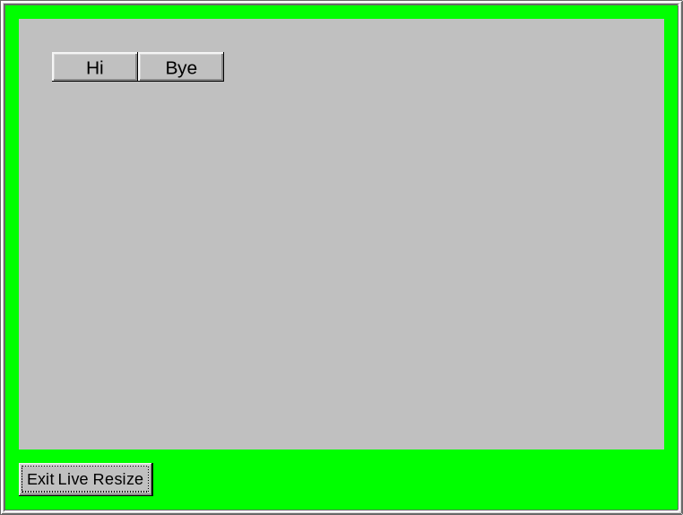
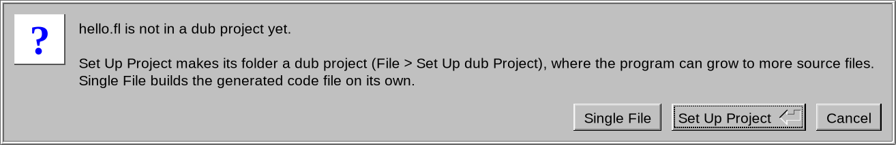
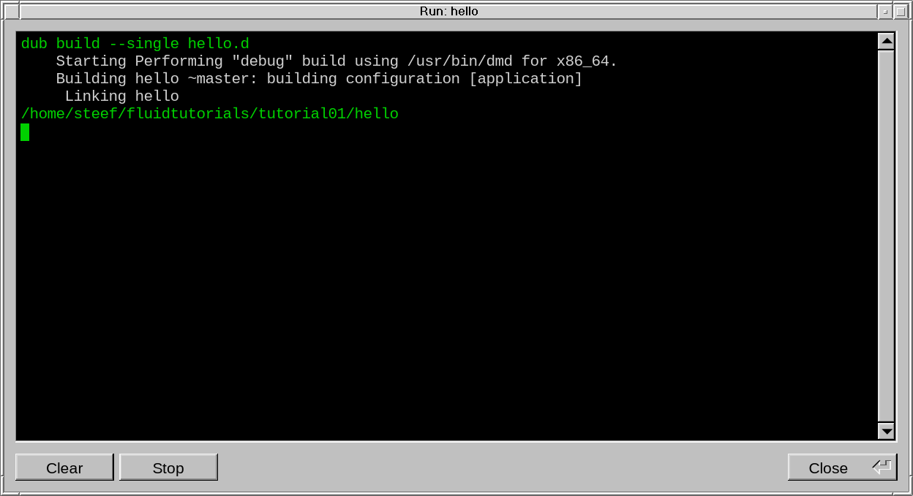
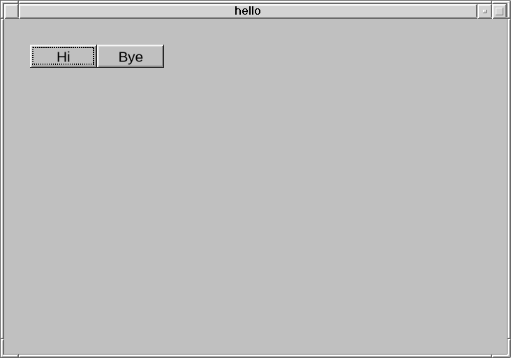
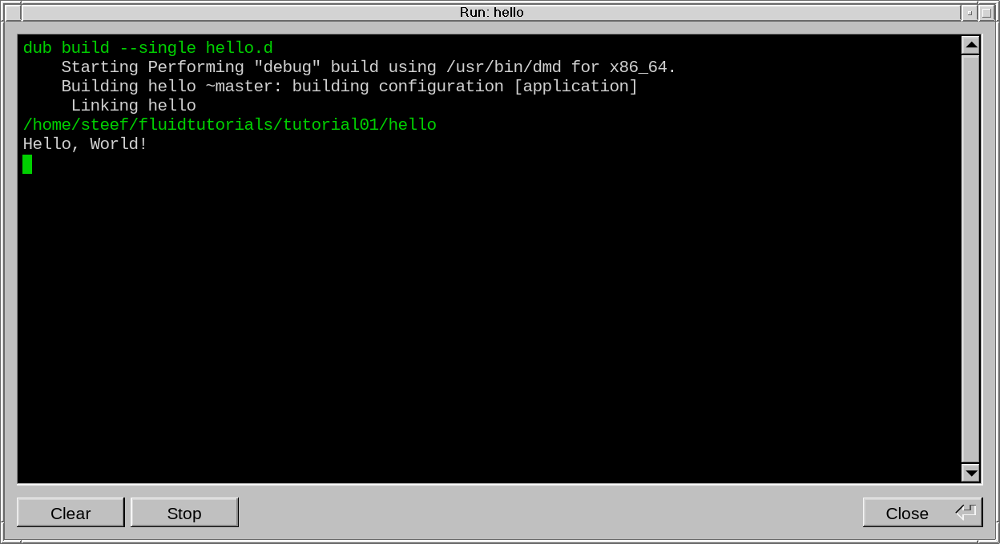
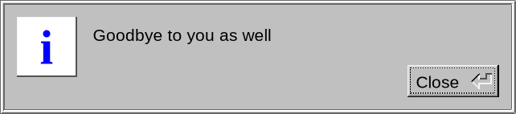

# Tutorial 1: a first Fluid program

[All tutorials](TUTORIALS.md)

This tutorial makes a first program: a window with two buttons that
perform callback functions when they are clicked. You design it in Fluid,
and Fluid builds and starts it when you press F5.

In this tutorial the fldtk folder is assumed to be `~/fldtk`; use your own path
everywhere it appears.

## 1. Preparing fldtk and Fluid

If you haven't done so already, once, in your fldtk folder, build Fluid (and
the fldtk library if needed):

    cd ~/fldtk
    rdmd buildfluid.d

This builds the fldtk library and Fluid (`~/fldtk/fluid`, or
`fluid.exe` on Windows). You
also need dub, D's build tool, which comes with every D compiler: Fluid
uses it to build your program.

## 2. Starting Fluid

    ~/fldtk/fluid

(Or start it from a file manager or a desktop shortcut: it doesn't
matter which folder it starts in.)

Fluid's main window shows the project as a tree; a new project is
empty:

When Fluid started, it should have started up with the Widget Bin shown below.
You can press Esc to close it. To reopen it,
choose Edit > Show Widget Bin..., or press Alt+B.

The Widget Bin has a button for every kind of item you can add to a design:

## 3. Creating a window

Click  (Window, the
first button under Groups) in the Widget Bin. A window has to belong to
a function, the code that shows it, and the project has none yet, so
Fluid asks:

Click Create a Function or press Enter. Fluid makes the function and the window in it,
and opens the window in a design window of its own. It is still empty;
the red outline shows that it is selected:

## 4. Adding two buttons

With the window selected, click
 (Button) in the
Widget Bin twice. Each click puts a new button in the window, the
second one to the right of the first. The new one is selected:

The tree shows the hierarchy of the project: the function, `main()`,
holds the window, which holds the two buttons:

`main()` is where every D program starts and is the default function.
For more complicated programs, it can be changed to a different function
name to allow for proper structuring of a larger project.

Double-click the first button, in the design window or in the tree, to
open its properties. On the GUI tab, set the Label to `Hi`. The button
shows its new label at once:

Then, on the D tab, click "callback" and type the code to run when the
button is clicked:

    writeln("Hello, World!");

This will write the famous first line for any programming language in the console
(the Run window, when Fluid runs the program).

Click on the second button in the design window and the properties window
will change to edit the second button: give it the Label
`Bye`. The tree should now show both labels:

Change the callback function for the second button to:

    message("Goodbye to you as well");

This function will open a message dialog when the button is clicked.

## 5. Saving the project

Choose File > Save (Ctrl+S). Since the design has no file name yet, Fluid
asks where to save it. Go to the folder where you want to keep your
tutorials, here `~/fluidtutorials`:

Make a new folder there for this tutorial with the folder button at the
top right of the file chooser, and call it `tutorial01`:

The file chooser goes into the new folder. Type `hello` after the
folder's name (Fluid adds `.fl` itself) and click OK:

Note that the name becomes the name of the D file (`hello.d`) and of the program,
so it has to be a valid D name. Use letters, digits and underscores, and start
with a letter. Spaces, dashes and dots don't work (`my_app` is fine, `my-app` or
`my app` is not). Fluid warns you if an invalid name is used.

## 6. Adjusting the window

Click an empty part of the design window to select the window:

Double-click it to open its properties. Its Label is blank, so the
program will use its own name as the window's title. Position and size
are the window's place on the screen and its size, in pixels:

You can type different numbers in the Width and Height boxes to change the size of the window.
You can use the mouse scroll wheel when hovering over those numerical fields.
Or you can just resize the design window with the mouse to whichever size you want it to have
and the numbers should change accordingly. You can also move the buttons to
a layout of your liking and resize them.

On the bottom left of the properties window, click Live Resize to try the
window out the way the program will show it. It opens as a copy in a green
frame, which you can resize to see how the buttons follow:

Note that the buttons will respond to mouse clicks, but the callback functions
will not be called. This visualization mode is strictly to test the
visual behavior of your Graphical User Interface (GUI).
Click Exit Live Resize or press Esc on the keyboard to close the Live Resize
view.

## 7. Running the program

Two buttons over to the right of Live Resize is Run (F5), which builds and
starts the actual program. You can use the F5 key from any window in Fluid. The
first time you press F5, Fluid asks how to build the program:

Click Single File. (Set Up Project makes a full dub folder structure for a dub
project. That option is demonstrated in [Tutorial 2](TUTORIAL02.md)).

In the background, Fluid writes the program's D code to `hello.d`, then
launches a Run window and builds it with dub. The Run window shows what dub
does (shown in white), and if the program builds correctly,
the next line in green shows that the program is started:

D compiles the project so fast that the program launches almost immediately.
Its window appears with the two buttons; its
title defaults to the name you saved the project under,
since the window has no label of its own:

Click Hi. It prints its line in the Run window:

Click Bye. The program shows the expected message:

Close the program's window to end it; i.e. press Esc, X-out with the mouse, or
click Stop in the Run window.

## 8. Changing it and running it again

Change anything in the design: a label, a callback, the size of the window.
Whenever you press F5 again, Fluid does all the work to update the program
files to launch the update so you can see immediately how your changes affect
your work. If the old version was still running from the last F5, it is
stopped, so there is never more than one instance to avoid any confusion.

If the Run window shows error messages from the compiler instead of
starting the program, check the callbacks: Fluid copies each one into
`hello.d` exactly as typed, so it has to be correct D, exactly as above.
Correct it in Fluid and press F5 again. (Edit > Show Code View shows the
D code Fluid writes, with the part belonging to the selected item
shaded.)

## What is in the folder

    $ ls -l
    -rwxr-xr-x 1 you users 71632 Nov  8 22:37 hello
    -rw-r--r-- 1 you users   597 Nov  8 22:37 hello.d
    -rw-r--r-- 1 you users   515 Nov  8 22:37 hello.fl

- `hello.fl`: the design, made with Fluid
- `hello.d`: the D code, written from `hello.fl` on every F5
- `hello`: the program (`hello.exe` on Windows)

`hello.d` starts with a comment that tells dub how to build it:

    /+ dub.sdl:
    dependency "fldtk" path="/home/you/fldtk"
    subConfiguration "fldtk" "program"
    +/
    import fl;
    ...

It says that the program needs fldtk, found in your fldtk folder, and
how to use it. The folder is written as a full path (on Windows, for
instance, `C:/Users/you/fldtk`), so `tutorial01` can be moved anywhere.
Fluid adds it because of the Single File choice, which it keeps in the
design (Edit > Settings..., Project tab, "Dub single-file-package
header").

On Linux, the program uses `~/fldtk/libfldtk.so`, the fldtk library,
from where it is: it runs from any folder, as long as the fldtk folder
stays in place. Started from a terminal,
the program should launch and when clicking the `Hi` button,
it prints its output there:

    $ ./hello
    Hello, World!

## Rebuilding and launching a project manually

To build and run an application directly from a Fluid project file, the
following commands can be used (the same as what Fluid does when hitting F5).
Assuming you are in the project folder:

    $ ~/fldtk/fluid -c hello.fl
    fluid: hello.fl -> hello.d
    $ dub build --single hello.d
        Starting Performing "debug" build using /usr/bin/dmd for x86_64.
        Building hello ~master: building configuration [application]
         Linking hello
    $ ./hello

`--single` tells dub to build one file that carries its own dub
comment, instead of a project; `dub run --single hello.d` builds it and
starts it in one go.

## Summary

This concludes the first fldtk/Fluid tutorial. You have learned how to set up a
new project, how to create a window, buttons, make basic design changes to your
GUI, test and launch the application and create a program binary. Feel free to
play with all the GUI options for the buttons to explore how to change fonts,
font sizes, colors etc. to familiarize yourself with the vast array of options
the fldtk library offers to build customized GUIs.
