# Tutorial 1: a first Fluid program

[All tutorials](TUTORIALS.md)

This tutorial makes the smallest program there is: a window with a
button that prints "Hello, World!" when it is clicked. It is designed in
Fluid and built inside the fldtk folder, without a project of its own,
in either of two ways: with dub, or with the Makefile in the fldtk
folder. [Tutorial 2](TUTORIAL02.md) makes a similar program in a project folder of
its own, the usual way for a real program.

In this tutorial the fldtk folder is `~/fldtk`; use your own path
everywhere it appears. Every command is typed in that folder.

## 1. Prepare fldtk

    cd ~/fldtk
    rdmd buildfluid.d

This builds Fluid (`~/fldtk/fluid`, or `fluid.exe` on Windows).

## 2. Design the window in Fluid

Start Fluid:

    ./fluid

Fluid's main window shows the project as a tree; a new project is
empty:

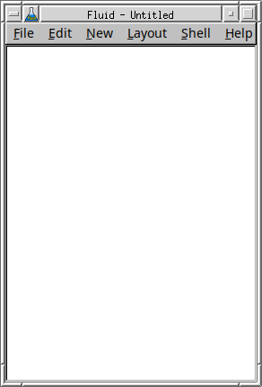

Items are added with the New menu, or with the Widget Bin (Edit > Show
Widget Bin...), which has a button for each of them, grouped the same
way:

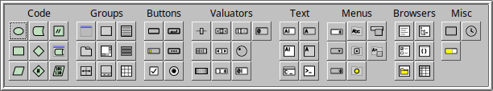

1. **The function.** Choose New > Code > Function, or click
    in the Widget
   Bin. Fluid adds a function to the tree:

   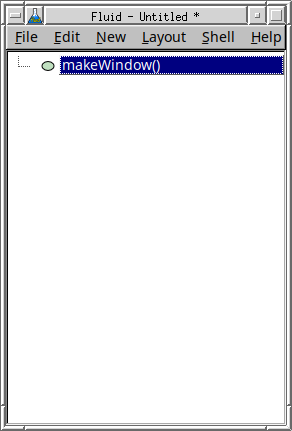

   and opens its properties. The field "Function Name and Args:" says
   `makeWindow()`:

   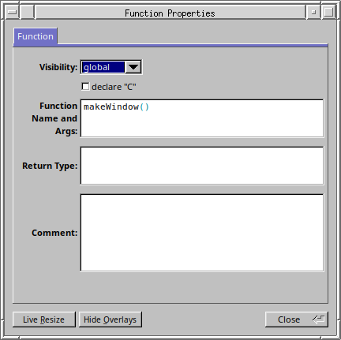

   Clear it: a blank name makes this function the program's `main()`.

   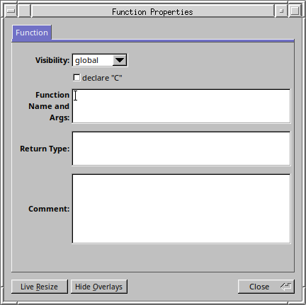

   Click Close. The tree now shows `main()`:

   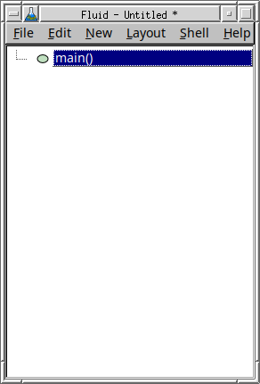

   (Double-click any item in the tree to open its properties again.)
2. **The window.** With `main()` selected, choose New > Group > Window,
   or click  in the
   Widget Bin. An empty window appears; the red outline shows it is
   selected:

   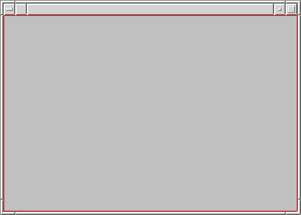

   Its properties open as well; click Close.
3. **The button.** With the window selected, choose New > Buttons >
   Button, or click 
   in the Widget Bin. A button labelled "Button" appears in the window's
   top left corner:

   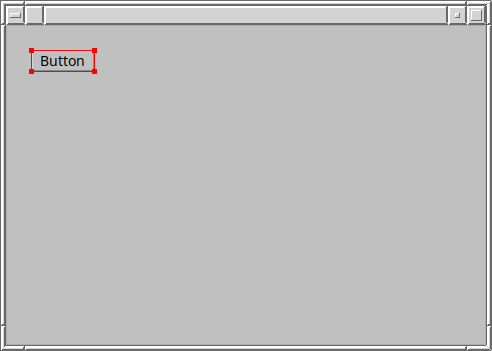

   The tree shows the window and the button inside `main()`:

   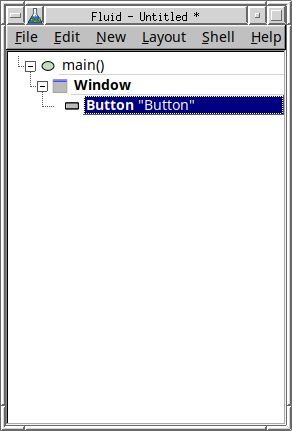

   The button's properties open as well. On the D tab, click "callback"
   and type the code to run when the button is clicked:

       writeln("Hello, World!");

   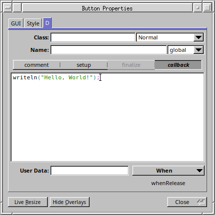

   Click Close.
4. **The dub header.** Choose Edit > Settings..., open the Project tab,
   and tick "Dub single-file-package header". Leave "Code File:" empty:
   the code then goes to `hello.d`, next to `hello.fl`. Close the
   settings window. (The header is needed for building with dub, in
   step 3; the Makefile doesn't use it.)

   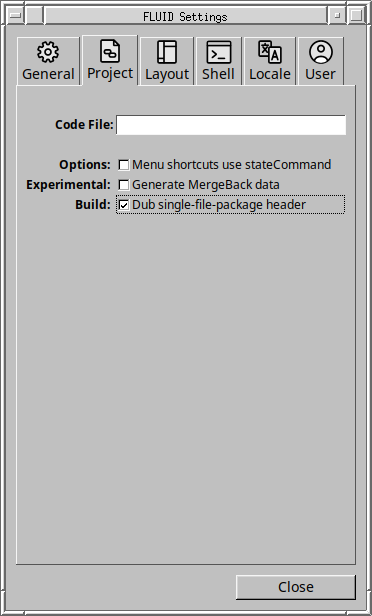

5. **Save.** Choose File > Save and save the design as `hello.fl` in the
   fldtk folder (`~/fldtk/hello.fl`). Typing `hello` is enough: Fluid
   adds `.fl` itself.

   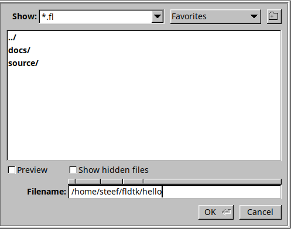

To see the D code Fluid makes from the design, choose Edit > Show Code
View. Refresh updates it after a change; with Auto-Refresh ticked, it
follows your changes by itself.

## 3. Build and run

Build it in either of two ways. Both work from the same `hello.fl`.

### With dub

dub builds from the D file, so write it first: in Fluid, choose File >
Write Code, or type `./fluid -c hello.fl`. Either writes `hello.d`. Its first lines are the dub header:

    /+ dub.sdl:
    dependency "fldtk" path="."
    subConfiguration "fldtk" "program"
    +/
    import fl;
    ...

It tells dub that the program needs fldtk, found in the same folder
(`.`), and how to use it. Then:

    dub run --single hello.d

`--single` tells dub to build one file that carries its own dub header,
instead of a project. dub builds the fldtk library first if it is out
of date, then the program, `hello` (`hello.exe` on Windows), and starts
it. `dub build --single hello.d` only builds it; start it with
`./hello`.

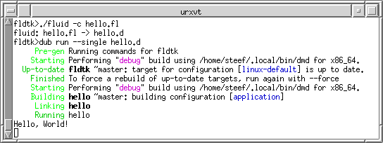

After a change in Fluid, write `hello.d` again before building: dub
doesn't run Fluid itself.

### With make

The Makefile in the fldtk folder builds any program from its `.d` file,
and writes the `.d` file from the `.fl` file first when the `.fl` file
is newer:

    make hello
    ./hello

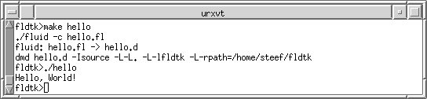

So after a change in Fluid, saving is enough: `make hello` runs Fluid
for you. It needs GNU make, which most Linux systems have; on Windows,
use it from a Cygwin shell. The comment at the top of `Makefile` says
what it does.

### If it doesn't build

If the output looks very different from the pictures above, with
error messages from the compiler, check the button's callback first.
Fluid copies it into `hello.d` exactly as typed, so it has to be
correct D, exactly as in the button step above:
`writeln("Hello, World!");`. Correct it in Fluid, not in `hello.d`,
and build again (for dub, write `hello.d` again first).

### The result

The program shows its window with the button. Its title is the
program's name, since the window has no label of its own:

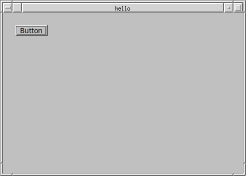

Each click on the button prints "Hello, World!" in the terminal the
program was started from, as in the two terminal pictures above. Close
the window to end the program.

The folder now holds, besides fldtk itself:

    hello.fl     the design, made with Fluid
    hello.d      the D code, written from hello.fl
    hello        the program (hello.exe on Windows)

On Linux, the program uses `~/fldtk/libfldtk.so`, the fldtk library,
from where it is: it runs from any folder, as long as the fldtk folder
stays in place.
