# Tutorial 2: a Fluid program as a dub project

[All tutorials](TUTORIALS.md)

This tutorial makes a small program with a window and a button, designed
in Fluid and built with dub. It assumes no earlier experience with dub.

## What dub is

dub is D's build tool and package manager, installed with every D
compiler. A dub project is a folder that holds:

- `dub.sdl` (or `dub.json`, the same thing in another notation): the
  project's name, what it depends on, and any extra build steps;
- `source/`: the program's `.d` files.

`dub build` compiles everything under `source/`, together with every
package the project depends on, into one program. `dub run` builds it
and starts it. dub only rebuilds what has changed.

In this tutorial the project depends on fldtk. dub keeps the fldtk
library in your fldtk folder up to date and passes everything a program
needs to use it: import paths, version flags and the libraries to link.
Your own `dub.sdl` stays short.

## 1. Prepare fldtk

Once, in your fldtk checkout (in this tutorial `~/fldtk`; use your own
path everywhere it appears):

    cd ~/fldtk
    rdmd buildfluid.d

This builds Fluid (`~/fldtk/fluid`, or `fluid.exe` on Windows). The
library itself is built by dub in step 4, so there is nothing else to
do here.

## 2. Create the project

This tutorial creates the project in your home folder, but any folder
of your choosing works the same way:

    cd ~
    dub init -n -f sdl hello
    cd hello

`dub init` makes the folder `hello` with a `dub.sdl`, a `.gitignore`
and a placeholder `source/app.d`. `-n` skips its questions (name,
author, licence, ...), and `-f sdl` picks the `dub.sdl` notation, which
is the one this tutorial uses. Run `dub init hello` without them to
answer the questions yourself.

The `dub.sdl` it made only names the project. Replace it with the
complete one for this tutorial, `docs/tutorial02/dub.sdl` in the fldtk
folder:

    cp ~/fldtk/docs/tutorial02/dub.sdl dub.sdl

It reads:

    // The dub.sdl of docs/TUTORIAL02.md's project. Copy it into the project
    // folder as dub.sdl. The fldtk dependency's path is relative to the
    // project folder: ../fldtk is a fldtk folder next to it. Change it if
    // your fldtk folder is somewhere else.
    name "hello"
    description "A minimal D application."
    authors "you"
    license "proprietary"
    targetType "executable"
    dependency "fldtk" path="../fldtk"
    preGenerateCommands "\"$FLDTK_PACKAGE_DIR/fluid\" -c \"$PACKAGE_DIR/hello.fl\"" platform="linux"
    preGenerateCommands "\"$FLDTK_PACKAGE_DIR\\fluid.exe\" -c \"$PACKAGE_DIR\\hello.fl\"" platform="windows"
    subConfiguration "fldtk" "program"

Lines starting with `//` are comments, which dub ignores. The four
lines after them are the ones `dub init` wrote: the project's name, a
description, the author and the licence; change them as you like. In a
project with another name, change `hello` in the `name` line and in
the `hello.fl` of the two `preGenerateCommands` lines.

The other lines, one by one:

- `targetType "executable"`: the project is a program. Without this,
  dub decides by looking for `source/app.d`, and calls the project a
  library when that file isn't there yet (see the next point).
- `dependency "fldtk" path="../fldtk"`: where your fldtk folder is,
  relative to the project folder. `../fldtk` is a folder `fldtk` next
  to the project folder: with the project in your home folder, that is
  `~/fldtk`, so nothing needs changing. If your fldtk folder is
  somewhere else, open `dub.sdl` in an editor and give its path here,
  relative or in full, like `path="/opt/fldtk"`; on Windows, with
  forward slashes, like `path="C:/fldtk"`. (dub doesn't understand `~`
  in this path.)
- `preGenerateCommands`: a command dub runs before every build. Here it
  is `fluid -c hello.fl`, which writes the D code for the design, so
  the program always matches the `.fl` file. `$FLDTK_PACKAGE_DIR` is dub's
  name for the fldtk folder and `$PACKAGE_DIR` for your project folder.
  The `\"` are quotes inside the quoted command, so folder names with
  spaces work. `platform=` picks the line for the system you build on.
- `subConfiguration "fldtk" "program"`: how the program uses fldtk. A
  dub package can be built in several ways, called configurations;
  `program` is the one fldtk has for programs that use it. It builds
  the library in the fldtk folder when it is out of date, and links your
  program to it there. On Linux, the library is a shared library,
  `~/fldtk/libfldtk.so`: every program built this way uses that one
  file, so rebuilding fldtk updates all of them, and the program finds
  it there when it runs. On Windows, the library, `fldtk.lib`, is
  linked into the program itself.

## 3. Design the window in Fluid

Start Fluid from the project folder:

    ~/fldtk/fluid

Fluid's main window shows the project as a tree; a new project is
empty:

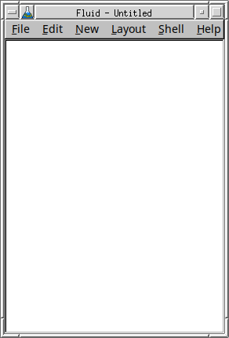

Items are added with the New menu, or with the Widget Bin (Edit > Show
Widget Bin...), which has a button for each of them, grouped the same
way:

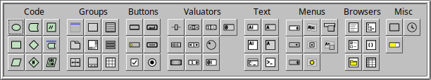

1. **The function.** Choose New > Code > Function, or click
    in the Widget Bin. Fluid adds a function
   to the tree and opens its properties. The field "Function
   Name and Args:" says `makeWindow()`:

   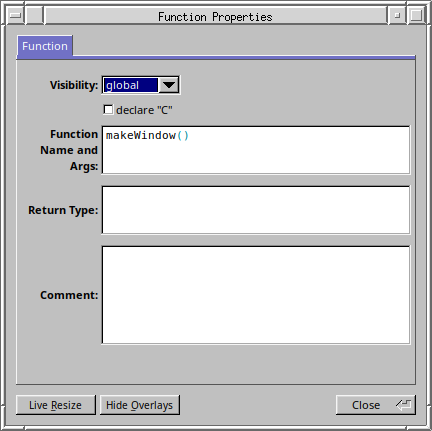

   Clear it: a blank name makes this function the program's `main()`.

   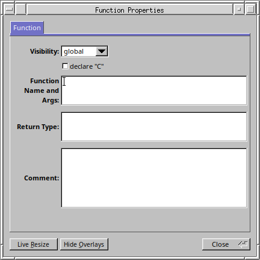

   Click Close. The tree now shows `main()`:

   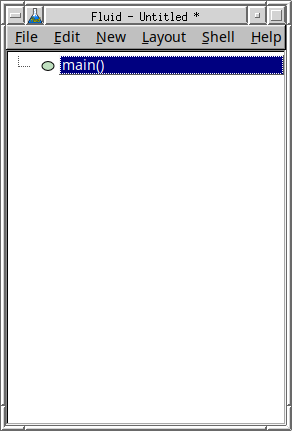

   (Double-click any item in the tree to open its properties again.)
2. **The window.** With `main()` selected, choose New > Group > Window,
   or click  in the Widget Bin.
   An empty window appears, without a title yet; the red outline shows
   it is selected:

   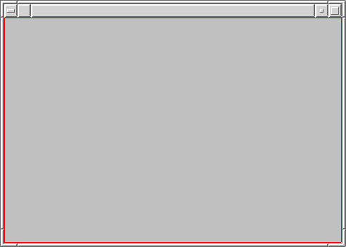

   Its properties open as well. On the GUI tab, type `Hello` as its
   Label:

   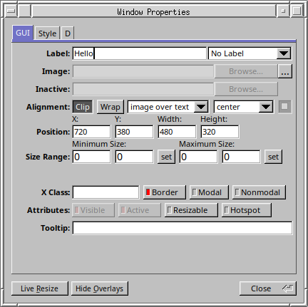

   The label is the window's title, and the window shows it at once:

   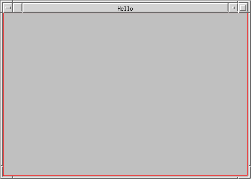

3. **The button.** With the window selected, choose New > Buttons >
   Button, or click  in the Widget Bin. It
   appears in the window's top left corner:

   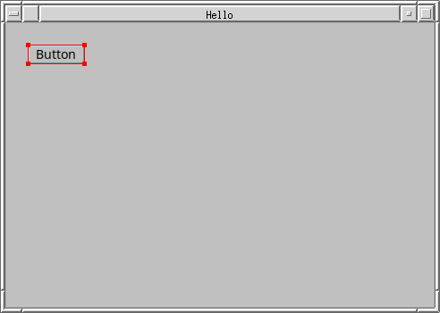

   Drag it where you want it, and resize it from its edges or corners.
   In its properties, on the GUI tab, set the Label to `Say hello`:

   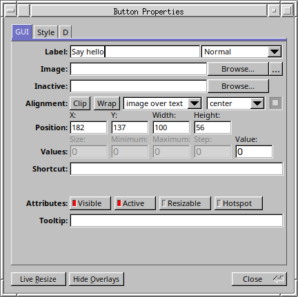

   The button shows its new label at once:

   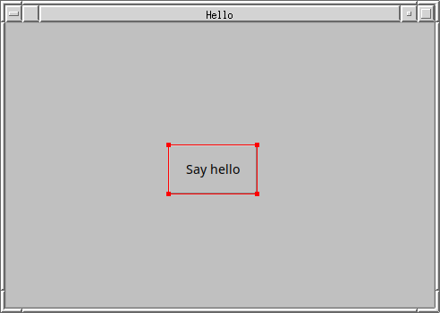

   Then, on the D tab, click "callback" and type the code to run when
   the button is clicked:

       message("Hello, world!");

   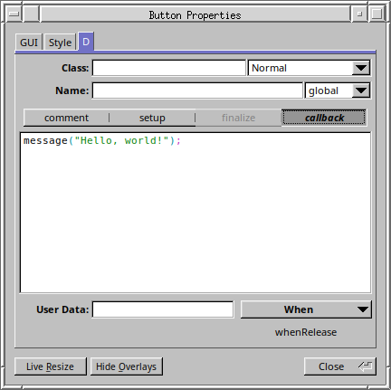

   Click Close.
4. **Where the code goes.** Choose Edit > Settings..., open the Project
   tab, and type `source/app.d` in "Code File:". From now on, Fluid
   writes this design's D code to `source/app.d`, replacing the
   placeholder `dub init` made. Close the settings window.

   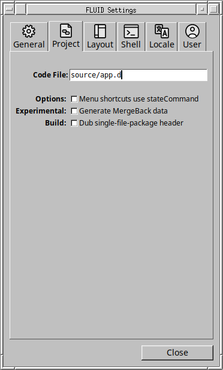

5. **Save.** Choose File > Save and save the design as `hello.fl` in the
   project folder (`~/hello/hello.fl`).

   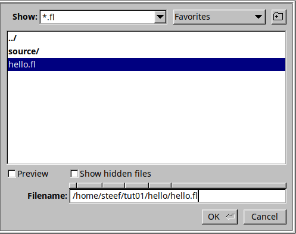

To see the D code Fluid makes from the design, choose Edit > Show Code
View. It shows the code that will go into `source/app.d`, with the
part belonging to the selected item shaded. Refresh updates it after a
change; with Auto-Refresh ticked, it follows your changes by itself:

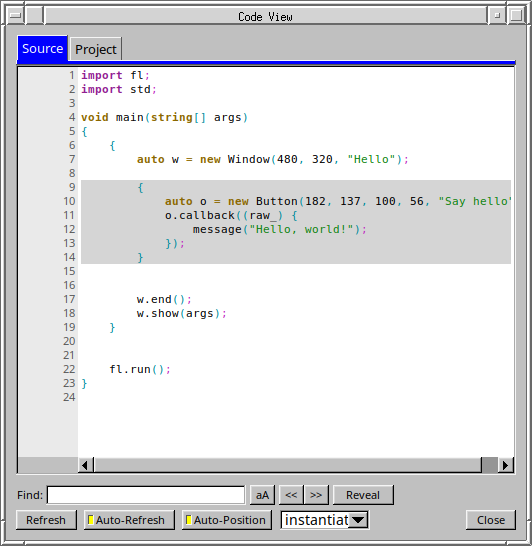

You can leave Fluid open while you build. File > Write Code writes
`source/app.d` from Fluid itself, but the build does that anyway.

## 4. Build and run

In the project folder:

    dub build
    ./hello

or both in one go:

    dub run

dub first checks the fldtk library and builds it if it is out of date
(the first time, that takes a minute; here it was already up to date).
Then it runs Fluid to write `source/app.d`, and builds the program;
`dub run` then starts it:

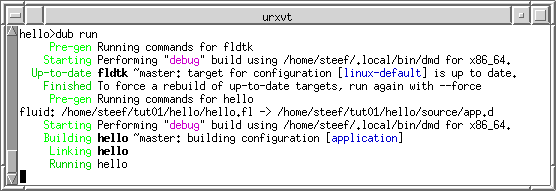

The program shows its window:

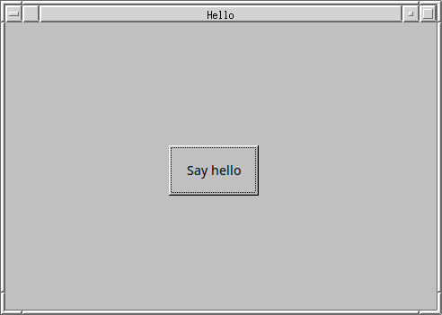

Click the button and a message box says hello:

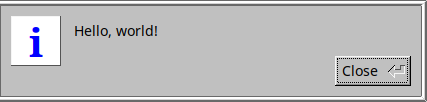

After this, the cycle is: change the design in Fluid, save, and run
`dub run` again.

The folder now holds:

    hello/
      dub.sdl          the project
      hello.fl         the design, made with Fluid
      source/app.d     generated from hello.fl on every build
      hello            the program (hello.exe on Windows)

On Linux, the program needs `~/fldtk/libfldtk.so` where it is: it
runs from anywhere on your computer, as long as the fldtk folder stays
in place.

## 5. Adding your own code

`source/app.d` is written again on every build, so changes made to it
by hand are lost. Put code in one of these places instead:

- in Fluid: a callback, as above, or a Code, Function or Declaration
  node (New > Code > ...);
- in your own `.d` files in `source/`. dub compiles every `.d` file
  there. Fluid can import a module of yours with a Declaration node
  (New > Code > Declaration) holding, for instance, `import mycode;`.

## Variations

- **Other builds of the library.** `program` uses the default fldtk
  library: with Cairo and Pango on Linux, without them on Windows. For
  another one, name its configuration instead of `program`:
  `linux-no-cairo` (Linux without Cairo and Pango) or `windows-cairo`
  (Windows with them; the Cairo and Pango libraries must be built
  first). See `BUILDING.md` for both. dub then builds the library for
  the project and, on Linux, puts a copy of `libfldtk.so` in the project
  folder; add this line so the program finds it there:

      lflags "-rpath=$$ORIGIN" platform="linux"

  (`$$` is how you write a plain `$` in `dub.sdl`.)
- **A single file, no project.** For a quick program in one `.d` file,
  dub's single-file mode needs no `dub.sdl`: see "The dub
  single-file-package header" in `BUILDING.md`.
