# Tutorial 3: buttons, shortcuts and a group, on Windows

[All tutorials](TUTORIALS.md)

> Note: the Command Prompt figure still shows the code going to
> `source\app.d`.

This tutorial makes a window with four buttons, each with a keyboard
shortcut of its own, groups them into one bar, and turns them into
radio buttons, of which only one can be down at a time. It then keeps
the choice in a variable and shows it in a dialog, asks the buttons
themselves which one is down, then their group, and finally names the
choices in an enum, so the program can decide what to do for each. It is done on Windows; on Linux
the steps are the same. It assumes you have done [Tutorial 1](TUTORIAL01.md) and
[Tutorial 2](TUTORIAL02.md), so it says less about the basics of Fluid.

## 1. Opening a Command Prompt

Click Start, type `cmd` and press Enter. The commands in this tutorial
are typed in the Command Prompt window that opens. The project goes in
`%USERPROFILE%\fluidtutorials\tutorial03` (for instance
`C:\Users\you\fluidtutorials\tutorial03`).

## 2. Starting Fluid

```
dub run fldtk:fluid
```

Fluid opens with an empty design. The project folder doesn't exist
yet: Fluid asks for it the first time you press F5, in step 6.

## 3. Creating the window and the first button

1. **The function.** Choose New > Code > Function, or click
    in the Widget
   Bin. Its "Function Name and Args:" is blank, so it is `main()`;
   click Close.
2. **The window.** With `main()` selected, choose New > Group > Window,
   or click . In its
   properties, on the GUI tab, set the Label to `Four Buttons`, and
   click Close. The window's size does not matter; drag its edge or
   corner to make it larger or smaller whenever you like.
3. **The first button.** With the window selected, choose New > Buttons
   > Button, or click .
   In its properties, on the GUI tab:
   - set the Label to `Button &1`. An `&` in a label underlines the
     character after it: the button shows "Button 1" with the 1
     underlined, a hint at its shortcut;
   - click the Shortcut field, then press the 1 key. The field shows
     `1`: pressing 1 while the program runs is the same as clicking the
     button.

   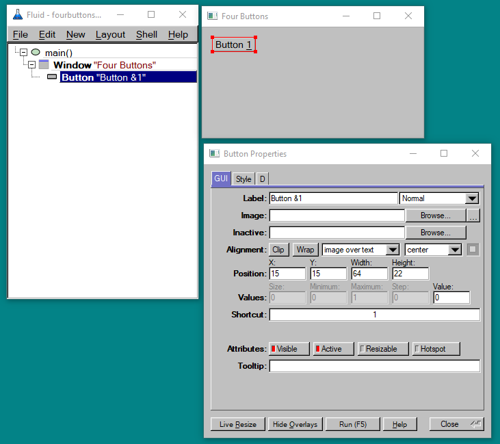

   Click Close. Where the button sits does not matter: drag it to place
   it as you like.

## 4. Making four buttons

1. **A copy.** With the first button selected, press Ctrl first and
   keep it held, then press the mouse button on the button and drag it
   down. The order matters: pressing Ctrl only after the mouse button
   moves the original instead of copying it. Done in this order, the
   original stays where it is and a copy follows the mouse; the tree now
   shows two buttons. Drag until the copy
   snaps into place just below the original, with its top edge touching
   the original's bottom edge: no gap between them and no overlap. While
   you drag, guide lines show where it will snap. Keep the copy straight
   below the original, at the same left edge. The buttons have to touch
   like this for step 7, where they are joined into one bar.

   The copy has the same label and shortcut as the original, so change
   them in its properties: Label `Button &2`, Shortcut 2. (Double-click
   a button, in the window or in the tree, to open its properties.)
2. **Two more.** Do the same twice more, each time Ctrl-dragging the
   newest button until its copy snaps against the bottom of that one:
   the third gets `Button &3` and 3, the fourth `Button &4` and 4. If
   the window is too small for the fourth button, make it taller first.

   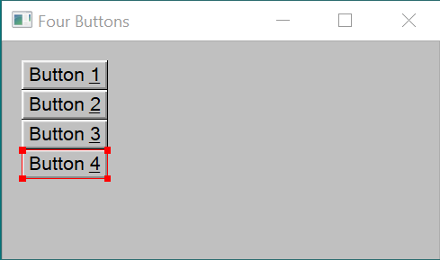

The usual ways of copying work too: Edit > Copy (Ctrl+C) and Edit >
Paste (Ctrl+V), or Edit > Duplicate (Ctrl+U), which copies the selection
in one step. Both place the copy exactly on top of the original, so the
window seems unchanged until you drag the copy away. Until then the tree
shows two buttons, and in the window the button is hatched:

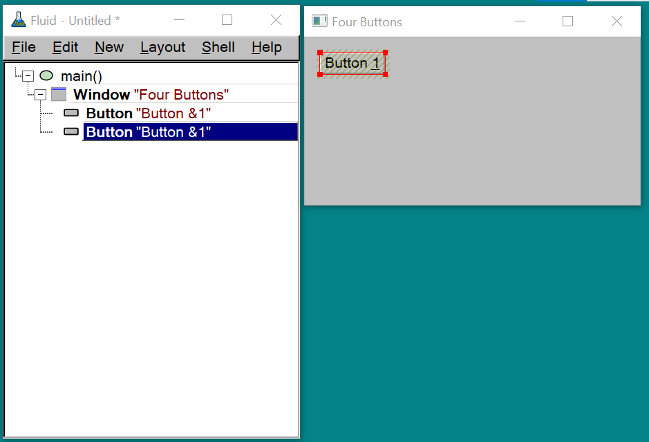

Fluid hatches every part of a widget that overlaps another widget, since
widgets on top of each other are almost always a mistake: the one on top
hides the other, and takes its clicks. Here is what that looks like for
widgets that partly overlap:

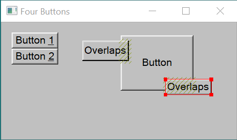

There is also a quicker way to make the stack, with a feature added
after this tutorial was first written. Turn on New > Place New Widgets
Below:

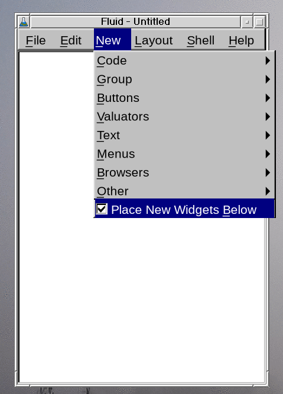

With this on, a widget made while another one is selected goes right
below it, instead of to its right. Place the first button anywhere,
keep it selected, and click
 (Button) in the
Widget Bin three times: each new button lands just below the one made
before it, touching it, the same as the four stacked above. (If the
window is too small for four, the next one starts a new column beside
them instead; make the window taller first.) New buttons get the label
`Button` and no shortcut, so give each its label and shortcut as in
step 3. Fluid remembers the setting, so turn it off again for designs
in which new widgets should go to the right.

## 5. Adding callbacks

A button does nothing when clicked until it has a callback: D code that
runs on each click. Open the first button's properties, and on the D
tab click "callback" and type:

```D
writeln("Button 1 pushed");
```

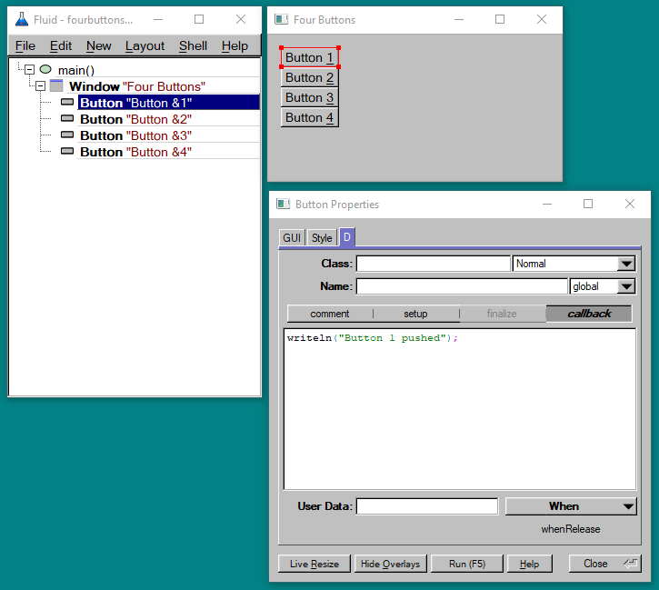

Give the other three their own: `writeln("Button 2 pushed");`,
`writeln("Button 3 pushed");` and `writeln("Button 4 pushed");`.

To try the design without building anything, click Live Resize at the
bottom of a properties window. Fluid opens a copy of the window, "Fluid
Live Resize", in which the buttons can be clicked and the window can be
resized. Callbacks do not run there: it shows how the window looks and
behaves, not what the program does. Click Exit Live Resize to close it.

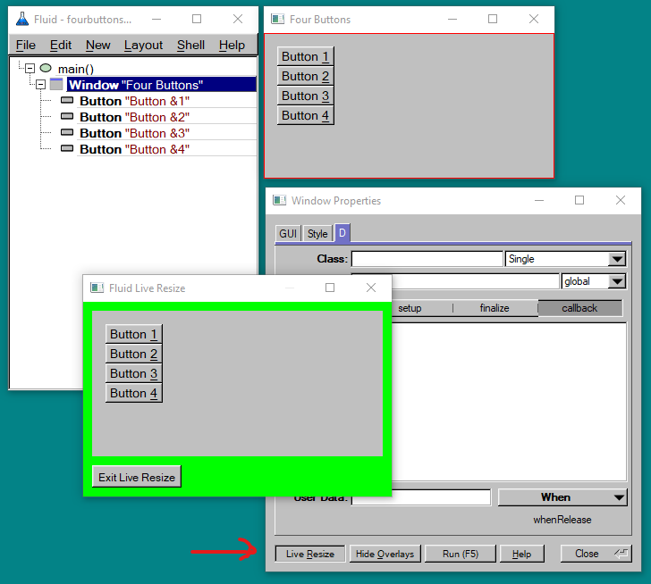

## 6. Saving and running

To quickly run the actual compiled program, press F5 in any of the
Fluid windows. Building on Windows works the same as on Linux, as
shown in Tutorials 1 and 2.
For this tutorial, a single file project is sufficient, but either
option will work.

The design has no file name yet, so Fluid first asks where to save
it. Go to the folder where you keep your tutorials, here `%USERPROFILE%\fluidtutorials`, make a new folder
`tutorial03` with the folder button at the top right, and save the
design in it as `fourbuttons`. Typing `fourbuttons` is enough: Fluid
adds `.fl` itself.

Then Fluid asks how to build the program. Click Single File, as in
Tutorial 1, and Fluid writes the design's code to `fourbuttons.d`,
next to `fourbuttons.fl`. Or click Set Up Project, as in Tutorial 2,
and Fluid makes the folder `tutorial03` a dub project, with the
design's code in `source\fourbuttons.d`; click Close when it has said
what it did. Either way, Fluid builds the program, with dub's output
in the Run window, and starts it. The window appears:

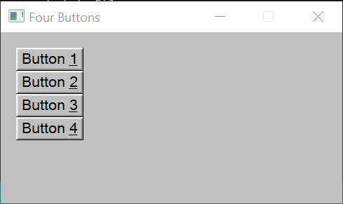

Click the buttons, and press 1 to 4: each prints a line in the Run
window.

If the Run window shows error messages from the compiler instead,
check the callbacks: Fluid copies each one into the D code exactly as
typed, so each has to be correct D, exactly as above. Correct them in
Fluid and press F5 again.

From now on, F5 saves the design, builds the program and starts it
without asking. To build in the Command Prompt instead, see
[Building in the Command Prompt](#building-in-the-command-prompt) at
the end of this tutorial.

The finished design is the same as [`fourbuttons_1.fl`](tutorial03/fourbuttons_1.fl) in fldtk's
`docs/tutorial03` folder (apart from the Code File, if you chose
Single File). When you read this tutorial in Fluid (Help > fldtk
README..., then the tutorials), clicking the file's name opens the
design in Fluid; [Where fldtk and the tutorials
are](TUTORIALS.md#where-fldtk-and-the-tutorials-are) explains where the
folder is.

## 7. Grouping the buttons

The four buttons are separate widgets, each with its own border. Put
into a group and made compact, they become one bar.

1. **Select the four buttons.** Click the first one in the tree, then
   Shift-click the fourth.
2. **Group them.** Choose Edit > Group (F7). Fluid puts the four buttons
   in a new group, sized to fit around them, inside the window. The tree
   shows it as a Group holding the four buttons.
3. **Make them compact.** Select the four buttons again, open their
   properties (Edit > Properties..., F1), and on the Style tab turn on
   Compact. The change applies to all four at once. A compact button
   draws the border of the whole group it is in, but shows only its own
   part of it, with a short line where it meets the next button, so the
   four together look like one bar with a single border around it.

   This only works when the buttons are inside a group that fits
   tightly around them, as the group from Edit > Group does. Compact
   buttons placed directly in the window draw the border of the whole
   window instead: its edges are far away from the buttons, so the
   buttons lose their outer border altogether, and only the short lines
   between them remain.

   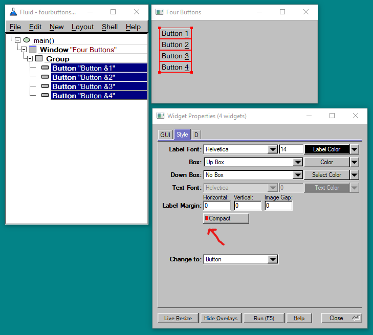

   Live Resize shows the bar:

   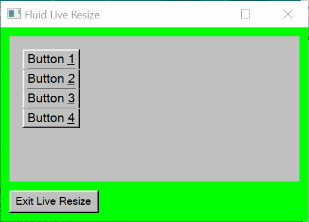

The buttons work as before; only their look changed.

## 8. Making radio buttons

A plain button springs back up when you let go of it. A radio button
stays down, and only one radio button in a group can be down at a
time: pressing one releases the one that was down before, like the
station buttons of an old car radio.

Which buttons belong together is decided by the group they are in:
pressing a radio button releases only the radio buttons in the same
group, its siblings in the tree. So all the buttons of one set of
choices have to be inside the same group. Here the group from step 7
already holds the four buttons. A radio button outside it, for
instance directly in the window, would not release them, nor be
released by them. The same rule lets a window have several independent
sets of choices: give each set a group of its own.

1. **Select the four buttons** in the tree, as in step 7.
2. **Make them radio buttons.** Open their properties (F1), and on the
   D tab, in the Class row, set the choice next to the class name to
   `Radio`. As with Compact, the change applies to all four at once.

   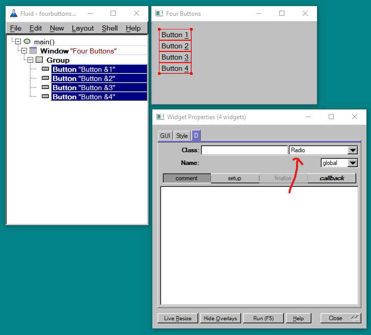

   In Live Resize, the button you click stays down, and the one that
   was down comes back up:

   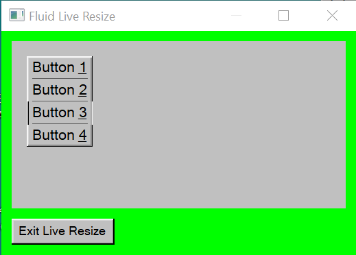

3. **One button down at the start.** When the program starts, no button
   is down yet. To start with the first one down, select it alone, and
   on the GUI tab set Value to `1`. A button's value is 1 when it is
   down and 0 when it is up.

   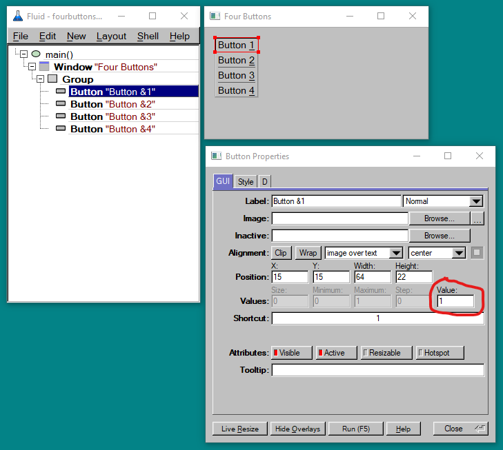

4. Press F5 again. Click the buttons, or press 1 to 4:
   the button you choose stays down and the one that was down comes
   back up. Each still prints a line, as before.

## 9. Remembering the choice

A program usually needs to know which option is chosen, not just print
it at the moment of the click. This step keeps the chosen option in a
variable, and adds a button that shows it in a dialog.

1. **A variable for the choice.** Select the window, open its
   properties, and on the D tab click "setup". Type:

   ```D
   //the scope has to be higher than the buttons
   int selected;
   ```

   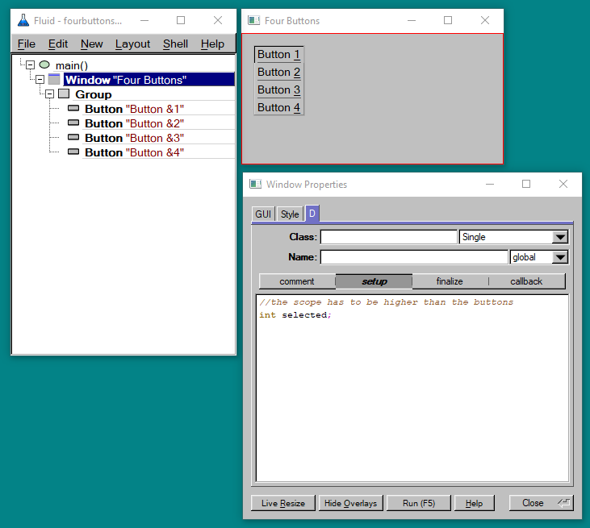

   A window's setup code runs right after the window is made, before
   the widgets inside it. A variable declared there can be used in the
   callbacks of every widget inside the window, because Fluid writes
   their code after it, in the same block. In a button's own setup, it
   would be visible only to that button.
2. **Store the choice.** Add a line to each button's callback that
   stores its number: `selected = 1;` for the first button,
   `selected = 2;` for the second, and so on. The first button's
   callback becomes:

   ```D
   selected = 1;
   writeln("Button 1 pushed");
   ```

3. **A button that shows the choice.** Select the window and add a
   Return Button (New > Buttons > Return Button) outside the group, to
   the right of it, with Label `Check`. With the window selected, the
   new button lands near the window's top-left corner, on top of the
   group, so drag it to the right of the group. A return button is pressed by
   the Enter key as well as by a click. Its callback:

   ```D
   message(format("Button %s is selected", selected));
   ```

   `message()` shows a small dialog with a text and a Close button. It
   takes one piece of text, so `format()` puts the number into it: each
   `%s` in the first argument is replaced by the next argument. Without
   a `%s` for `selected`, the program stops with a `FormatException`
   ("Orphan format arguments") when the button is pressed.

   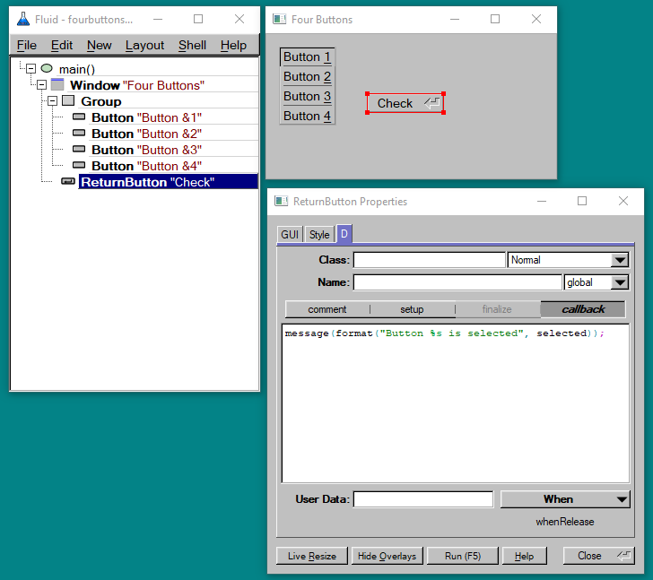

   Edit > Show Code View (Alt+C) shows where `selected` ends up in the
   generated code: right after the window is made, before the group and
   the buttons whose callbacks use it.

   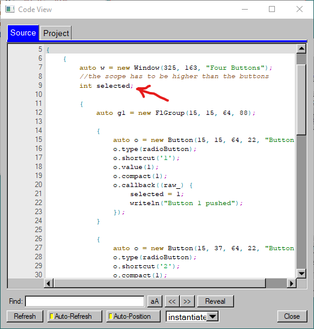

4. Press F5 again.

Choose a button, then press Enter or click Check:

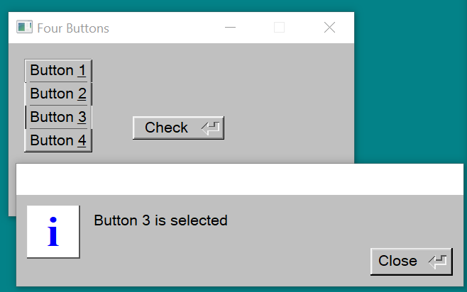

The finished design is the same as [`fourbuttons_2.fl`](tutorial03/fourbuttons_2.fl) in fldtk's
`docs/tutorial03` folder (apart from the Code File, if you chose
Single File).

## 10. Asking the buttons themselves

Run the program and press Check right away, before clicking any
button. Button 1 is down, as set in step 8, yet the dialog says
"Button 0 is selected".
`selected` only knows what the buttons' callbacks told it, and Button 1
was put down by its Value setting, not by a click, so no callback ran.
A D `int` starts at 0. The buttons always know their own state, so this
step asks them instead, and the variable is no longer needed.

1. **Name the buttons.** So far, each button has had the automatic
   variable name `o` by default: as
   [Tutorial 2](TUTORIAL02.md) showed, Fluid makes each button in a
   block of its own, in a variable called `o`, which only that button's
   own code can use. But in this tutorial, the Check button's callback
   has to reach the four buttons, so each needs a name of its own.
   Select each button in turn, and on the D tab, in the Name row, type
   `b1`, `b2`, `b3` and `b4`. A named widget becomes a variable in the
   generated code, which any callback can use.

   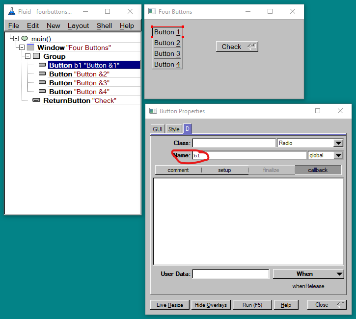

2. **Remove what is no longer needed.** Clear the window's setup code,
   and the four buttons' callbacks.
3. **Ask them.** Change the Check button's callback to:

   ```D
   long selected;
   foreach (i, b; [b1, b2, b3, b4])
     if (b.value())
       selected = i + 1;

   message(format("Button %s is selected", selected));
   ```

   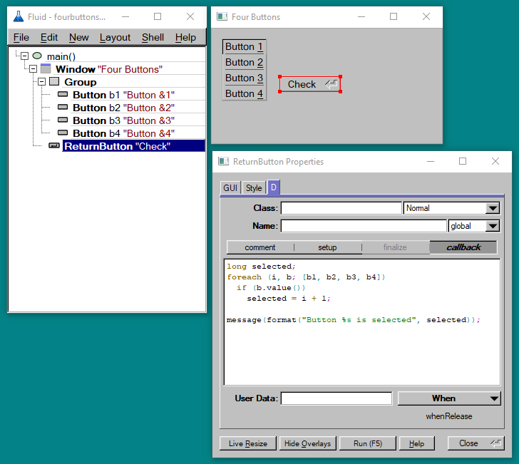

   `[b1, b2, b3, b4]` is a list of the four buttons. `foreach` takes
   them one at a time: `b` is the button, and `i` its place in the list,
   counting from 0. `b.value()` is true when the button is down, and
   `i + 1` turns places 0 to 3 into buttons 1 to 4. `i` is a large
   number type, which fits in a `long` but not in an `int`; that is why
   `selected` is a `long` here. The same, without the list, would be:

   ```D
   long selected;
   if (b1.value()) selected = 1;
   if (b2.value()) selected = 2;
   if (b3.value()) selected = 3;
   if (b4.value()) selected = 4;
   ```

   The Code View shows the four named buttons as variables at the top
   of the generated code, outside `main()`:

   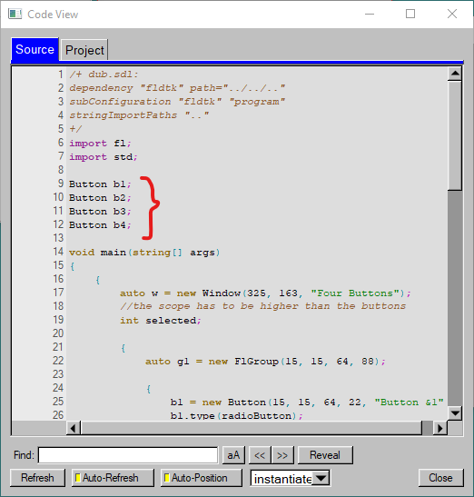

   Declared there, at the level of the module, the names can be used by
   every callback in the file, whichever block it is in. The buttons
   themselves are still made inside `main()`, each in its own block,
   with `b1 = new Button(...)` where an unnamed one has
   `auto o = new Button(...)`. The choice next to the Name sets whether
   other modules can use them too: with global, the default, any module
   that imports this one can use `b1`. A function in such a module, like
   the ones in Tutorial 2's `actions.d`, then doesn't need the button
   passed to it as `o`: it can read the button's state directly with
   `b1.value()`. With local, Fluid writes
   `private Button b1;`, so other modules cannot see it. That keeps the
   window's widgets shielded from the rest of the program.

4. Press F5 again.

Press Check right away: the dialog now says Button 1, the one that is
down. Choose another button and press Check again: it names that one.

The finished design is the same as [`fourbuttons_3.fl`](tutorial03/fourbuttons_3.fl) in fldtk's
`docs/tutorial03` folder (apart from the Code File, if you chose
Single File).

## 11. Asking the group

Step 10 needed a name for every button and a loop to go through them.
As of fldtk v1.1.3, the group that holds the buttons can answer the
question in two different ways.

Only the group needs a name and you can optionally remove the names for the
buttons themselves.

1. **Name the group.** Select the group in the tree, and on the D tab,
   in the Name row, type `buttons`.

   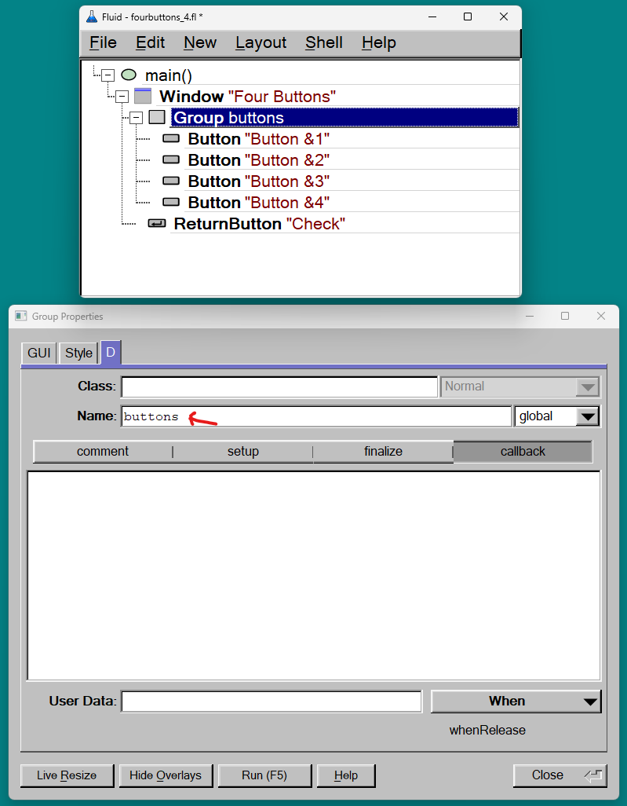

2. **(OPTIONAL) Remove what is no longer needed.** Select each button in turn and
   clear its Name, `b1` to `b4`. The buttons go back to being `o`,
   each in its own block.

   The Code View (Alt+C) now shows `FlGroup buttons;` at the top of the
   file: the group is the only named widget, a variable at the level of
   the module, as the buttons were in step 10.

   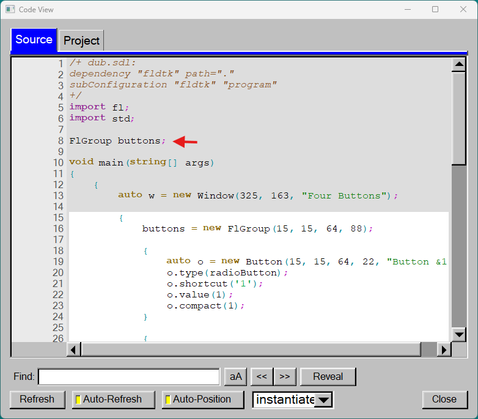

The first way is to use the group's `widgets` function. It returns the
widgets in the group as an array, and an array can be used in a foreach loop.
So, you can replace the manually entered array `[b1, b2, b3, b4]` by using that
function as follows:

```D
long selected;
foreach (i, w; buttons.widgets)
  if (auto b = cast(Button) w)
    if (b.value())
      selected = i + 1;

message(format("Button %s is selected", selected));
```

`w` is a widget of any kind, and only a button has a value, so
`cast(Button) w` checks first that it is a button: it gives the button,
or `null` when `w` is some other widget.

However, not all the widgets in the group may be  radio buttons and  an even
more elegant way is to use the `selectedRadioButton` function, which returns
just the selected radio button or `null` if no radio button is selected at all.

3. **Ask the group.** Change the Check button's callback to:

   ```D
   auto b = buttons.selectedRadioButton;
   if (b !is null)
     message(format("%s is selected", b.label.replace("&", "")));
   else
     message("no button is selected");
   ```

   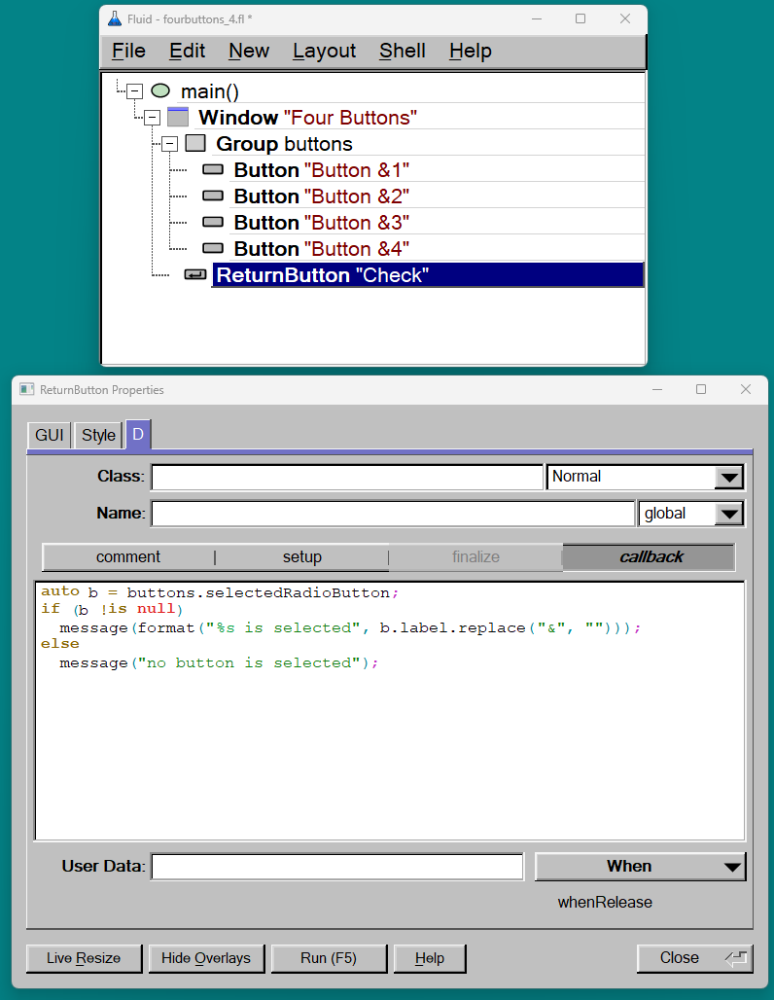

   `buttons.selectedRadioButton` asks the group which of its radio
   buttons is down, and gives that button itself. `b` is the button, so
   any of its properties can be read; here its label, `Button &3`.
   `replace("&", "")` takes out the `&` that marks the shortcut letter.
   The group asks its buttons each time, so the answer is right however
   a button was put down: by a click, by its shortcut, or by its Value
   setting, as Button 1 at the start.

   When no radio button is down, `selectedRadioButton` gives `null`, no
   button at all. A `null` has no label, so `b.label` would stop the
   program with an error. That is why the callback checks first:
   `b !is null` is true when there is a button, and only then is its
   label used; otherwise the dialog says so. Here one button is always
   down, since Button 1 starts down, from its Value in step 8, and
   pressing a radio button puts it down, never up. Checking for `null`
   is still a good habit: without that Value, or after a change to the
   design later on, there may be no button down.

4. Press F5 again.

Choose Button 3 and press Check: the dialog says "Button 3 is selected".
Choose another button and press Check again: it names that one.

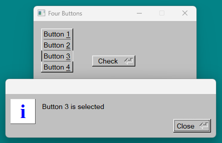

The finished design is the same as [`fourbuttons_4.fl`](tutorial03/fourbuttons_4.fl) in fldtk's
`docs/tutorial03` folder (apart from the Code File, if you chose
Single File).

## 12. Using enums for switch statements

Showing the name of which button is down is rarely what a program needs: the
user already sees it. What the program needs is to do something different for
each choice.
In D this is typically done using switch statements and this can be facilitated
by using an enumerated list that provides a name for each choice. A label is no
good for this: it is text for the user, and changing `Button &3` to `&Third`
should not break the program. fldtk uses the power of the D programming language
to give the choices names in the code: an `enum`.

1. **Name the choices.** Choose Edit > Select None, then New > Code >
   Code, or click
   
   (Code) in the Widget Bin. Replace `writeln("Hello, World!");` with:

   ```D
   enum Pick { button1, button2, button3, button4 }
   ```

   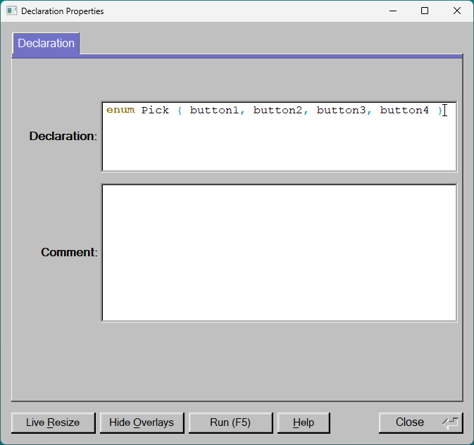

   An `enum` is a type of your own with a fixed list of named values,
   its members: a variable of type `Pick` can only be `Pick.button1`,
   `Pick.button2`, `Pick.button3` or `Pick.button4`. Here each member
   stands for one radio button: the first member for the first radio
   button in the group, the second for the second, and so on.

   In the tree, the Code node sits at the top level, outside `main()`.
   As Tutorial 2 explained, a Code node at the top level is written
   outside every function, so `Pick` can be used by every callback in
   the file.

   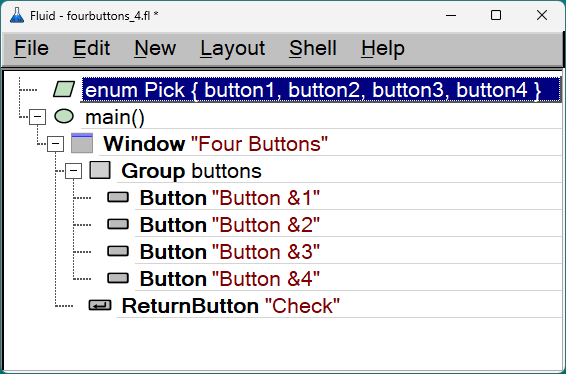

   The Code View shows the `enum` at the top of the file, above
   `FlGroup buttons;`:

   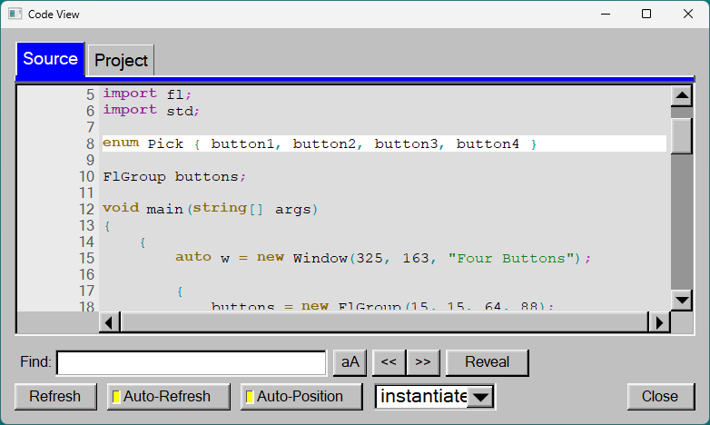

2. **Ask the group for a member.** Change the Check button's callback
   to:

   ```D
   message(format("%s is selected", buttons.selectedRadioButton!Pick));
   ```

   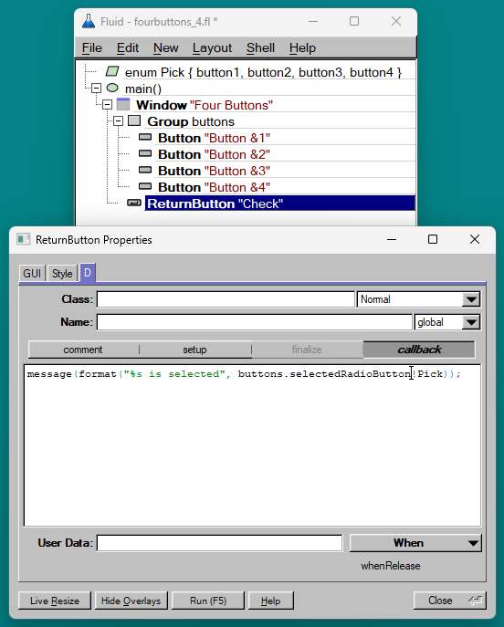

   `buttons.selectedRadioButton!Pick` asks the group the same question
   as in step 11, but answers with the member of `Pick` that stands for
   the button that is down, not with the button itself. The `!` hands
   the type `Pick` to `selectedRadioButton`, so that it knows which list
   of names to answer with.


3. Press F5 again.

Choose Button 3 and press Check: the dialog says "button3 is
selected", the member's name, exactly as it is spelled in the `enum`.

That is a gimmick, but it shows something C and C++ cannot do. There,
an enum's names are gone once the program is compiled, and printing a
member gives only its number, 2 for the third. In D, the program keeps
the names, so what you type in the `enum` is what the choices are
known as in the program. Rename the members, say to
`{ red, green, blue, yellow }`, and the dialog says "blue is selected",
with nothing else to change.

Two things to keep in mind:

- **The order is the tree's, not the window's.** The first member of
  `Pick` stands for the first radio button in the group as the tree
  lists it, wherever that button is in the window. Edit > Earlier (F2)
  and Edit > Later (F3) move a button up or down in the tree, and so
  change which member it stands for. Moving a button in the window does
  not.
- **One member for each radio button.** When the `enum` has more or
  fewer members than the group has radio buttons, pressing Check stops
  the program with an exception that says so, for instance "Pick has 3
  members, but the group has 4 radio buttons".

**How a program uses it.** Where the `enum` pays off is in deciding
what to do. A `final switch` on the group's answer has one `case` for
each member:

```D
final switch (buttons.selectedRadioButton!Pick)
{
    case Pick.button1: writeln("Doing the first thing"); break;
    case Pick.button2: writeln("Doing the second thing"); break;
    case Pick.button3: writeln("Doing the third thing"); break;
    case Pick.button4: writeln("Doing the fourth thing"); break;
}
```

Each `case` names a member, so the code says what it is about, not a
number or a label. `final` makes the compiler check that every member
has its `case`: leave one out and the program does not build. When a
fifth button and a fifth member are added later, the compiler points
at every `final switch` that still has to handle it.

The same works the other way round: `buttons.selectRadioButton(Pick.button3);` in
a callback puts down Button 3 and releases the others, as a click on it
would, but without running its callback.

The finished design is the same as [`fourbuttons_5.fl`](tutorial03/fourbuttons_5.fl) in fldtk's
`docs/tutorial03` folder (apart from the Code File, if you chose
Single File).

## Summary

You have made a window with four buttons and given each a label with
an underlined letter and a keyboard shortcut of its own. You have
copied buttons by Ctrl-dragging them, and made the same stack with
Place New Widgets Below. You have given the buttons callbacks, tried
the design with Live Resize, and built and run the program with F5.
You have grouped the buttons and made them compact, so they look like
one bar, and made them radio buttons, of which only one can be down at
a time. Finally, you have kept the chosen option in a variable declared
in the window's setup code, and then asked the buttons themselves by
giving them names, which makes them variables that every callback in
the file, and, with global, other modules too, can use. Then you have
asked the group itself: `selectedRadioButton` gives the button that is
down, and with it its label. Last, you have named the choices in an
`enum` of your own, asked the group with `selectedRadioButton!Pick` for the member
that stands for the button that is down, and seen how a `final switch`
on those members decides what the program does.

This concludes Tutorial 3. Additional information is provided below.

## Building in the Command Prompt

The program builds without Fluid too. In the Command Prompt, go to the
project folder:

```
cd %USERPROFILE%\fluidtutorials\tutorial03
```

For a single file, write the code from the design, then build and run
it, as in Tutorial 1's [Rebuilding and launching a project
manually](TUTORIAL01.md#rebuilding-and-launching-a-project-manually):

```
dub run fldtk:fluid -- -c fourbuttons.fl
dub run --single fourbuttons.d
```

For a dub project, one command does it all:

```
dub run
```

dub then runs Fluid first, to write `source\fourbuttons.d` from the
design (Tutorial 2's [What dub.sdl
says](TUTORIAL02.md#what-dubsdl-says) explains how), so saving the
design in Fluid is enough before building this way.

Either way, the program's window appears, and the buttons print their
lines in the Command Prompt:

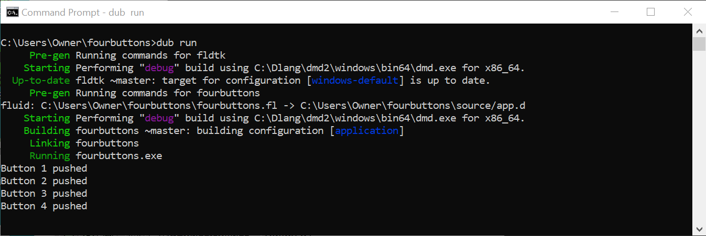
