# Tutorial 3: buttons, shortcuts and a group, on Windows

[All tutorials](TUTORIALS.md)

This tutorial makes a window with four buttons, each with a keyboard
shortcut of its own, groups them into one bar, and turns them into
radio buttons, of which only one can be down at a time. It then keeps
the choice in a variable and shows it in a dialog, and finally asks the
buttons themselves which one is down. It is done on Windows, as a dub
project like the one in [Tutorial 2](TUTORIAL02.md); on Linux the steps
are the same, with the commands of Tutorial 2. It assumes you have done
[Tutorial 1](TUTORIAL01.md), so it says less about the basics of Fluid.

The commands are typed in a Command Prompt window (`cmd`). This
tutorial assumes the fldtk folder is `fldtk` in your user folder
(`%USERPROFILE%\fldtk`, for instance `C:\Users\you\fldtk`), and creates
the project next to it.

## 1. Prepare fldtk

    cd %USERPROFILE%\fldtk
    rdmd buildfluid.d

This builds Fluid, `fluid.exe`.

## 2. Create the project

    cd %USERPROFILE%
    dub init -n -f sdl fourbuttons
    cd fourbuttons
    copy ..\fldtk\docs\tutorial03\dub.sdl dub.sdl

This makes the project folder `fourbuttons` and replaces the `dub.sdl`
that `dub init` wrote with the one for this tutorial. It is the same as
Tutorial 2's, for a project called `fourbuttons`; Tutorial 2 explains
it line by line. Its fldtk path, `../fldtk`, is the fldtk folder next
to the project folder; if yours is somewhere else, change it in
`dub.sdl`.

## 3. The window and the first button

Start Fluid from the project folder:

    ..\fldtk\fluid.exe

1. **The function.** Choose New > Code > Function, or click
    in the Widget
   Bin, clear "Function Name and Args:" so that it becomes `main()`, and
   click Close.
2. **The window.** With `main()` selected, choose New > Group > Window,
   or click . In its
   properties, on the GUI tab, set the Label to `Four Buttons`, and
   click Close. The window's size does not matter; drag its edge or
   corner to make it larger or smaller whenever you like.
3. **The first button.** With the window selected, choose New > Buttons
   > Button, or click .
   In its properties, on the GUI tab:
   - set the Label to `Button &1`. An `&` in a label underlines the
     character after it: the button shows "Button 1" with the 1
     underlined, a hint at its shortcut;
   - click the Shortcut field, then press the 1 key. The field shows
     `1`: pressing 1 while the program runs is the same as clicking the
     button.

   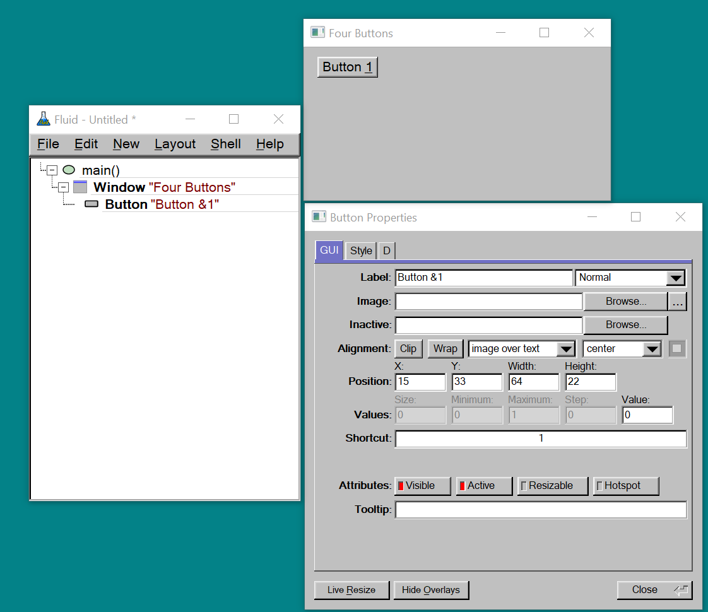

   Click Close. Where the button sits does not matter: drag it to place
   it as you like.

## 4. Four buttons

1. **A copy.** With the first button selected, choose Edit > Duplicate
   (Ctrl+U). The copy is placed exactly on top of the original, so the
   window seems unchanged. The tree shows two buttons, and in the window
   the button is hatched:

   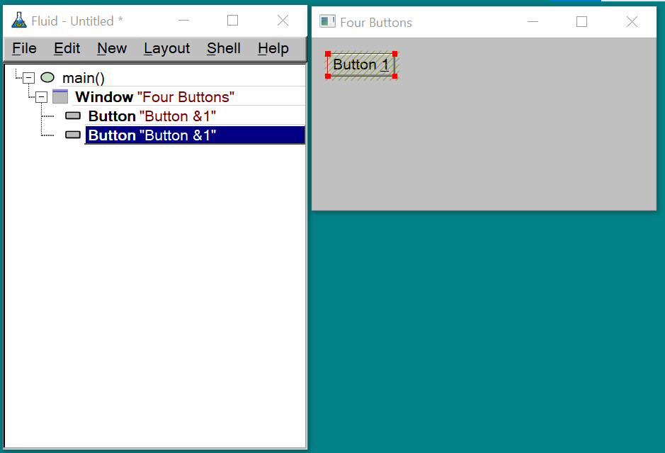

   Fluid hatches every part of a widget that overlaps another widget,
   since widgets on top of each other are almost always a mistake: the
   one on top hides the other, and takes its clicks. Here is what that
   looks like for widgets that partly overlap:

   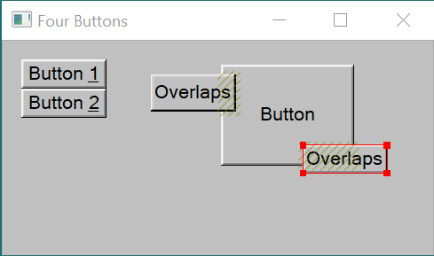

2. **Place the copy.** Drag the copy down with the mouse until it snaps
   into place just below the original, with its top edge touching the
   original's bottom edge: no gap between them and no overlap, so no
   hatching. While you drag, guide lines show where it will snap. Keep
   the copy straight below the original, at the same left edge. The
   buttons have to touch like this for step 7, where they are joined
   into one bar.

   The copy has the same label and shortcut as the original, so change
   them in its properties: Label `Button &2`, Shortcut 2. (Double-click
   a button, in the window or in the tree, to open its properties.)
3. **Two more.** Do the same twice more, each time duplicating the
   newest button and dragging the copy until it snaps against the
   bottom of that one: the third gets `Button &3` and 3, the fourth
   `Button &4` and 4. If the window is too small for the fourth button,
   make it taller first.

   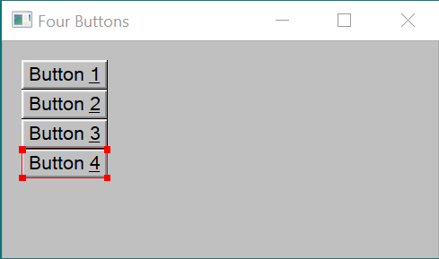

## 5. Callbacks

A button does nothing when clicked until it has a callback: D code that
runs on each click. Open the first button's properties, and on the D
tab click "callback" and type:

    writeln("Button 1 pushed");

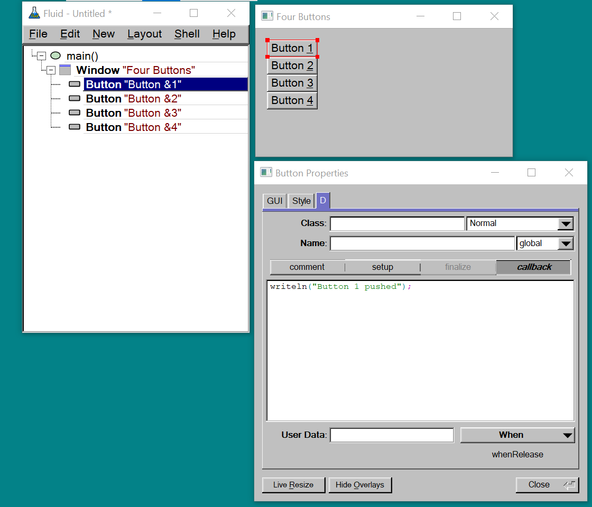

Give the other three their own: `writeln("Button 2 pushed");`,
`writeln("Button 3 pushed");` and `writeln("Button 4 pushed");`.

To try the design without building anything, click Live Resize at the
bottom of a properties window. Fluid opens a copy of the window, "Fluid
Live Resize", in which the buttons can be clicked and the window can be
resized. Callbacks do not run there: it shows how the window looks and
behaves, not what the program does. Click Exit Live Resize to close it.

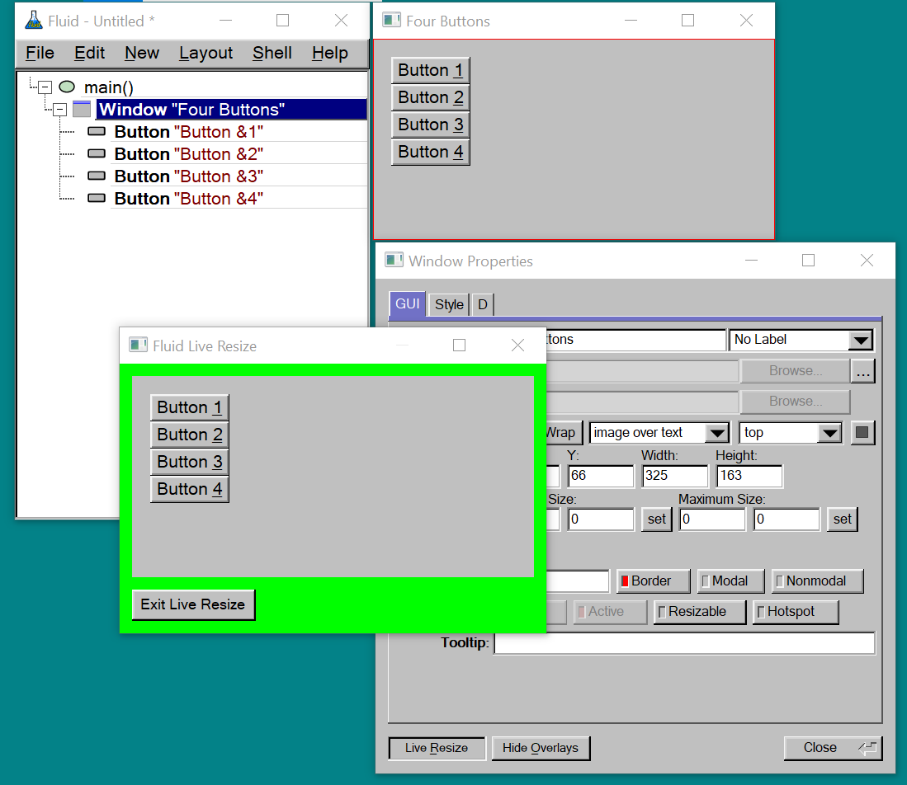

## 6. Save and run

1. **Where the code goes.** Choose Edit > Settings..., open the Project
   tab, and type `source/app.d` in "Code File:". From now on, Fluid
   writes this design's D code to `source/app.d`, replacing the
   placeholder `dub init` made. Close the settings window.
2. **Save.** Choose File > Save and save the design as `fourbuttons.fl`
   in the project folder (`%USERPROFILE%\fourbuttons\fourbuttons.fl`).
   Typing `fourbuttons` is enough: Fluid adds `.fl` itself.
3. **Write the code.** Choose File > Write Code (Ctrl+Shift+C). Fluid
   writes `source/app.d` and says so:

   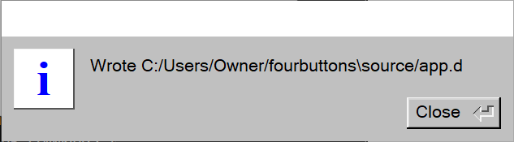

   `dub run` below writes it too, through the `preGenerateCommands` in
   `dub.sdl`, so this step is only needed to look at the code before
   building. (Edit > Show Code View, Alt+C, shows it inside Fluid.)

Then, in the Command Prompt, in the project folder:

    dub run

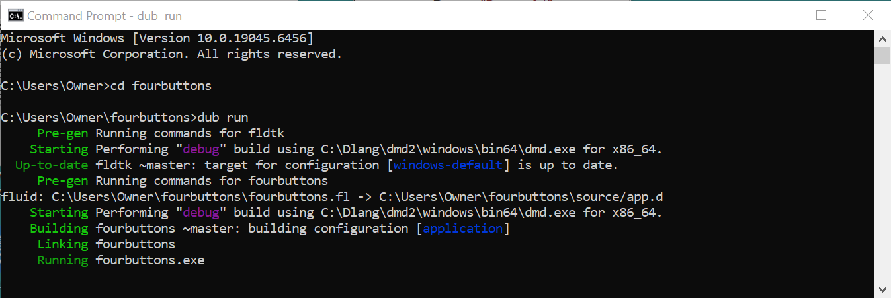

The window appears:

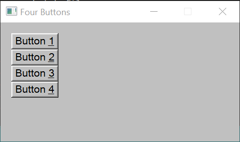

Click the buttons, and press 1 to 4: each prints a line in the Command
Prompt:

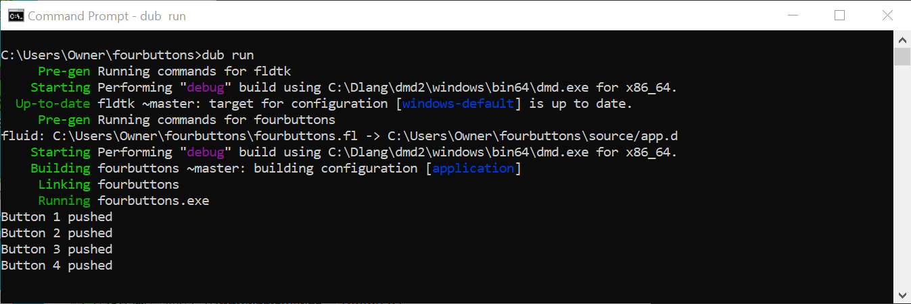

If the output looks very different, with error messages from the
compiler, check the callbacks: Fluid copies each one into
`source/app.d` exactly as typed, so each has to be correct D, exactly
as above. Correct them in Fluid, save, and run `dub run` again.

The finished design is the same as `fourbuttons_1.fl` in fldtk's
`docs/tutorial03` folder.

## 7. A group

The four buttons are separate widgets, each with its own border. Put
into a group and made compact, they become one bar.

1. **Select the four buttons.** Click the first one in the tree, then
   Shift-click the fourth.
2. **Group them.** Choose Edit > Group (F7). Fluid puts the four buttons
   in a new group, sized to fit around them, inside the window. The tree
   shows it as a Group holding the four buttons.
3. **Make them compact.** Select the four buttons again, open their
   properties (Edit > Properties..., F1), and on the Style tab turn on
   Compact. The change applies to all four at once. A compact button
   draws the border of the whole group it is in, but shows only its own
   part of it, with a short line where it meets the next button, so the
   four together look like one bar with a single border around it.

   This only works when the buttons are inside a group that fits
   tightly around them, as the group from Edit > Group does. Compact
   buttons placed directly in the window draw the border of the whole
   window instead: its edges are far away from the buttons, so the
   buttons lose their outer border altogether, and only the short lines
   between them remain.

   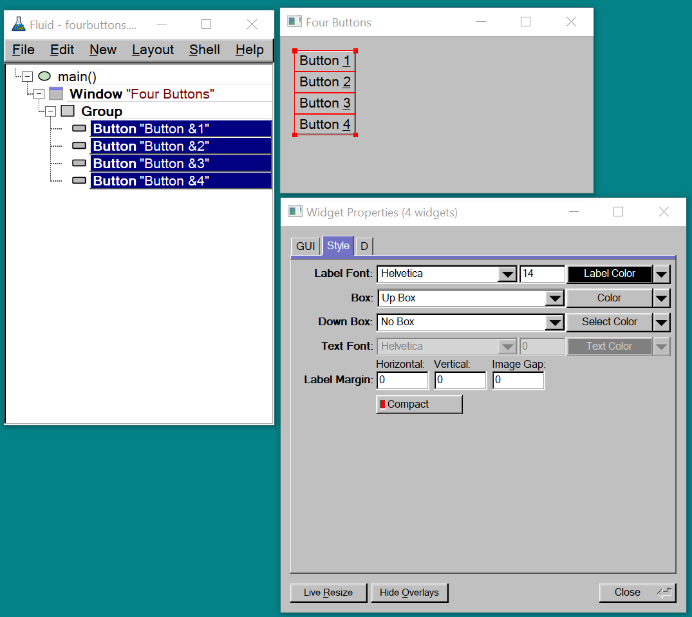

   Live Resize shows the bar:

   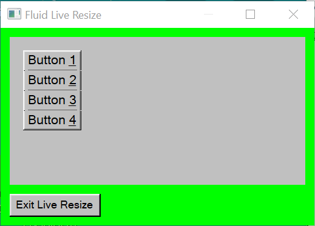

The buttons work as before; only their look changed.

## 8. Radio buttons

A plain button springs back up when you let go of it. A radio button
stays down, and only one radio button in a group can be down at a
time: pressing one releases the one that was down before, like the
station buttons of an old car radio.

Which buttons belong together is decided by the group they are in:
pressing a radio button releases only the radio buttons in the same
group, its siblings in the tree. So all the buttons of one set of
choices have to be inside the same group. Here the group from step 7
already holds the four buttons. A radio button outside it, for
instance directly in the window, would not release them, nor be
released by them. The same rule lets a window have several independent
sets of choices: give each set a group of its own.

1. **Select the four buttons** in the tree, as in step 7.
2. **Make them radio buttons.** Open their properties (F1), and on the
   D tab, in the Class row, set the choice next to the class name to
   `Radio`. As with Compact, the change applies to all four at once.

   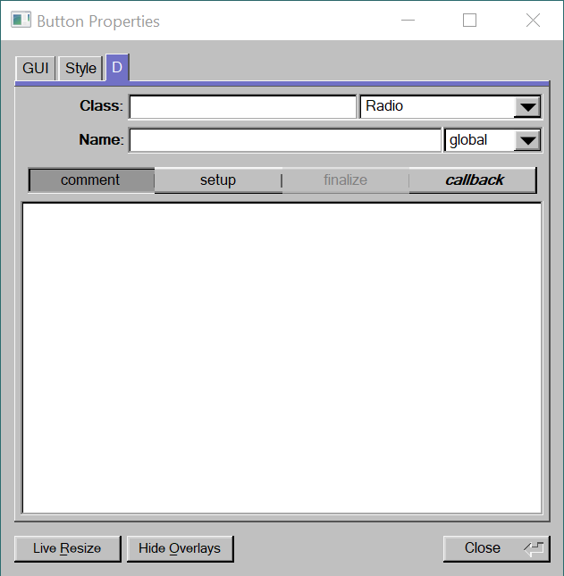

   In Live Resize, the button you click stays down, and the one that
   was down comes back up:

   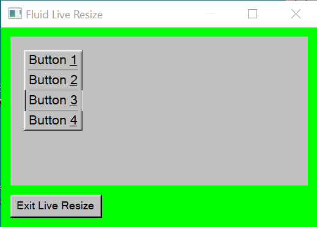

3. **One button down at the start.** When the program starts, no button
   is down yet. To start with the first one down, select it alone, and
   on the GUI tab set Value to `1`. A button's value is 1 when it is
   down and 0 when it is up.

   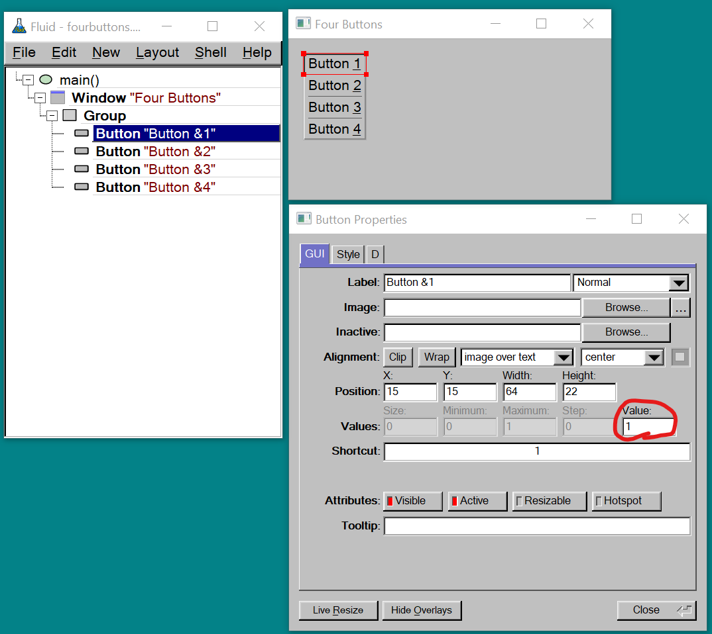

4. Save, and run `dub run` again. Click the buttons, or press 1 to 4:
   the button you choose stays down and the one that was down comes
   back up. Each still prints a line, as before.

## 9. Remembering the choice

A program usually needs to know which option is chosen, not just print
it at the moment of the click. This step keeps the chosen option in a
variable, and adds a button that shows it in a dialog.

1. **A variable for the choice.** Select the window, open its
   properties, and on the D tab click "setup". Type:

       // the scope has to be higher than the buttons
       int selected;

   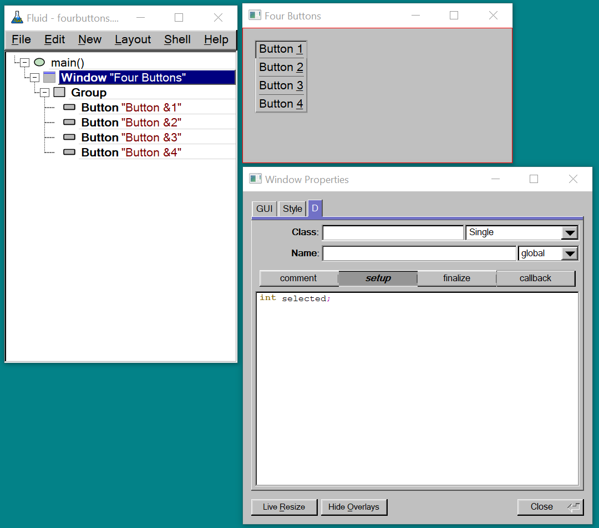

   A window's setup code runs right after the window is made, before
   the widgets inside it. A variable declared there can be used in the
   callbacks of every widget inside the window, because Fluid writes
   their code after it, in the same block. In a button's own setup, it
   would be visible only to that button.
2. **Store the choice.** Add a line to each button's callback that
   stores its number: `selected = 1;` for the first button,
   `selected = 2;` for the second, and so on. The first button's
   callback becomes:

       selected = 1;
       writeln("Button 1 pushed");

3. **A button that shows the choice.** Select the window and add a
   Return Button (New > Buttons > Return Button) outside the group, to
   the right of it, with Label `Check`. A return button is pressed by
   the Enter key as well as by a click. Its callback:

       message(format("Button %s is selected", selected));

   `message()` shows a small dialog with a text and a Close button. It
   takes one piece of text, so `format()` puts the number into it: each
   `%s` in the first argument is replaced by the next argument. Without
   a `%s` for `selected`, the program stops with a `FormatException`
   ("Orphan format arguments") when the button is pressed.

   

   Edit > Show Code View (Alt+C) shows where `selected` ends up in the
   generated code: right after the window is made, before the group and
   the buttons whose callbacks use it.

   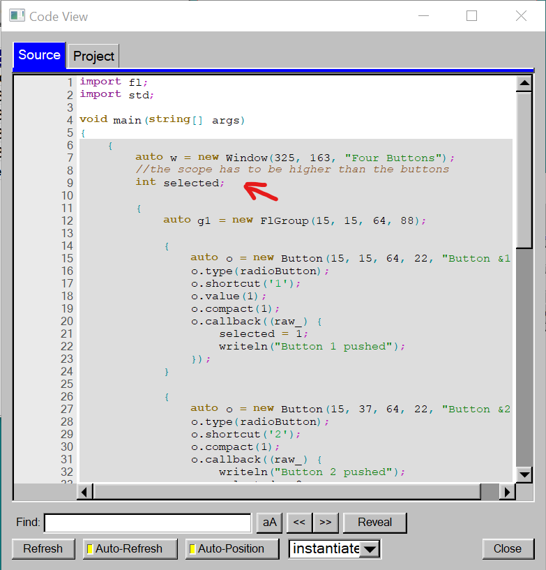

4. Save, and run `dub run` again.

Choose a button, then press Enter or click Check:

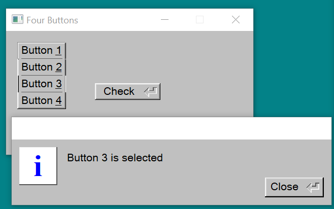

The finished design is the same as `fourbuttons_2.fl` in fldtk's
`docs/tutorial03` folder.

## 10. Asking the buttons themselves

Run the program and press Check right away, before clicking any
button. Button 1 is down, as set in step 8, yet the dialog says
"Button 0 is selected".
`selected` only knows what the buttons' callbacks told it, and Button 1
was put down by its Value setting, not by a click, so no callback ran.
A D `int` starts at 0. The buttons always know their own state, so this
step asks them instead, and the variable is no longer needed.

1. **Name the buttons.** Select each button in turn, and on the D tab,
   in the Name row, type `b1`, `b2`, `b3` and `b4`. A named widget
   becomes a variable in the generated code, which any callback can
   use.

   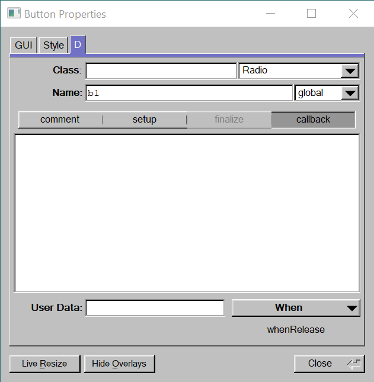

2. **Remove what is no longer needed.** Clear the window's setup code,
   and the four buttons' callbacks.
3. **Ask them.** Change the Check button's callback to:

       long selected;
       foreach (i, b; [b1, b2, b3, b4])
         if (b.value())
           selected = i + 1;

       message(format("Button %s is selected", selected));

   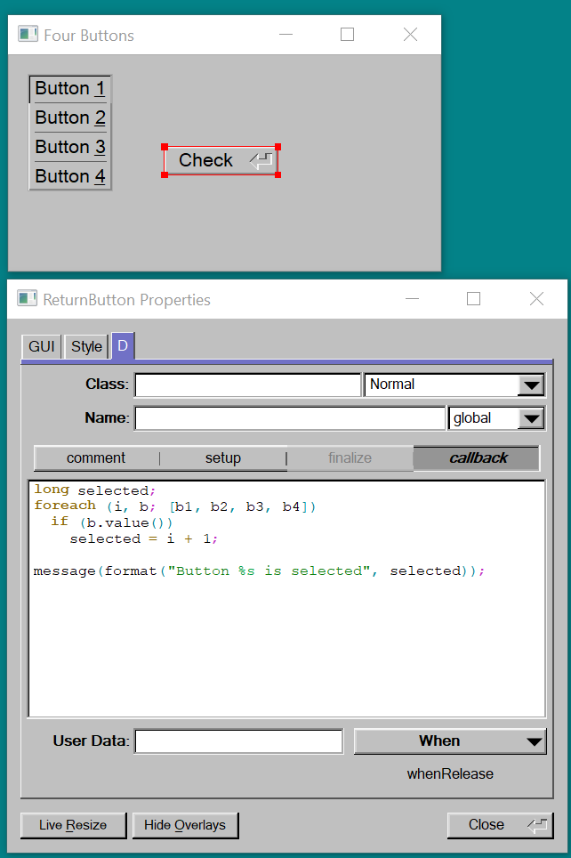

   `[b1, b2, b3, b4]` is a list of the four buttons. `foreach` takes
   them one at a time: `b` is the button, and `i` its place in the list,
   counting from 0. `b.value()` is true when the button is down, and
   `i + 1` turns places 0 to 3 into buttons 1 to 4. `i` is a large
   number type, which fits in a `long` but not in an `int`; that is why
   `selected` is a `long` here. The same, without the list, would be:

       long selected;
       if (b1.value()) selected = 1;
       if (b2.value()) selected = 2;
       if (b3.value()) selected = 3;
       if (b4.value()) selected = 4;

   The Code View shows the four named buttons as variables at the top
   of the generated code, outside `main()`:

   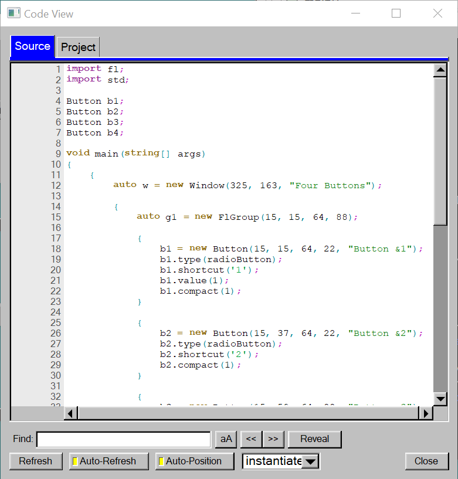

4. Save, and run `dub run` again.

Press Check right away: the dialog now says Button 1, the one that is
down. Choose another button and press Check again: it names that one.

The finished design is the same as `fourbuttons_3.fl` in fldtk's
`docs/tutorial03` folder.
