# Tutorial 4: a bill splitter

[All tutorials](TUTORIALS.md)

This tutorial makes a bill splitter: type in what the meal cost, choose
the number of people and a tip, and the program shows the total with
the tip and what each person pays. Along the way it shows the widgets
made for numbers: a Spinner, a Value Input, a Value Slider and Value
Outputs, which hand your code a number directly, with no conversion
from text. All of them call one function of your own, which does the
calculation. It assumes you have done Tutorials 1 to 3.

The figures were made on Linux under Wayland, with KDE Plasma drawing
the window frames. On X11 or Windows the frames look different; the
steps are the same.

## 1. Creating the window and the title

Start Fluid in your usual way, e.g.:

    ~/fldtk/fluid

Click 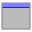 (Window) and
click Create a Function, as in Tutorial 1.

Of course, you have the freedom to make the GUI appear as fancy or as dull
as you want.
To show how to give the window a big title, we will make a box.

With the window selected, click
 (Box, in the Misc group
of the Widget Bin). A box shows a text, here the title of the window.
In its properties, on the GUI tab, set the Label to `Shared bill
calculator`. On the Style tab, set the size next to Label Font to `34`
and Box to Flat Box: a flat box has no border. Drag the box's edges so
it spans the top of the window.

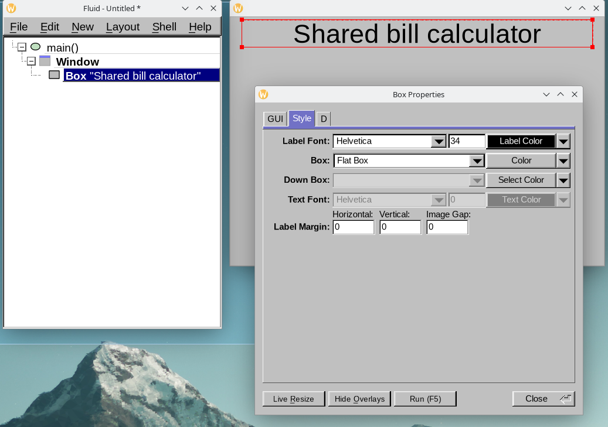

## 2. Adding the fields

Turn on New > Place New Widgets Below (see Tutorial 3), keep the box
selected, and click these in the Widget Bin, one after the other. Each
lands just below the one before it.

-  Input (Text group):
  for the name of the restaurant;
-  Spinner
  (Valuators group): for the number of people;
-  Value
  Input (Valuators): for the bill;
- 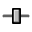 Slider
  (Valuators): for the tip;
-  Value
  Output (Valuators), twice: for the total with the tip, and for the
  share of each person.

Leave some room between the slider and the two outputs by dragging the outputs
down a little. Each new widget has a default label of its own, such as
`spinner:`. Your window should now roughly look like this:

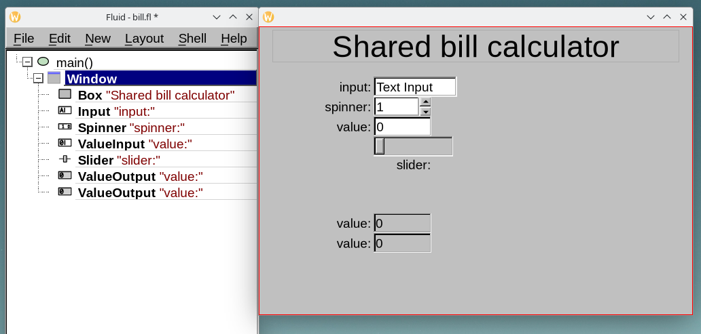

What each one does:

- An **Input** holds text: whatever the user types. Its value is a
  `string`.
- A **Spinner** holds a number, typed in or changed with its two arrow
  buttons. A Value Input holds a number too, typed in. For both, your
  code gets the number as a `double`: no conversion from text, and no
  error to handle when the user types something that is not a number.
- A **Slider** chooses a number by dragging. A Value Slider is a slider
  that also shows its number.
- A **Value Output** shows a number that the program sets. The user can
  read it, but not change it.

Now the labels and the sizes. Click the widgets one by one, either in the window or in the
project tree, and give them these Labels (at the top of the GUI tab):
`Restaurant`, `People`, `Bill total`, `Tip (%)`, `Total + tip` and
`Cost per person`. Make the Restaurant field wider, and the slider too.

The slider should show the tip it is set to.
It would be nicer to see the actual number, so we change the widget
type to a Value Slider, with one of the three ways described in
[Working with the right-click menu](TUTORIAL02.md#working-with-the-right-click-menu)
in Tutorial 2.
For instance, click it in the window to
select it, then right-click it and choose Change To > Value Slider. Its
label sits below it; to line it up with the others, set the choice at
the right end of its Alignment row (GUI tab) to `left`, circled in the
figure of step 3.

## 3. Setting the values

A widget for numbers has a range: the lowest and highest number it
accepts. Select the slider, and on the GUI tab, in the Values row, set
Minimum `15`, Maximum `25`, Step `0.1` and Value `20`: a tip from 15 to
25 percent, in steps of a tenth, starting at 20.

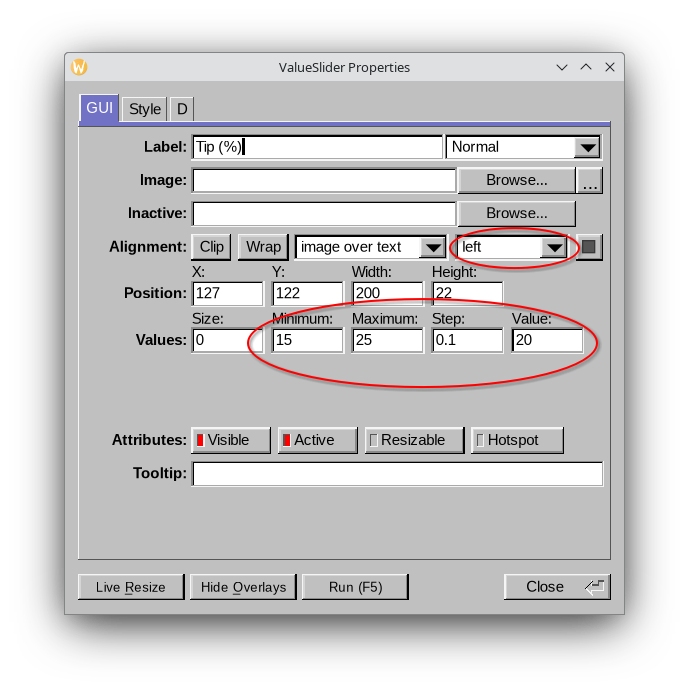

Select the Spinner and set its Value to `2`: a bill is usually shared by
at least two. A Spinner's range is 1 to 100 unless you change it, so
the number of people can't drop below 1.

Your design should now roughly look like this:

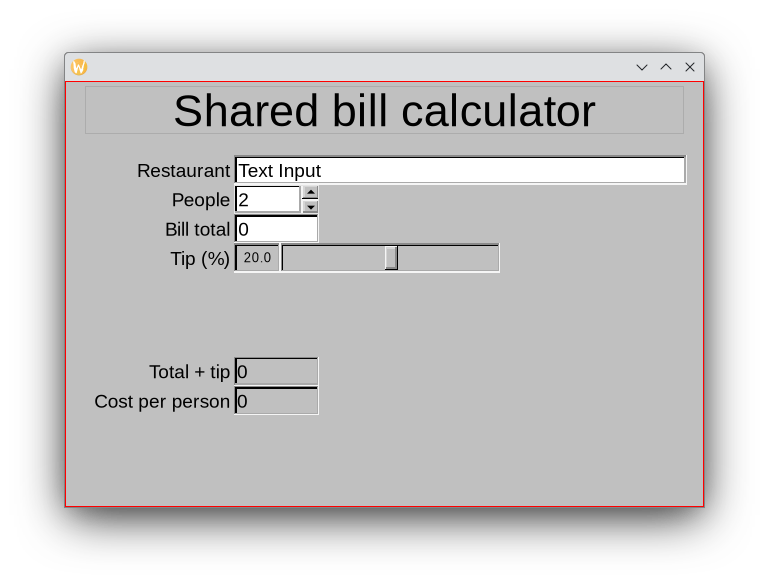

## 4. Saving and running

Press F5. The design has no file name yet, so Fluid asks where to save
it. As usual, save it wherever it is convenient. In this example,
the project is saved as `bill`:

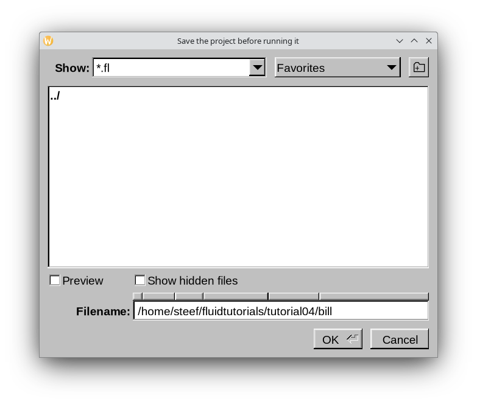

This project will be completely self-contained, including a function of its own
outside `main()`, so you can pick Single File for
the type of project. Fluid should now build the program and start it. The window works:
you can enter values in the input fields, but nothing is calculated yet and the output fields at the
bottom of the window remain at 0. This is because the widgets have no callbacks.

## 5. Naming the widgets and adding callbacks

To make the application do the actual calculation, the values of the input fields need to be visible to
a function that does the calculation. In the earlier tutorials the names of the widgets were the default
`o`, and they remained hidden from the outside world. The following makes them available.

We will need to interact with all the numerical fields.
So we need to read the bill, the tip and the number of people, and
we will need to write the results into the two outputs. As in
[Tutorial 3](TUTORIAL03.md), a widget that code elsewhere has to reach
needs a name (also known as a symbol in D). All three inputs run the same calculation when they
change, so each gets the same callback: a call to `calculate()`, a
function written in step 6. Again, by clicking the widgets one by one with the D tab of the properties
selected, enter the settings as shown in the following figures.

1. **People.** Select the Spinner. On the D tab, in the Name: field, set the widget's symbol to
   `people`. Click "callback" and type:

       calculate();

   Then click When and turn on whenChanged. whenRelease is already on:
   it is the default. The line below the button shows the combination,
   `whenChanged | whenRelease`.

   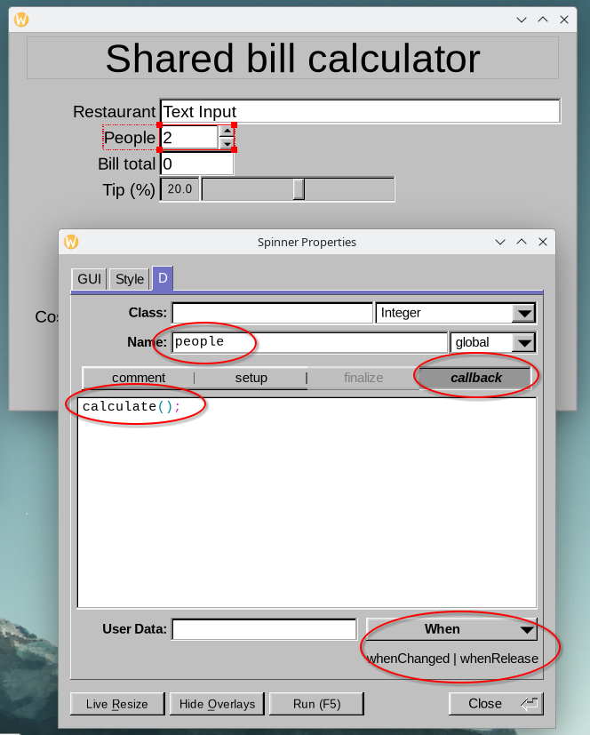

   When says at which moments the callback runs. whenChanged runs it as
   soon as the value changes: every typed digit, every click on an
   arrow, every step of the slider while it is dragged. whenRelease also
   runs it when the user lets go: of an arrow, of the slider, or of the
   field, by leaving it. With both, the results always follow what the
   user does.
   Once the program is finished, you can go back to this setting and
   see how it changes the behavior of the widget, i.e. under what circumstances it executes
   the callback function.

2. **The bill.** Select the Value Input and do the same: Name `bill`,
   callback `calculate();`, When `whenChanged | whenRelease`.

   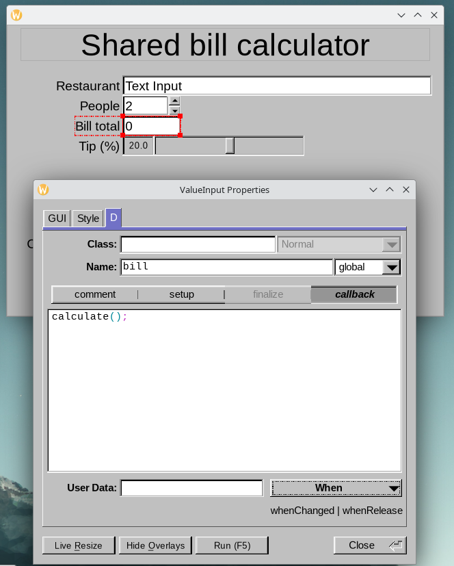

3. **The tip.** The Value Slider: Name `tip`, callback `calculate();`,
   When `whenChanged | whenRelease`.

   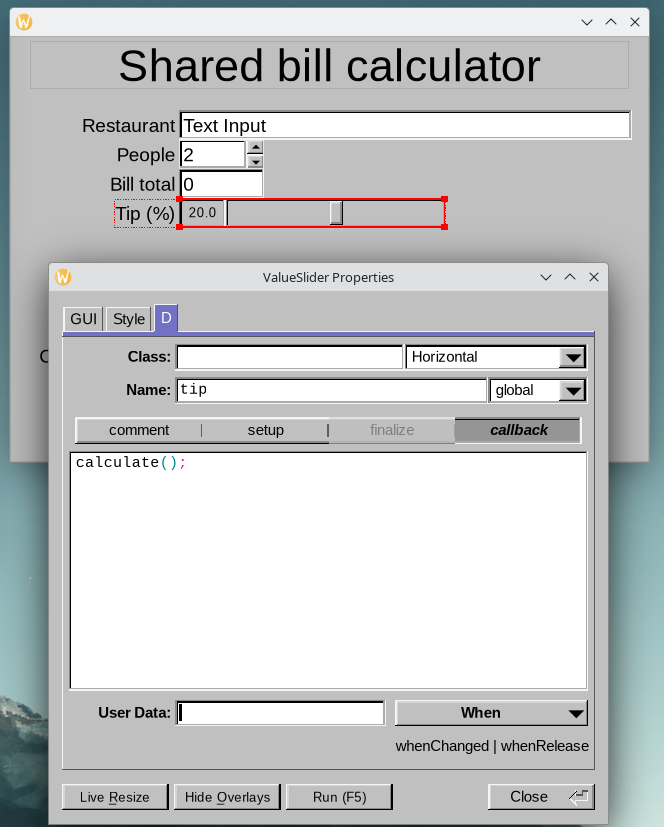

4. **The results.** Select the first Value Output and set its Name to
   `totalwithtip`, and the second one's to `costperperson`. They get no
   callback: the user can't change them, so they would never run one.
   All we need to do is give these widgets a name.

   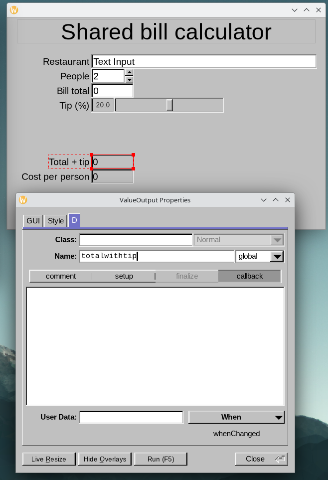

   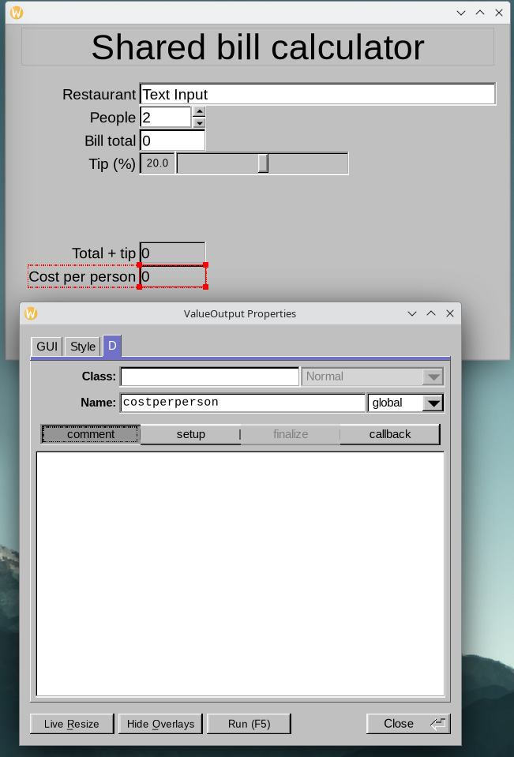

The Restaurant field needs neither a name nor a callback: the
calculation doesn't use it. That widget is only to show how you can
input an arbitrary string.

## 6. Writing the calculation

The callbacks call `calculate()`, which doesn't exist yet. It is a
Function in the design, like `main()`, but with a name.
If you tried to run the program now, you would see a compiler error.

1. **The function.** Select `main()` in the tree and choose New > Code
   > Function. In its properties, change the default `makeWindow()` to
   `calculate()`. Note that, in the project tree on the left,
   it lands above `main()`, not inside it. It is a function of its own. If it lands below `main()`,
   Edit > Earlier (F2) moves it up, though in D the order doesn't
   matter.

   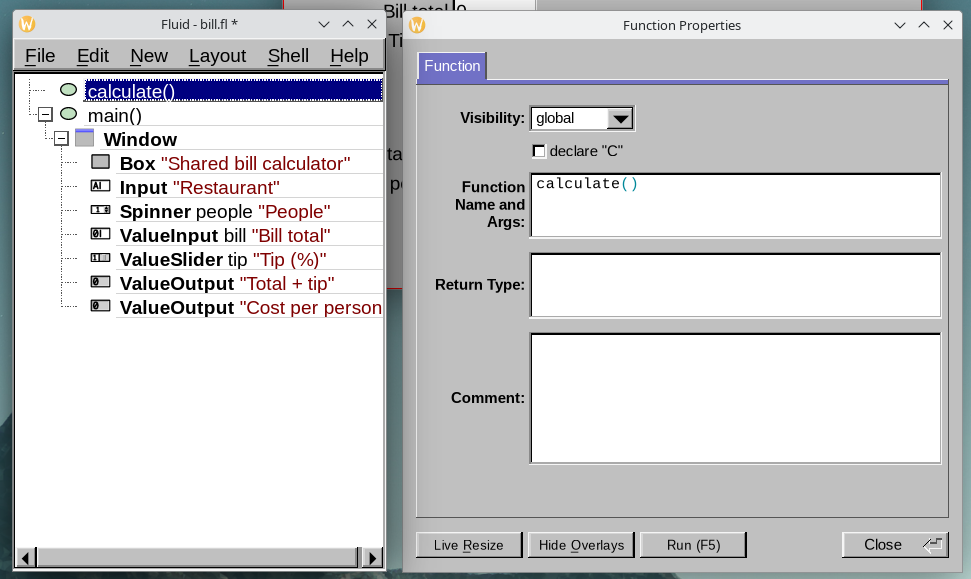

2. **The function code.** With `calculate()` selected, choose New > Code >
   Code. A Code node holds lines of D that run in the function.
   Fluid fills it with a default line:

       writeln("Hello, World!");

   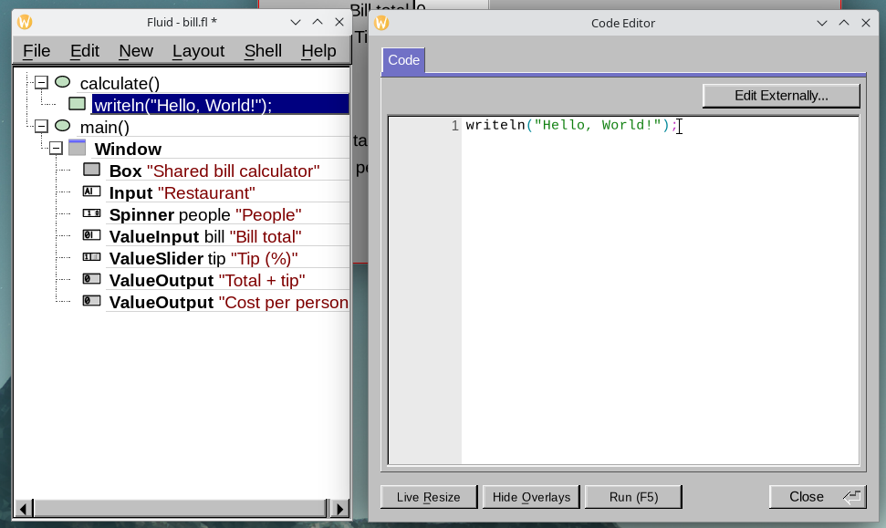

   At this point, the program should compile and run when you press F5.
   When changing any of the values in the program, you should see the hello
   statement printed in the Run window. Now we will write the calculation.

3. **The calculation.** Double-click the Code node and replace its line
   with:

       writeln("calculating..."); // check when called

       // calculate the total plus tip
       double total = bill.value * (1.0 + tip.value / 100.0);

       // now write the calculated amount to the value output widgets
       totalwithtip.value(total);
       costperperson.value(total / people.value);

   You can do so by copying and pasting the block of text.

   The comments, starting with `//`, are optional.
   `double total` is a local variable: it only exists inside the
   `calculate` function.

   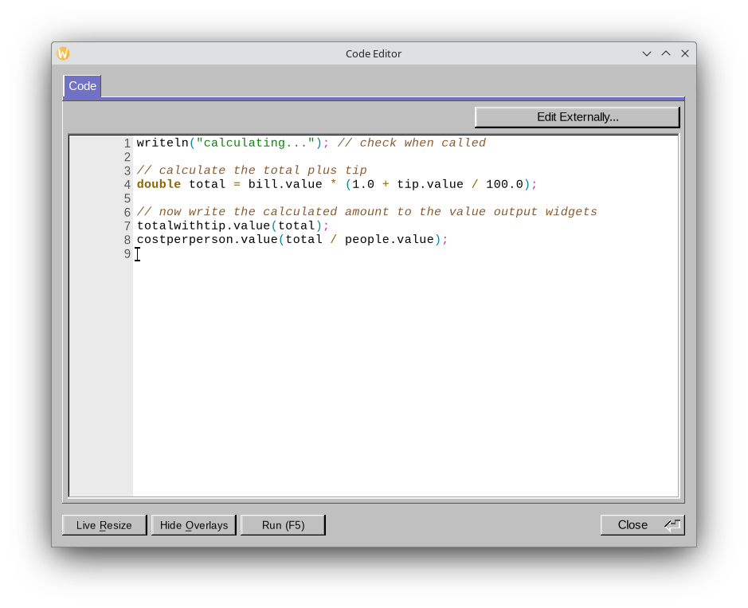

   Some D programming language specifics: `bill.value()` is a function call to the bill widget that returns the numerical value in its field.
   D allows you to abbreviate that to `bill.value` so it works syntactically as if you are accessing
   a variable directly within a structure. This feature makes for very concise, easy to read code.
   `bill.value` and `tip.value` return numbers. No conversion from text is necessary.
   There is also no need to apply `try`/`catch` to prevent the program from crashing
   when text is entered that cannot be interpreted as a number.
   Calling the `.value` functions with an argument,
   for instance, `tip.value(25)`, calls a so-called setter function.
   In this case, it would set the value to 25.
   The setter can be written without parentheses too: `totalwithtip.value =
   total;` means the same.

   A tip of 20 (percent) makes `1.0 + 20 / 100.0` = 1.2, the bill plus 20 percent.
   The variable `total` is set to that value.
   Finally, the results are written into the outputs with the two `value(total)` calls.

   The tree now shows the function, with its code, above `main()`:

   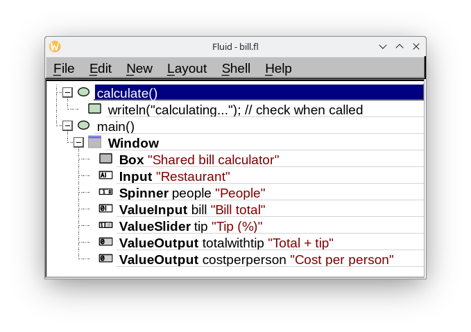

Edit > Show Code View (Alt+C) shows the generated code. Click
`calculate()` in the tree, and its code is highlighted. The five named
widgets are generated by Fluid as global variables at the top of the module, outside `main()`, so every function in
the `bill.d` module can access them (as well as all modules that `import` this module).

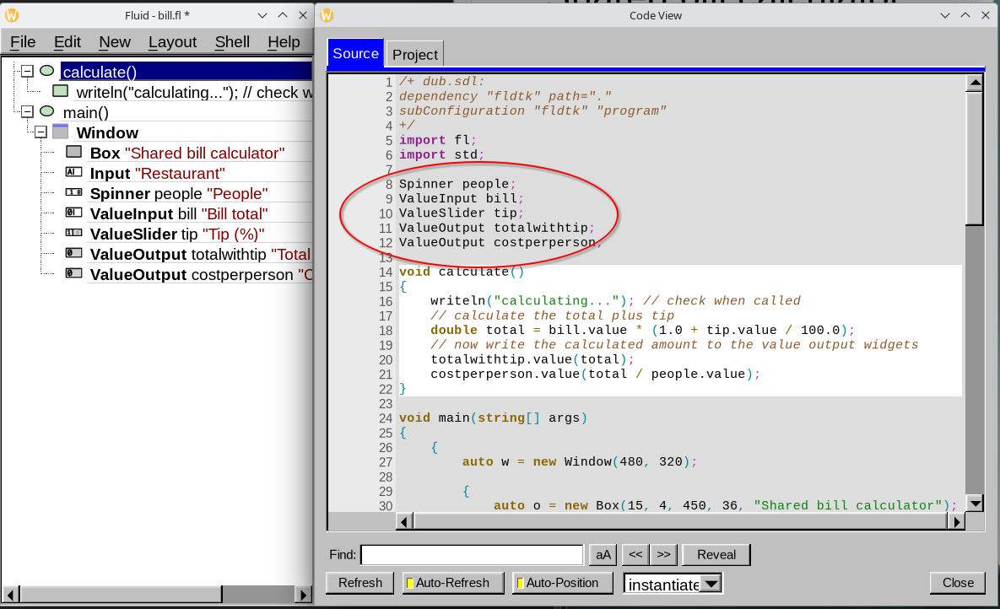

## 7. Running it

Press F5. Type a restaurant, set the number of people, type the bill,
and drag the tip: the results follow every change.

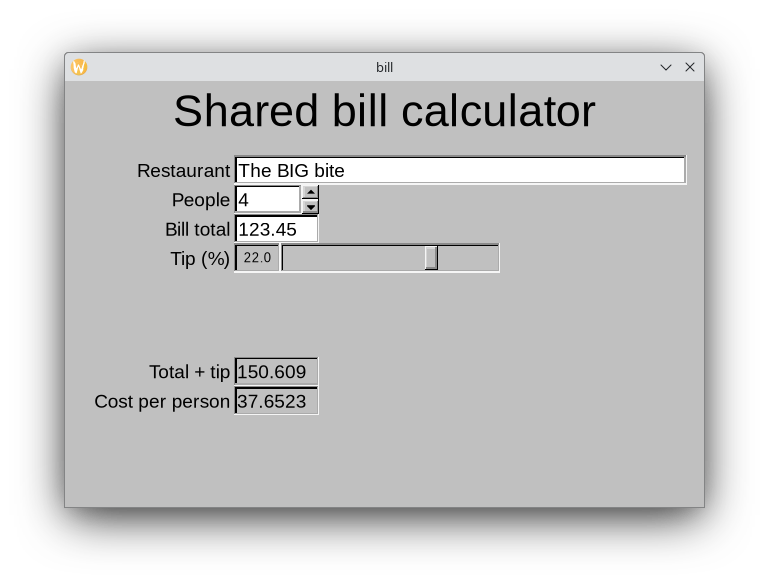

The Run window shows a line for each time `calculate()` ran:

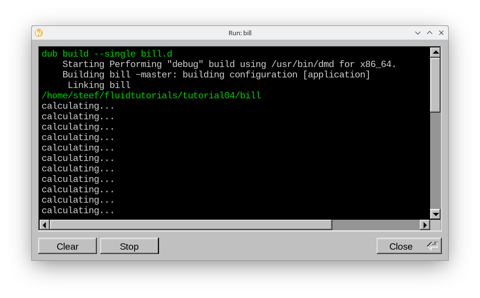

Try the When settings from step 5 here: with only whenRelease, the
results change only when you let go of the slider or leave the bill
field. Setting a value from code, as `calculate()` does for the
outputs, never runs that widget's callback, so widgets that update
each other can't end up calling each other forever.

The finished design, with the settings from [Showing
cents](#showing-cents) below, is the same as `bill.fl` in fldtk's
`docs/tutorial04` folder.

## Summary

You have made a window with a title in a flat box, and fields for
numbers: a Spinner, a Value Input and a Value Slider, which hand your
code a `double`, with a range that keeps out numbers you don't want,
and Value Outputs, which show results that the user can't change. You
have named the widgets the calculation uses, given the three inputs one
callback, set when that callback runs, and written the calculation as a
Function of its own, with a Code node in it. The Code View showed the
named widgets as variables at the top of the file, where the function
can use them.

This concludes Tutorial 4. Additional information is provided below.

## Showing cents

The results show as many decimals as the calculation gives: 37.6523. A
widget for numbers shows its value with as many decimals as its Step
has. Select the two Value Outputs and the Value Input, and set Step
`0.01` (GUI tab, Values row): they show two decimals, `0.00` to start
with.

The step is also what the mouse wheel changes the bill by: point at the
bill field and turn the wheel, and the bill goes up or down by 10
cents a notch (1 cent with Shift, a dollar with Ctrl). The wheel keeps
the value within the range, and the range of a Value Input is 0 to 1
unless you change it, so one notch over a bill of 123.45 would set it
to 1.00. A typed amount is never limited. To take the upper limit away
for the wheel too, give the bill field this setup code (D tab,
"setup"):

    bill.maximum(double.infinity);

No number is larger than infinity, so the bill has no upper limit. The
minimum stays 0: the wheel can't take the bill below zero.

The step only changes how a number is shown: the calculation still
uses every decimal, so 12.345 stays 12.345. To calculate with whole
cents, round the amount yourself, for instance
`total = round(total * 100) / 100;` in `calculate()`.
Of course, the big question remains: when every share is rounded, who
pays the missing cent?
